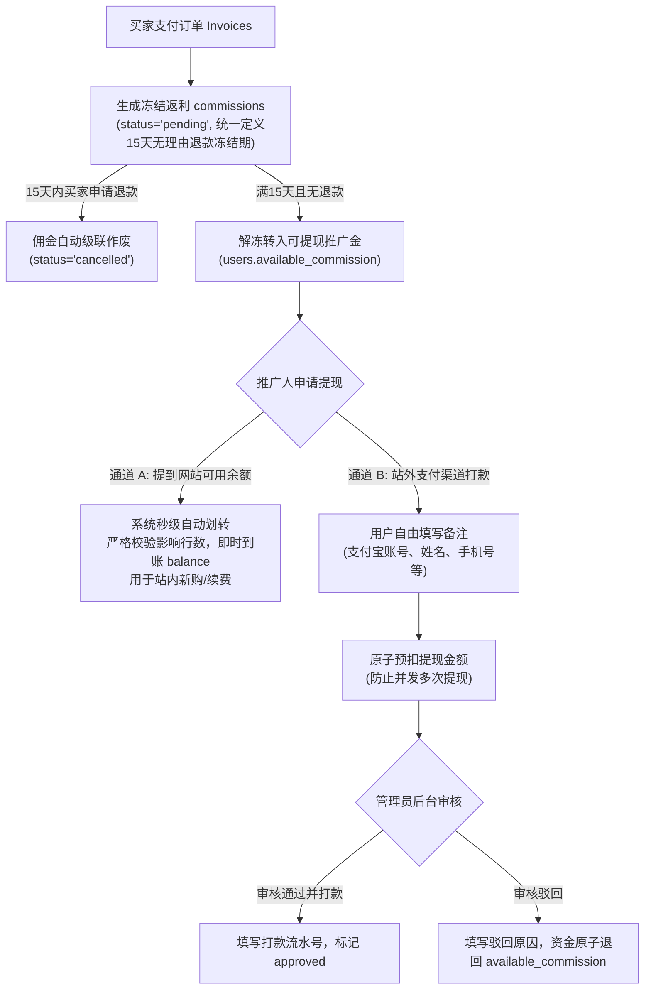

# JianYun (简云) · 推广返佣与提现体系规范 (Affiliate & Withdrawal)

## 1. 业务流程与生命周期



---

## 2. 双提现通道设计规范

### 2.1 通道 A：划转至本站可用余额（To Balance / 零等待秒级到账）
- **商业价值**：激励推广者将返现直接转为站内消费资本（用于续费现有服务器或开通新节点），留存资金并降低平台的现金流压力。
- **执行机制**：
  - **免人工审批，事务级秒到，严格校验行锁影响行数**。
  - 核心原子 CAS 事务（伪代码逻辑）：
    ```php
    DB::transaction(function() use ($userId, $amount) {
        // 1. 原子扣减可提现推广金并增加钱包可用余额 (前置条件: available_commission >= amount)
        $affected = DB::update("
            UPDATE `users` 
            SET `available_commission` = `available_commission` - :amt,
                `balance` = `balance` + :amt 
            WHERE `id` = :uid AND `available_commission` >= :amt
        ", ['amt' => $amount, 'uid' => $userId]);

        if ($affected === 0) {
            throw new InsufficientCommissionException("可提现佣金不足或并发冲突");
        }

        // 2. 双向记入全账本流水表 (双分录)
        // 2.1 推广账户出账流水
        DB::insert("
            INSERT INTO `transactions` 
            (`user_id`, `account_type`, `type`, `amount`, `balance_before`, `balance_after`, `idempotency_key`, `remark`)
            VALUES (:uid, 'available_commission', 'affiliate_to_balance', -:amt, :comm_before, :comm_after, :idem_key1, '推广返佣转出至钱包余额')
        ", [...]);

        // 2.2 钱包账户入账流水
        DB::insert("
            INSERT INTO `transactions` 
            (`user_id`, `account_type`, `type`, `amount`, `balance_before`, `balance_after`, `idempotency_key`, `remark`)
            VALUES (:uid, 'wallet', 'affiliate_to_balance', :amt, :wallet_before, :wallet_after, :idem_key2, '推广返佣转入钱包可用余额')
        ", [...]);

        // 3. 记入提现记录表 (直接标记为 approved 已成功)
        DB::insert("
            INSERT INTO `commission_withdrawals` (`user_id`, `amount`, `destination`, `status`, `processed_at`) 
            VALUES (:uid, :amt, 'balance', 'approved', NOW())
        ", ['uid' => $userId, 'amt' => $amount]);
    });
    ```

### 2.2 通道 B：站外渠道人工打款（To External / 自由备注与合规审核）
- **商业价值**：支持站外现金提现，满足头部推介人与代理商的获利变现诉求。
- **自由备注支持**：
  - 系统不写死复杂的银行卡或外部接口，给用户提供自由灵活的文本备注框 `channel_info`。
  - 用户按提示填写：`【收款方式: 支付宝 / 银行卡】【姓名: 张三】【账号: 13800138000】【联系电话: 13800138000】`。
- **两阶段防超提安全流转**：
  1. **提现发起阶段（原子预扣）**：
     - 必须先原子扣减 `available_commission`，彻底封死用户在审核期间并发发起第二笔提现的漏洞：
       ```sql
       UPDATE `users` SET `available_commission` = `available_commission` - :amount 
       WHERE `id` = :user_id AND `available_commission` >= :amount;
       ```
     - 插入记录，初始状态为 `pending`。
  2. **管理员审核与打款阶段**：
     - **打款确认**：管理员通过企业/个人支付宝转账后，在后台输入“转账流水号/批次号”，点击确认打款，记录更新为 `approved`。
     - **驳回处理**：若用户填写的姓名与账号不符，管理员填写驳回理由，系统自动执行**原子反冲回滚**：
       ```sql
       UPDATE `users` SET `available_commission` = `available_commission` + :amount 
       WHERE `id` = :user_id;
       ```
       状态更新为 `rejected`，资金即刻退回用户推广账户。

---

## 3. 数据库表结构规范

> [!NOTE]
> **DDL 单一事实来源**：`commission_withdrawals` 完整字段定义以 `database/schema.sql` 为唯一权威（字典释义见 [DATABASE.md](DATABASE.md) §1.15），本规范不再内嵌 DDL 副本，避免双源漂移。关键字段提示：
> - 站外提现收款：`channel_type`（alipay / bank / manual）、`account_name`、`account_no`（AES-256-GCM 加密存储）、`channel_info`（自由备注）；
> - 审批流转：`admin_id`、`admin_remark`、`processed_at`。
