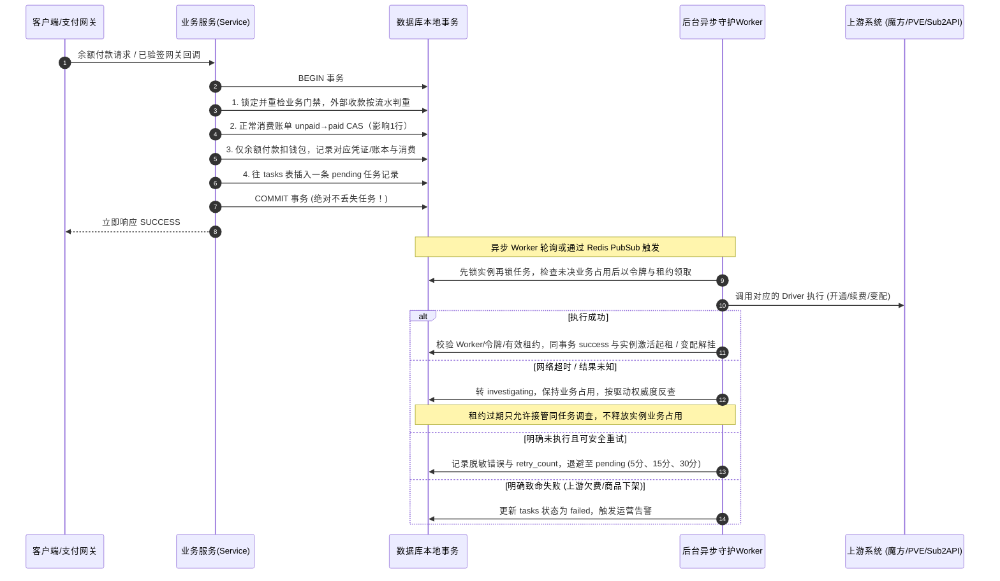

# JianYun (简云) · 系统全景架构设计文档

**客户预览接入**：CatalogService通过可选LocalPreviewDriverInterface调用插件纯本地计价，独立preview入口不读取上游连接凭据、不发网络请求。成功发布观察hash及期限控制可用性；lp1确认绑定成交指纹与完整履约上下文，Billing仍实时预检并在原事务锁内比较。未支持只要求online，不以旧预览掩盖在线失败，见[契约](M2_LOCAL_PREVIEW.md)。

**有界快照刷新**：ProductRefreshService只处理显式本地ID，独立可选oneshot／timer、不占金融Worker或schedule；MySQL会话互斥／失连拒绝发布，网络准备在事务外。核心通过可选SnapshotRulesDriverInterface要求完整规则和对价，魔方语义仍在插件；原persist事务发布、内容不变不写商品、变化推进JSON修订号，运行观察独立settings行。无新表、客户提交在线核价与历史语义保持，见[契约](M2_PRODUCT_REFRESH.md)。

**插件本地计价验证**：LocalPriceCalculator／PriceComparison与CLI均在魔方插件内，核心不直接引用具体插件；临时完整规则信封不写商品表，在线结果始终为权威。客户calculate／checkout、原指纹及Outbox不改，诊断价格hash不参与成交；定时同步与客户预览已由后续独立批次接入，见[契约](M2_LOCAL_PRICING.md)。

**选购库存观察**：通用PreflightResult追加可空StockObservation，魔方专用stock_control／qty语义只在插件解析。StockObservationService在Redis暂存5分钟，目录一次MGET批读、不遍历上游；缓存故障／过期显示未知。观察不写MySQL配额、配置快照、报价指纹或Outbox，不代替下单及Worker预检；前端合并核价与耗时记录见[契约](M2_CHECKOUT_RESPONSIVENESS.md)。

**整数数量配置增量**：魔方专用类型15／18只在插件投影为通用integer字段，核心ConfigOptions校验范围／步长／区间；原报价／账单／实例／任务JSON承接configuration_quantities，无配置拆表或新任务。qty=1、历史及未知调查保持，见[契约](M2_INTEGER_QUANTITIES.md)。

**枚举依赖增量**：具体上游advanced解析留在魔方插件，核心ConfigOptions只消费通用dependencies；不增接口层、表或同步副本。依赖只进入原商品JSON、schema_hash及driver_context，继续原报价确认／请求键／Outbox和未知调查。单父无环子集与真实样本限制见[契约](M2_ENUM_DEPENDENCIES.md)。

**验证码策略管理增量**：CaptchaSettingsService复用原captcha_scenes JSON行和不可改审计，按场景独立CAS，锁定管理员后重核会话／权限，更新与审计同事务；核心仍只依赖CaptchaDriverRegistry。公开客户HTTP认证新增独立Redis原子限流，先限流后验证码，关闭验证仍计数、依赖故障拒绝；不参与资金／资源事实。无新表、驱动或迁移，见[契约](M2_CAPTCHA_SETTINGS.md)。

**站点展示配置**：独立SiteSettingsService只读写`system_settings.site.basic`，超级管理员保存与`site_configure`审计同事务，HMAC版本含最新审计以拒绝ABA；公开投影只读value的五个固定字段，不触及支付、SMTP或上游凭据。前端display-only状态异步加载和失败默认，不参与业务决策。无新表、驱动耦合或迁移，见[契约](M2_SITE_SETTINGS.md)。

**客户账号运营增量**：CustomerAccountService只写原客户账号和不可改审计，复用auth_version撤销旧登录／找回链接；CustomerAccessService在关键主动操作最终提交时检查当前状态与原请求认证版本。后台按管理员→客户行锁复核，原金融顺序仍实例→账单→钱包；已付任务、回调结算不经过主动操作门禁。27表无迁移，详见[契约](M2_CUSTOMER_ACCOUNTS.md)。

**到期核对与欠费恢复**：魔方负责实际停机／解挂／释放，简云只读核对；本地权益、上游服务与电源分别展示。仅结构化 `due` 允许欠费续费，未知／非财务暂停保留核验；原续费确认目标账期与 Active 后才恢复。27表无迁移；M2 原Worker已加载，体验CDN真实due暂停→充值／原单代扣→上游目标日期及Active→本地恢复已验，见[契约](M2_EXPIRY_RECOVERY.md)。

**邮件配置后台增量**：`/admin/notifications` 仅当前超级管理员读写，复用原配置服务、版本校验、同事务审计和密文存储；密钥默认保留且不回显。工单订阅单独确认／保存，普通配置不切换订阅起点，无新增迁移；M2 工单启用与真实收件仍待单独验收，见[配置契约](M2_MAIL_SETTINGS.md)。

本文档定义了 JianYun (简云) 系统的核心架构、领域模型、关键业务流转以及数据一致性保障机制。

---

## 1. 总体分层架构 (Layered Architecture)

**客户重装增量**：InstanceReinstallService 通过可选 ReinstallDriverInterface 读取镜像与能力，HTTP 只落非财务 reinstall Outbox；复用任务门禁、令牌、调查与管理员同事务审计。已知原资源绑定／账期／价格不可改写，正常受理自动只读跟踪；空闲预检／明确受理／结构化重装类型（不解析中文）后恢复空闲且取得原资源凭据，原子同步密文并以 execution_ended 结束占用，不声称系统成功。未知／漏观察／超时才转人工；不能以 Active／镜像更新推定成功；不新增表、控制台中继或自动退款。兼容／迁移和验证见 [本批契约](M2_INSTANCE_REINSTALL.md)。

**状态读取分工**：客户重装 `?view=tasks` 仅查询原 MySQL 任务与业务门禁，不读取驱动能力或生成操作确认；Worker 继续独立查询真实执行。页面结束后完整重取能力与确认。上游单独返回执行中也可触发有限页面轮询，不能据此写入任务证据、修改账期或解除占用；不增缓存事实副本、接口抽象或表。

**上游接入增量**：ProviderConnectionService 经可选 ConnectionConfigInterface 规范化并加密新增连接，原 CLI 安装器复用它；AdminProviderService 提供安全投影、当前超级管理员写权限、版本、重放和同事务审计。账号命名空间不可替换；验证仅复用 ProductSnapshotService.prepare 的只读配置／报价，不调用具体驱动类或增表，不混入商品／支付写入。见 [接入契约](M2_PROVIDER_CONNECTIONS.md)。

**管理员查询增量**：AdminQueryService 仅从原客户／实例／商品／上游表投影非财务定位字段，账单状态按客户／实例一致关联；通过原 FinanceQueryService 与 TaskInspectionService 链接资金和异常。四个只读 GET 无驱动调用、写表、缓存副本或迁移；财务／超级管理员仍是金额／收款／流水边界，旧任务投影同步裁剪非财务角色的结构化财务字段。权限与兼容见 [只读查询契约](M2_ADMIN_QUERIES.md)。

**充值运营增量**：WalletService 只创建原 invoices 的 recharge 账单，PaymentService 复用支付插件验签、凭证唯一键和账单 CAS，以同连接事务提交充值余额及 LedgerService 只追加流水；纯充值无实例、消费、佣金或 Outbox。FinanceQueryService 只投影原账单／凭证／钱包流水，不建同步副本；客户仅本人，管理员限当前启用 finance/super_admin。27 表保持，无迁移。接口和冻结契约变化见 [充值与资金查询](M2_WALLET_FINANCE.md)。

系统采用 **“极简内核 + 驱动抽象 + 异步可靠任务”** 的清晰三层结构：

**已确认技术底座**：PHP 8.4 + Laravel 13、MySQL 8.0+、Redis，以及单一 Vue 3/Vite/TypeScript/Element Plus 前端。HTTP 首版采用普通 PHP-FPM；Laravel 承接路由、校验、配置、日志、命令和调度，领域服务保留财务与履约规则。当前 MVP 已接入 Laravel 及单一前端，已验证范围为模拟余额交易闭环；M2 已实现可靠新购/续费 Worker、魔方固定商品驱动、易支付收单和最小实例页面，首个固定 CDN 商品已完成真实支付与交付回填，其他能力仍依路线图验收，适配边界见 [TECH_STACK.md](TECH_STACK.md)。

**事务与运行边界**：财务服务使用同一数据库连接提交账单 CAS、钱包/账本及 `tasks`，不以框架普通队列、`afterCommit` 或自动重试替代 Outbox。Worker 独立运行并管理逐任务状态；Redis 仅用于缓存和唤醒，不能取代 MySQL 业务占用。框架迁移保留插件隔离及现有 API、身份和密文兼容要求。

**充值提前代扣增量**：正常 recharge 流水提交后，afterCommit 仅发送可合并、可丢失的 Redis 客户提示；现有 Worker 复用 RenewalService 按该客户扫描原单并重新执行原 MySQL 门禁。充值事务不包含续费扣款、不等待上游；所有实际代扣／账期／renew Outbox 仍在独立同连接事务中。Redis 丢失或消费崩溃由原 15 分钟扫描恢复，未增表或额外守护进程，见 [充值唤醒契约](M2_RENEWAL_CONTRACT.md#充值到账后的异步唤醒)。

**客户自助认证边界**：账单列表仅投影本人原账单，不建立订单副本。改密/邮件重置以 users.auth_version 行锁递增撤销旧登录和重置凭据，仅增用户属性、不增表。短效重置凭据不作为主登录，待发送密文复用原通知表，Sender 重核版本/邮箱/期限后清密文；未知发送不重试。兼容及边界见 [客户自助契约](M2_CUSTOMER_SELF_SERVICE.md)。

**当前退款边界**：用户已确认退款由管理员手动办理，本期不建设自动退款、自动补偿或网关退款调用/反查。下文完整退款状态机为未来另行授权的参考，已有资金防重、人工裁决及未知任务占用规则保留，详见 [人工退款策略](PAYMENTS_LEDGER.md#manual-refund-policy)。

**旧站迁移交付边界**：旧系统适配器以独立插件部署在旧站，生成指定简云版本的 SQL 数据库备份及映射/对账材料，由运维通过通用 MySQL 工具恢复到独立空库。简云运行架构不包含迁移页面、旧站专用 API、专用导入命令或旧库连接；该工具不属于简云 `plugins/` 驱动层。旧回调持久接收及桥接同样是外置过渡设施，仍通过已核准的通用支付契约结算，完整边界与开放门禁见 [MIGRATION_RUNBOOK.md](MIGRATION_RUNBOOK.md)。

```text
┌────────────────────────────────────────────────────────────────────────┐
│                        前端展现层 (Single App)                         │
│   • 统一响应式单页应用 (Vue 3 + TypeScript + Vite + Element Plus)        │
│   • 路由多角色权限切分: 公开购买门户 / 客户控制台 / 管理员运维后台       │
└───────────────────────────────────┬────────────────────────────────────┘
                                    │ HTTP / RESTful API (JSON)
┌───────────────────────────────────▼────────────────────────────────────┐
│                        核心业务域 (Core Domain)                        │
│   • Auth (认证 & RBAC & 模拟登录)                                      │
│   • Catalog (商品目录 & SWR 快照缓存 & 动态 Schema 渲染)                │
│   • Billing (账单结算 & 余额代扣 & 支付网关聚合)                       │
│   • Instance (实例生命周期 & 覆盖改价 & 变配补差)                      │
│   • Affiliate (分销推荐 & 冻结期管理 & 退款级联冲正)                   │
│   • Outbox Dispatcher (事务发件箱任务分发器)                           │
└───────────────────────────────────┬────────────────────────────────────┘
                                    │ Unified Driver Interface
┌───────────────────────────────────▼────────────────────────────────────┐
│                        扩展驱动层 (Driver Layer)                       │
│  ┌───────────────────────┐  ┌───────────────────────┐  ┌─────────────┐ │
│  │   Upstream Providers  │  │   Payment Gateways    │  │  Notify     │ │
│  │  • ZjmfProxyDriver    │  │  • AlipayF2FDriver    │  │  • Mail     │ │
│  │  • EasypanelDriver    │  │  • HpjpayDriver       │  │  • Sms      │ │
│  │  • Sub2ApiDriver      │  │  • EpayDriver         │  │  • Telegram │ │
│  │  • ManualAdminDriver  │  │  • BalanceDriver      │  │             │ │
│  └───────────────────────┘  └───────────────────────┘  └─────────────┘ │
└────────────────────────────────────────────────────────────────────────┘
```

---

## 2. 核心业务生命周期机制

### 2.1 任务可靠执行机制：事务发件箱模式 (Transactional Outbox)

解决旧系统“先调上游接口，网络超时导致任务凭空丢失”的问题。下图仅描述**需要上游履约的正常云消费结算**；外部支付先验签、按网关流水判重并检查报价/实例/退款/任务门禁，通过后才执行账单 CAS。只有余额支付扣钱包；纯充值与迟到/多收款入钱包不投实例任务，完整分流见 [PAYMENTS.md](PAYMENTS.md)。



**任务安全边界**：`tasks` 是任务执行占用的唯一事实来源。`running` / `investigating` 以及 `failed + MANUAL_AUDIT_REQUIRED` 都阻断同实例其他动作，不能用 `lease_until` 到期来解除阻断。所有领取、接管与人工裁决先锁实例再锁任务；Worker 的租约只控制执行权与回写资格。无法反查的未知结果必须保留人工核验标记并告警，通用重试拒绝此类任务；`super_admin` 通过独立、受审计的强制重发或人工回填命令裁决，不绕过普通 Worker 完成方法的租约门禁。详见 [TASKS_OUTBOX.md](TASKS_OUTBOX.md) §2–§3。

**退款业务边界（未来退款登记/编排的安全约束）**：云消费退款认领先检查实例未决任务；认领后的正常消费主账单 `refund_pending` 同时阻断新动作与已有 `pending` 任务领取，退款不通过第二份任务锁承载。明确拒绝按原状态安全恢复后再检查任务资格；结果未知持续冻结。成功终态 CAS、主账单转 `refunded`、旧 pending 任务失效与唯一销毁任务投递同事务完成，销毁前继续保留退款关停冻结。接管或回写若发现不匹配退款归属则转人工核对。迟到/多收钱包款退款不改父账单或实例，不触发此冻结。详见 [PAYMENTS_LEDGER.md](PAYMENTS_LEDGER.md) §3 与 [TASKS_OUTBOX.md](TASKS_OUTBOX.md) §2.4。

**快照与备份链路**：手动请求和调度器同事务写入本地 `creating` 台账与 `snapshot_create` / `backup_create` Outbox，唯一任务键冲突整笔回滚；Worker 确认结果后回填同一台账。删除任务按本地台账 ID 使用统一幂等键 `snapshot_delete:{instance_snapshots.id}`，执行前核验 Provider、实例、类型与远端 ID。快照标识只在 `(instance_id, type, remote_snapshot_id)` 范围唯一；创建、删除均使用上述未知结果调查协议，轮转必须等待前序结果确认。详见 [LIFECYCLE_PRICING.md](LIFECYCLE_PRICING.md) §5。

---

### 2.2 自动续费双阶段解耦机制 (Two-Phase Auto-Renew)

彻底解决旧系统“账单已存在导致代码 return 500 跳过扣款”的致命缺陷：

- **阶段一：出账调度器（Invoice Generator - 每天跑一次）**
  - 扫描所有 `status = 'active'` 且距离 `due_date <= 7 天` 的实例。
  - 若当前实例不存在未付款续费账单，则生成一张唯一续费账单（`invoices` 表唯一键防重）。
  - 若已存在，则静默跳过，绝不重复生成。

- **阶段二：自动代扣器（Auto Debit Dispatcher - 事件驱动秒级唤醒 + 15分钟兜底）**
  - **充值提交后提前代扣**：正常充值先独立入账，再向 Redis 集合发送客户 ID 提示，由现有 Worker 异步复用原代扣服务。只处理本人符合条件的既有续费单，不自动出账；没有管理员手工入账接口或通用 wallet.recharged 事件总线。Worker 空闲时可更早开始代扣，不承诺严格秒级或上游完成时限。
  - **15分钟定时兜底**：后台扫描所有状态为 `unpaid` 且实例属于 `active` 或宽限期内 `suspended` 的续费账单，作为定时安全网。
  - **扣费与履约**：
    - 检查客户是否开启自动续费且 `user.balance >= invoice.total`：开启事务行锁扣减余额，账单标记为 `paid`，严格基于实例原 `due_date` 顺延一个周期（`DATE_ADD(due_date, INTERVAL ...)`），并向 `tasks` 表写入一条携带确定性目标到期日（`target_due_date`）的 `renew` 任务。
    - 若余额不足：保留账单，待正常充值提示或 15 分钟扫描继续；已实现通知的范围以通知契约为准，不将规划中的 Web Push 当作已有能力。
    - 若未付续费账单因超时、变配重算或手动取消置为 `cancelled`，必须同步清空 `cycle_marker = NULL` 以释放唯一索引槽位。

---

### 2.3 动态升降级与运维改价机制 (Upgrade & Price Override)

**当前边界**：已实现的管理员改价只影响后续续费，并同事务作废原未付续费单及留审计，已付权益保持；详见 [改价契约](M2_INSTANCE_RENEWAL_PRICE.md)。另已实现管理员确认实际变配完成后的独立余额补差，按原已付单期计价、同事务结清及未来改价；不投递上游任务，见[补差契约](M2_MANUAL_ADJUSTMENT.md)。下述自动升降级和客户自助变配仍为规划。

- **弹性云自动化升降级（对接上游魔方）**：
  - **升级补差价**：
    $$\text{补差金额} = \max\left(0.01, \; (P_{\text{新配置周期价}} - P_{\text{原配置周期价}}) \times \frac{\text{剩余天数}}{\text{本周期总天数}}\right)$$
    生成补差账单，用户付完款后通过 Outbox 队列异步调上游魔方变配生效。
  - **降级不退款（纯配置变更）**：
    降级不退款属于非支付类纯配置变更行为，不生成需要支付的结算账单（不受结算账单最低 0.01 元支付门槛约束）。用户在前端明确确认降级风险后，**系统同事务将变更任务写入 Outbox 任务发件箱（复用 `tasks.action = 'upgrade'`, `invoice_id = NULL`, 幂等键 `instance_downgrade:{instance_id}:{token}`），由异步 Worker 可靠调度上游 `driver->resize()` 执行降级**，严禁在 HTTP 线程同步请求上游；上游执行完毕后，将本地实例的 `recurring_price`（下次续费基准价）降为新规格价格。

- **自营/固定套餐实例手动运维改价**：
  - 运维在物理机/PVE 调整完机器配置后，在后台打开实例详情弹窗。
  - 输入新的续费循环价格（如从 50 改为 70）。
  - 系统自动折算剩余天数应收差价，管理员可一键勾选【从用户余额扣除】，系统自动生成一张 `type = 'upgrade'`, `status = 'paid'` 的差价账单并扣除余额（因运维已在宿主机手工完成变配，此账单**不投递** Outbox `tasks`），同时实例 `override_price` 永久更新为 70 元。
- **在途未付续费单联动失效（防价格撕裂铁律）**：
  - 无论通过弹性升降级更新了 `recurring_price`，还是通过运维改价更新了 `override_price`，必须在同一事务内将该实例名下已存在的未支付续费账单（`type = 'renew' AND status = 'unpaid'`）原子作废（`SET status = 'cancelled', cycle_marker = NULL`），严禁客户以变配前的旧价格支付已出账单。

---

### 2.4 推荐返佣防套利与退款级联冲正 (Anti-Fraud Affiliate)

- **绑定与冻结**：买家 B 正常云消费结算成功且商品参与返佣时，推荐人 A 产生一条 `status = 'pending'` 的返利明细，冻结 15 天（`freeze_until = paid_at + 15d`）；充值与迟到/多收钱包款不生成返利。
- **退款级联冲正**：
  - 仅正常云消费（`cloud_consumption`）退款成功终态 CAS 影响 1 行时，才在同一事务内检查该账单关联的返利：
    - 若处于 `pending`（冻结期内）：**状态直接更新为 `cancelled`，作废返佣！**
    - 若已过冻结期处于 `available`：触发 **Clawback（追回）**，扣减 A 的可提现余额；若余额不足扣成负数，阻止后续提现。
  - 退款待审、拒绝或结果未知不冲佣金；独立充值及 `late_wallet_credit` 退款也不冲佣金，迟到/多收款退款不得改变原云消费账单、实例或消费累计。完整用途边界见 [PAYMENTS_LEDGER.md](PAYMENTS_LEDGER.md) §3。

---

## 3. 购物车性能优化架构：SWR 快照 + 下单原子预检

- **浏览路径**：用户进入商品选购页，直接读取本地 Redis 缓存的配置项 JSON 快照（5 毫秒内极速渲染），彻底告别旧系统直连上游卡死的问题。
- **下单终审**：用户点击【立即支付】瞬间，系统发起一次仅耗时几十毫秒的轻量 Pre-flight 检查确认上游有货与价格匹配，确认无误后锁定成单，兼顾极致性能与防超卖底线。


**当前续费异常运营边界**：已扣款而上游未成功时，沿用任务只读调查、告警日志与持久待核验列表通知管理员；不自动退款/回滚权益或取消原资源。管理员可恢复原任务 investigating 继续查询，已续费只回填；单邮件人工核验告警已实现，TG 推送延期，见通知契约。现有账本/资源归属与插件边界不变，见 [续费契约](M2_RENEWAL_CONTRACT.md#续费异常通知与人工核验2026-11-08)。


**当前运行接入**：M2 验收环境以独立 systemd Worker 执行 MySQL Outbox，分钟 timer 调用同一 Laravel schedule:run，业务频率仍只定义在 routes/console.php；日志统一由 journal 采集。独立故障演练验证进程重启后调查原任务，不另建队列、重发任务或释放业务占用。正式环境仍需单独部署，见 [运行部署规程](DEPLOYMENT_RUNTIME.md)。


### M2 配置销售实现边界（2026-11-08）

现已实现本地 JSON Schema 快照、安全表单投影、独立枚举选配和事务外实时预检；5 分钟 HMAC 报价确认绑定配置、首期/续费价、密码生成策略与商品版本，事务内冻结后沿用原资金/Outbox/Worker 链路。魔方自身解析上游主机名/密码规则，核心仅识别通用密码策略和可选驱动接口，无具体插件依赖或配置拆表。历史名称和已提交任务继续按冻结身份/已知远端 ID 调查。单父无环枚举与独立类型15／18数量已按页首增量实现；Redis/SWR自动快照刷新及其他高级规则／数量类型仍是规划。商品 14 独立新单已实付、回填 Active 并通过 VNC 基础规格核验；创建丢响应后的上游原账单采用人工单次支付恢复，不将其认定为全自动异常续付。旧单继续待核验，完整契约与验收边界见 [M2_CONFIG_SALES.md](M2_CONFIG_SALES.md)。


## 运营后台最小增量（2026-11-08）

管理员账号运营由独立 AdminAccountService 承接，控制器不直接写admins。仅super_admin管理现有固定角色；四种角色可验证旧密码改密。复用不可改admin_audit_logs的目标索引与安全动作ID作为会话版本，认证每次重核，不新增撤销表／Redis同步。低频写按ID锁定admins原行集，事务内重核身份／请求会话／目标版本、最后可登录超管，再写变更与审计；密码校验／哈希在事务外。无资金、实例或Outbox变化，无迁移，详见[账号契约](M2_ADMIN_ACCOUNTS.md)。

为将既有命令行核验变为日常网页运营，单 Vue 应用增加管理员路由，Laravel 增加独立 admin 登录与只读任务投影。复用 admins 当前角色/启用状态：所有启用角色可查任务上下文，只有 super_admin 可裁决；客户与管理员 Token 作用域、前端存储及失效处理分离。无需 RBAC 新表、第二后端或任务处置副本。

人工写操作统一调用原 TaskResolutionService，保留实例优先行锁、资金/归属门禁、旧 execution_token、同事务审计与 Worker Fencing。查询 allowed_actions 只供展示，不构成授权。任意过期页面提交必须拒绝后重新核验。退款继续人工处理，显式新购钱包补偿的既有行为保留，续费不复用取消。具体安全投影、登录及操作边界见 [API](API.md#admin-operations)；无 schema 迁移，不改变插件物理边界。


## 商品目录运营增量（2026-11-08）

单 Vue 管理后台复用 admins 与原审计，目录读取/编辑及上游快照预览通过 AdminProductService 授权；实际 Schema 拉取、配置校验与参考报价仍由 ProductSnapshotService 和 Provider 契约承接，核心不引用具体插件。网络只读准备位于事务外，目录版本/管理员状态重核后同连接提交目录及审计；不写资金/实例/任务，也不新增同步副本或表。

销售状态是新购准入条件，不能提升为已付交付、原单调查或存量续费的全局开关。price_snapshot/config_snapshot、原任务身份和已冻结续费价格继续作为既有权益依据；新目录加价/Schema 更新不追溯改写历史。新导入默认下架，显式检查后上架，预览确认与旧版本冲突均由后端执行。详细兼容边界见 [商品契约](API.md#admin-products)。


## 实例常用运维增量（2026-11-08）

电源作为可选 Provider 能力，真实按钮/运行状态通过事务外只读查询投影，变更写入 action=power 的原 Outbox（无账单/资金动作），复用 Worker 与原任务业务占用。排队 power 阻断冲突操作，执行租约过期只转调查；当前运行状态不能证明丢响应的重启结果。人工处理沿用原证据/令牌/审计，不直接写实例生命周期状态，不自动重发或退款。核心与插件仍物理隔离，27 表保持，仅扩展任务枚举。页面、兼容与部署门禁见 [电源契约](M2_INSTANCE_POWER.md)。


## 本站控制台运行边界

用户定案为“本站页面 + 独立云控制台直连”。领域服务验证主登录、归属、权益/任务/资金门禁，Provider 可选能力返回经白名单预检的独立云 WS 和本次连接密码；浏览器本地 noVNC 与云系统直接交换画面和键鼠，本站不持有数据通道。财务域名/API 密钥、主机密码和 host_token 留在服务端，云连接参数允许浏览器读取。删除旧 PHP/RFB 中继、守护和 Redis 连接票据，不增加表或改 Outbox。页面检查与断开仅能约束正常页面，不能冒充上游连接强制撤销；详见 [M2_INSTANCE_VNC.md](M2_INSTANCE_VNC.md)。


## 单邮件通知增量

既有 notification_deliveries 同时充当待发送队列和投递事实：来源调度每分钟补扫任务人工核验与客户临期实例，独立邮件 Worker 只认领 pending。短事务重查业务和收件人后提交 sending，网络操作在事务外，SMTP 结果未知/崩溃悬空只能人工核验，绝不以重启或租约到期重发。具体 SMTP 由通知插件承担，核心只依赖 NotificationRegistry 与 DTO。新增 admin_id/context 仍是投递实体属性，未增业务表或金融事件副本；来源/资金/资源状态均不由通知反写。配置与核验只提供本地超级管理员受审计入口，见 [通知契约](NOTIFICATIONS.md)。


## 账单展示增量

客户列表／详情直接关联原 invoices、按账单和资源归属绑定的 tasks、以及本人 transactions；只读投影履约进度与累计钱包入款，不存状态／汇总副本，不借实例当前状态或另一张续费账单推定原单结果。新购／续费资金和履约仍独立确认；查询不写资金、任务或生命周期。新增报价截止字段只投影原签名期限。无实体／DDL／插件依赖变化，边界及兼容见 [第三批 API](API.md#第三批结账与账单展示增量)。

**管理员续费改价增量**：InstanceRenewalPriceService 只读写原实例override_price、受影响未付续费单和追加审计；先锁实例、重核版本与任务／资金门禁，价格／账单取消／cycle_marker释放／审计同事务。无驱动调用或新价格实体；既有收款服务处理旧单迟到实收入钱包，已付权益不变，无迁移，见 [改价契约](M2_INSTANCE_RENEWAL_PRICE.md)。

**最小客服沟通增量**：TicketService操作原tickets／ticket_replies与追加管理员审计，普通新消息可同事务占位原通知表；按作者行→工单行加锁，创建／回复／关闭通过同一回复实体的提交键防重，关闭使用持工单锁后的当前公开会话版本。无金融、实例状态、任务或具体插件调用，不建设工单事件总线／正文通知副本；已有库迁移000009，仍27表。权限、并发和验收见 [工单契约](M2_SUPPORT_TICKETS.md)。


**工单邮件增量**：TicketNotificationService仅为新提交普通消息按回复ID／收件身份同事务占位原notification_deliveries，结单／重放不占位；无消息提交后回调窗口、额外事件表或历史消息扫描。notify.ticket_mail在原system_settings中保存显式订阅起点与管理员，默认关闭；原独立mail Worker重核来源／归属／收件人与配置后发送最小登录链接，未知结果沿用核验。27表／DDL保持，无新迁移；金融Worker与驱动层不变，见[工单邮件](M2_TICKET_MAIL.md)。
