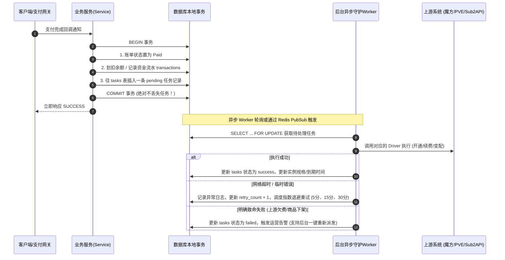

# JianYun (简云) · 系统全景架构设计文档

本文档定义了 JianYun (简云) 系统的核心架构、领域模型、关键业务流转以及数据一致性保障机制。

---

## 1. 总体分层架构 (Layered Architecture)

系统采用 **“极简内核 + 驱动抽象 + 异步可靠任务”** 的清晰三层结构：

```text
┌────────────────────────────────────────────────────────────────────────┐
│                        前端展现层 (Single App)                         │
│   • 统一响应式单页应用 (Vue 3 + TypeScript + Vite)                       │
│   • 路由多角色权限切分: 公开购买门户 / 客户控制台 / 管理员运维后台       │
└───────────────────────────────────┬────────────────────────────────────┘
                                    │ HTTP / RESTful API (JSON)
┌───────────────────────────────────▼────────────────────────────────────┐
│                        核心业务域 (Core Domain)                        │
│   • Auth (认证 & RBAC & 模拟登录)                                      │
│   • Catalog (商品目录 & SWR 快照缓存 & 动态 Schema 渲染)                │
│   • Billing (账单结算 & 余额代扣 & 支付网关聚合)                       │
│   • Instance (实例生命周期 & 覆盖改价 & 变配补差)                      │
│   • Affiliate (分销推荐 & 冻结期管理 & 退款级联冲正)                   │
│   • Outbox Dispatcher (事务发件箱任务分发器)                           │
└───────────────────────────────────┬────────────────────────────────────┘
                                    │ Unified Driver Interface
┌───────────────────────────────────▼────────────────────────────────────┐
│                        扩展驱动层 (Driver Layer)                       │
│  ┌───────────────────────┐  ┌───────────────────────┐  ┌─────────────┐ │
│  │   Upstream Providers  │  │   Payment Gateways    │  │  Notify     │ │
│  │  • ZjmfProxyDriver    │  │  • AlipayF2FDriver    │  │  • Mail     │ │
│  │  • EasypanelDriver    │  │  • HpjpayDriver       │  │  • Sms      │ │
│  │  • Sub2ApiDriver      │  │  • EpayDriver         │  │  • Telegram │ │
│  │  • ManualAdminDriver  │  │  • BalanceDriver      │  │             │ │
│  └───────────────────────┘  └───────────────────────┘  └─────────────┘ │
└────────────────────────────────────────────────────────────────────────┘
```

---

## 2. 核心业务生命周期机制

### 2.1 任务可靠执行机制：事务发件箱模式 (Transactional Outbox)

解决旧系统“先调上游接口，网络超时导致任务凭空丢失”的问题：



---

### 2.2 自动续费双阶段解耦机制 (Two-Phase Auto-Renew)

彻底解决旧系统“账单已存在导致代码 return 500 跳过扣款”的致命缺陷：

- **阶段一：出账调度器（Invoice Generator - 每天跑一次）**
  - 扫描所有 `status = 'active'` 且距离 `due_date <= 7 天` 的实例。
  - 若当前实例不存在未付款续费账单，则生成一张唯一续费账单（`invoices` 表唯一键防重）。
  - 若已存在，则静默跳过，绝不重复生成。

- **阶段二：自动代扣器（Auto Debit Dispatcher - 事件驱动秒级唤醒 + 15分钟兜底）**
  - **事件驱动秒级代扣**：用户在任何时刻完成余额充值、或管理员在后台给用户手工入账时（触发 `wallet.recharged` 领域事件），系统立即精准就地唤醒该用户的自动代扣逻辑，实现**充值完成秒级自动代扣续费**，消除停机风险。
  - **15分钟定时兜底**：后台扫描所有状态为 `unpaid` 且实例属于 `active` 或宽限期内 `suspended` 的续费账单，作为定时安全网。
  - **扣费与履约**：
    - 检查客户是否开启自动续费且 `user.balance >= invoice.total`：开启事务行锁扣减余额，账单标记为 `paid`，自动向 `tasks` 表写入一条携带确定性目标到期日（`target_due_date`）的 `renew` 任务。
    - 若余额不足：保留账单，发送邮件/Web Push催付通知，待用户充值唤醒。

---

### 2.3 动态升降级与运维改价机制 (Upgrade & Price Override)

- **弹性云自动化升降级（对接上游魔方）**：
  - **升级补差价**：
    $$\text{补差金额} = \max\left(0.01, \; (P_{\text{新配置周期价}} - P_{\text{原配置周期价}}) \times \frac{\text{剩余天数}}{\text{本周期总天数}}\right)$$
    生成补差账单，用户付完款后通过 Outbox 队列异步调上游魔方变配生效。
  - **降级不退款（纯配置变更）**：
    降级不退款属于非支付类纯配置变更行为，不生成需要支付的结算账单（不受结算账单最低 0.01 元支付门槛约束）。用户在前端明确确认降级风险后，**系统同事务将变更任务写入 Outbox 任务发件箱，由异步 Worker 可靠调度上游执行降级**，严禁在 HTTP 线程同步请求上游；上游执行完毕后，将本地实例的 `recurring_price`（下次续费基准价）降为新规格价格。

- **自营/固定套餐实例手动运维改价**：
  - 运维在物理机/PVE 调整完机器配置后，在后台打开实例详情弹窗。
  - 输入新的续费循环价格（如从 50 改为 70）。
  - 系统自动折算剩余天数应收差价，管理员可一键勾选【从用户余额扣除】，系统自动生成一张 Paid 差价账单并扣除余额，同时实例 `override_price` 永久更新为 70 元。

---

### 2.4 推荐返佣防套利与退款级联冲正 (Anti-Fraud Affiliate)

- **绑定与冻结**：买家 B 付款后，推荐人 A 产生一条 `status = 'pending'` 的返利明细，冻结 15 天（`freeze_until = paid_at + 15d`）。
- **退款级联冲正**：
  - 当管理员对订单执行【退款】时，系统检查该账单关联的返利：
    - 若处于 `pending`（冻结期内）：**状态直接更新为 `cancelled`，作废返佣！**
    - 若已过冻结期处于 `available`：触发 **Clawback（追回）**，扣减 A 的可提现余额；若余额不足扣成负数，阻止后续提现。

---

## 3. 购物车性能优化架构：SWR 快照 + 下单原子预检

- **浏览路径**：用户进入商品选购页，直接读取本地 Redis 缓存的配置项 JSON 快照（5 毫秒内极速渲染），彻底告别旧系统直连上游卡死的问题。
- **下单终审**：用户点击【立即支付】瞬间，系统发起一次仅耗时几十毫秒的轻量 Pre-flight 检查确认上游有货与价格匹配，确认无误后锁定成单，兼顾极致性能与防超卖底线。
