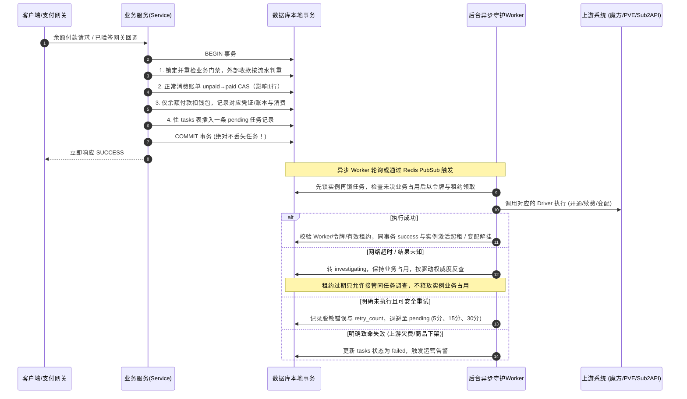

# JianYun (简云) · 系统全景架构设计文档

本文档定义了 JianYun (简云) 系统的核心架构、领域模型、关键业务流转以及数据一致性保障机制。

---

## 1. 总体分层架构 (Layered Architecture)

系统采用 **“极简内核 + 驱动抽象 + 异步可靠任务”** 的清晰三层结构：

**已确认技术底座**：PHP 8.4 + Laravel 13、MySQL 8.0+、Redis，以及单一 Vue 3/Vite/TypeScript/Element Plus 前端。HTTP 首版采用普通 PHP-FPM；Laravel 承接路由、校验、配置、日志、命令和调度，领域服务保留财务与履约规则。当前 MVP 已接入 Laravel 及单一前端，已验证范围为模拟余额交易闭环；M2 已实现可靠新购/续费 Worker、魔方固定商品驱动、易支付收单和最小实例页面，首个固定 CDN 商品已完成真实支付与交付回填，其他能力仍依路线图验收，适配边界见 [TECH_STACK.md](TECH_STACK.md)。

**事务与运行边界**：财务服务使用同一数据库连接提交账单 CAS、钱包/账本及 `tasks`，不以框架普通队列、`afterCommit` 或自动重试替代 Outbox。Worker 独立运行并管理逐任务状态；Redis 仅用于缓存和唤醒，不能取代 MySQL 业务占用。框架迁移保留插件隔离及现有 API、身份和密文兼容要求。

**旧站迁移交付边界**：旧系统适配器以独立插件部署在旧站，生成指定简云版本的 SQL 数据库备份及映射/对账材料，由运维通过通用 MySQL 工具恢复到独立空库。简云运行架构不包含迁移页面、旧站专用 API、专用导入命令或旧库连接；该工具不属于简云 `plugins/` 驱动层。旧回调持久接收及桥接同样是外置过渡设施，仍通过已核准的通用支付契约结算，完整边界与开放门禁见 [MIGRATION_RUNBOOK.md](MIGRATION_RUNBOOK.md)。

```text
┌────────────────────────────────────────────────────────────────────────┐
│                        前端展现层 (Single App)                         │
│   • 统一响应式单页应用 (Vue 3 + TypeScript + Vite + Element Plus)        │
│   • 路由多角色权限切分: 公开购买门户 / 客户控制台 / 管理员运维后台       │
└───────────────────────────────────┬────────────────────────────────────┘
                                    │ HTTP / RESTful API (JSON)
┌───────────────────────────────────▼────────────────────────────────────┐
│                        核心业务域 (Core Domain)                        │
│   • Auth (认证 & RBAC & 模拟登录)                                      │
│   • Catalog (商品目录 & SWR 快照缓存 & 动态 Schema 渲染)                │
│   • Billing (账单结算 & 余额代扣 & 支付网关聚合)                       │
│   • Instance (实例生命周期 & 覆盖改价 & 变配补差)                      │
│   • Affiliate (分销推荐 & 冻结期管理 & 退款级联冲正)                   │
│   • Outbox Dispatcher (事务发件箱任务分发器)                           │
└───────────────────────────────────┬────────────────────────────────────┘
                                    │ Unified Driver Interface
┌───────────────────────────────────▼────────────────────────────────────┐
│                        扩展驱动层 (Driver Layer)                       │
│  ┌───────────────────────┐  ┌───────────────────────┐  ┌─────────────┐ │
│  │   Upstream Providers  │  │   Payment Gateways    │  │  Notify     │ │
│  │  • ZjmfProxyDriver    │  │  • AlipayF2FDriver    │  │  • Mail     │ │
│  │  • EasypanelDriver    │  │  • HpjpayDriver       │  │  • Sms      │ │
│  │  • Sub2ApiDriver      │  │  • EpayDriver         │  │  • Telegram │ │
│  │  • ManualAdminDriver  │  │  • BalanceDriver      │  │             │ │
│  └───────────────────────┘  └───────────────────────┘  └─────────────┘ │
└────────────────────────────────────────────────────────────────────────┘
```

---

## 2. 核心业务生命周期机制

### 2.1 任务可靠执行机制：事务发件箱模式 (Transactional Outbox)

解决旧系统“先调上游接口，网络超时导致任务凭空丢失”的问题。下图仅描述**需要上游履约的正常云消费结算**；外部支付先验签、按网关流水判重并检查报价/实例/退款/任务门禁，通过后才执行账单 CAS。只有余额支付扣钱包；纯充值与迟到/多收款入钱包不投实例任务，完整分流见 [PAYMENTS.md](PAYMENTS.md)。



**任务安全边界**：`tasks` 是任务执行占用的唯一事实来源。`running` / `investigating` 以及 `failed + MANUAL_AUDIT_REQUIRED` 都阻断同实例其他动作，不能用 `lease_until` 到期来解除阻断。所有领取、接管与人工裁决先锁实例再锁任务；Worker 的租约只控制执行权与回写资格。无法反查的未知结果必须保留人工核验标记并告警，通用重试拒绝此类任务；`super_admin` 通过独立、受审计的强制重发或人工回填命令裁决，不绕过普通 Worker 完成方法的租约门禁。详见 [TASKS_OUTBOX.md](TASKS_OUTBOX.md) §2–§3。

**退款业务边界**：云消费退款认领先检查实例未决任务；认领后的正常消费主账单 `refund_pending` 同时阻断新动作与已有 `pending` 任务领取，退款不通过第二份任务锁承载。明确拒绝按原状态安全恢复后再检查任务资格；结果未知持续冻结。成功终态 CAS、主账单转 `refunded`、旧 pending 任务失效与唯一销毁任务投递同事务完成，销毁前继续保留退款关停冻结。接管或回写若发现不匹配退款归属则转人工核对。迟到/多收钱包款退款不改父账单或实例，不触发此冻结。详见 [PAYMENTS_LEDGER.md](PAYMENTS_LEDGER.md) §3 与 [TASKS_OUTBOX.md](TASKS_OUTBOX.md) §2.4。

**快照与备份链路**：手动请求和调度器同事务写入本地 `creating` 台账与 `snapshot_create` / `backup_create` Outbox，唯一任务键冲突整笔回滚；Worker 确认结果后回填同一台账。删除任务按本地台账 ID 使用统一幂等键 `snapshot_delete:{instance_snapshots.id}`，执行前核验 Provider、实例、类型与远端 ID。快照标识只在 `(instance_id, type, remote_snapshot_id)` 范围唯一；创建、删除均使用上述未知结果调查协议，轮转必须等待前序结果确认。详见 [LIFECYCLE_PRICING.md](LIFECYCLE_PRICING.md) §5。

---

### 2.2 自动续费双阶段解耦机制 (Two-Phase Auto-Renew)

彻底解决旧系统“账单已存在导致代码 return 500 跳过扣款”的致命缺陷：

- **阶段一：出账调度器（Invoice Generator - 每天跑一次）**
  - 扫描所有 `status = 'active'` 且距离 `due_date <= 7 天` 的实例。
  - 若当前实例不存在未付款续费账单，则生成一张唯一续费账单（`invoices` 表唯一键防重）。
  - 若已存在，则静默跳过，绝不重复生成。

- **阶段二：自动代扣器（Auto Debit Dispatcher - 事件驱动秒级唤醒 + 15分钟兜底）**
  - **事件驱动秒级代扣**：用户在任何时刻完成余额充值、或管理员在后台给用户手工入账时（触发 `wallet.recharged` 领域事件），系统立即精准就地唤醒该用户的自动代扣逻辑，实现**充值完成秒级自动代扣续费**，消除停机风险。
  - **15分钟定时兜底**：后台扫描所有状态为 `unpaid` 且实例属于 `active` 或宽限期内 `suspended` 的续费账单，作为定时安全网。
  - **扣费与履约**：
    - 检查客户是否开启自动续费且 `user.balance >= invoice.total`：开启事务行锁扣减余额，账单标记为 `paid`，严格基于实例原 `due_date` 顺延一个周期（`DATE_ADD(due_date, INTERVAL ...)`），并向 `tasks` 表写入一条携带确定性目标到期日（`target_due_date`）的 `renew` 任务。
    - 若余额不足：保留账单，发送邮件/Web Push催付通知，待用户充值唤醒。
    - 若未付续费账单因超时、变配重算或手动取消置为 `cancelled`，必须同步清空 `cycle_marker = NULL` 以释放唯一索引槽位。

---

### 2.3 动态升降级与运维改价机制 (Upgrade & Price Override)

- **弹性云自动化升降级（对接上游魔方）**：
  - **升级补差价**：
    $$\text{补差金额} = \max\left(0.01, \; (P_{\text{新配置周期价}} - P_{\text{原配置周期价}}) \times \frac{\text{剩余天数}}{\text{本周期总天数}}\right)$$
    生成补差账单，用户付完款后通过 Outbox 队列异步调上游魔方变配生效。
  - **降级不退款（纯配置变更）**：
    降级不退款属于非支付类纯配置变更行为，不生成需要支付的结算账单（不受结算账单最低 0.01 元支付门槛约束）。用户在前端明确确认降级风险后，**系统同事务将变更任务写入 Outbox 任务发件箱（复用 `tasks.action = 'upgrade'`, `invoice_id = NULL`, 幂等键 `instance_downgrade:{instance_id}:{token}`），由异步 Worker 可靠调度上游 `driver->resize()` 执行降级**，严禁在 HTTP 线程同步请求上游；上游执行完毕后，将本地实例的 `recurring_price`（下次续费基准价）降为新规格价格。

- **自营/固定套餐实例手动运维改价**：
  - 运维在物理机/PVE 调整完机器配置后，在后台打开实例详情弹窗。
  - 输入新的续费循环价格（如从 50 改为 70）。
  - 系统自动折算剩余天数应收差价，管理员可一键勾选【从用户余额扣除】，系统自动生成一张 `type = 'upgrade'`, `status = 'paid'` 的差价账单并扣除余额（因运维已在宿主机手工完成变配，此账单**不投递** Outbox `tasks`），同时实例 `override_price` 永久更新为 70 元。
- **在途未付续费单联动失效（防价格撕裂铁律）**：
  - 无论通过弹性升降级更新了 `recurring_price`，还是通过运维改价更新了 `override_price`，必须在同一事务内将该实例名下已存在的未支付续费账单（`type = 'renew' AND status = 'unpaid'`）原子作废（`SET status = 'cancelled', cycle_marker = NULL`），严禁客户以变配前的旧价格支付已出账单。

---

### 2.4 推荐返佣防套利与退款级联冲正 (Anti-Fraud Affiliate)

- **绑定与冻结**：买家 B 正常云消费结算成功且商品参与返佣时，推荐人 A 产生一条 `status = 'pending'` 的返利明细，冻结 15 天（`freeze_until = paid_at + 15d`）；充值与迟到/多收钱包款不生成返利。
- **退款级联冲正**：
  - 仅正常云消费（`cloud_consumption`）退款成功终态 CAS 影响 1 行时，才在同一事务内检查该账单关联的返利：
    - 若处于 `pending`（冻结期内）：**状态直接更新为 `cancelled`，作废返佣！**
    - 若已过冻结期处于 `available`：触发 **Clawback（追回）**，扣减 A 的可提现余额；若余额不足扣成负数，阻止后续提现。
  - 退款待审、拒绝或结果未知不冲佣金；独立充值及 `late_wallet_credit` 退款也不冲佣金，迟到/多收款退款不得改变原云消费账单、实例或消费累计。完整用途边界见 [PAYMENTS_LEDGER.md](PAYMENTS_LEDGER.md) §3。

---

## 3. 购物车性能优化架构：SWR 快照 + 下单原子预检

- **浏览路径**：用户进入商品选购页，直接读取本地 Redis 缓存的配置项 JSON 快照（5 毫秒内极速渲染），彻底告别旧系统直连上游卡死的问题。
- **下单终审**：用户点击【立即支付】瞬间，系统发起一次仅耗时几十毫秒的轻量 Pre-flight 检查确认上游有货与价格匹配，确认无误后锁定成单，兼顾极致性能与防超卖底线。
