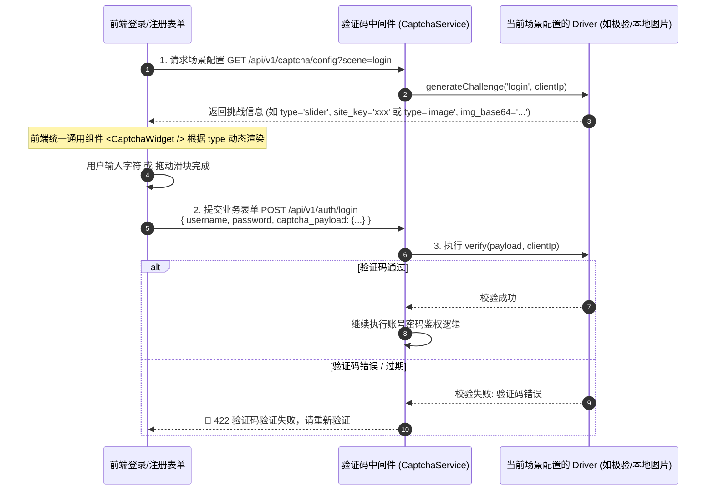

# JianYun (简云) · 模块化验证码中心设计文档 (Captcha Center)

本文档定义了 JianYun 的验证码架构、驱动插件化扩展规范、开箱即用的本地图片验证码，以及**“场景化自由绑定（Scene-based Strategy）”**策略。

---

## 1. 验证码形态支持

系统架构支持三种主流验证码形态，并由统一的客户端与服务端生命周期管理：

| 形态 | 交互方式 | 代表驱动 | 适用场景 |
| :--- | :--- | :--- | :--- |
| **图片验证码 (Image)** | 显示字符/算术图片，用户输入框填入匹配字符 | **`builtin_image` (系统内置，零依赖)** | 基础兜底、简单内网部署、无外部网络连接环境 |
| **点击验证 (Click / Turnstile)** | 用户点击复选框/无感自动判断，通过即放行 | **Cloudflare Turnstile**、极验行为点击、hCaptcha | 移动端友好、用户体验极佳、防机器撞库 |
| **滑块拼图 (Slider)** | 拖动滑块完成缺口拼图，校验拖动轨迹与时间 | **极验 Geetest v4**、腾讯云天御、顶象滑块 | 强风控场景、高价值操作、防脚本暴力破解 |

---

## 2. 统一验证码驱动接口 (`CaptchaDriverInterface`)

所有验证码插件（无论内置还是第三方）存放在 `plugins/captcha/`，并实现统一接口：

```php
namespace App\Plugins\Captcha;

interface CaptchaDriverInterface
{
    /**
     * 驱动唯一标识 (如 'builtin_image', 'geetest', 'turnstile', 'tencent')
     */
    public function getDriverId(): string;

    /**
     * 驱动名称 (如 '极验行为验证 (Geetest v4)')
     */
    public function getName(): string;

    /**
     * 验证码展现类型: 'image' | 'click' | 'slider'
     */
    public function getType(): string;

    /**
     * 后台动态配置表单 (如 AppID, SecretKey, 域名配置)
     */
    public function getConfigSchema(): array;

    /**
     * 渲染给前端客户端的初始化元数据 (如 site_key, 验证码图片base64, 挑战token)
     */
    public function generateChallenge(string $scene, string $clientIp): array;

    /**
     * 后端二次安全校验 (二次验签 / 校验字符匹配)
     * @param array $payload 客户端提交上来的验证凭据 (如验证码字符串, 或 极验lot_number/pass_token)
     */
    public function verify(array $payload, string $clientIp): CaptchaVerifyResult;
}
```

---

## 3. 场景化自由策略开关 (Scene-based Strategy)

管理员在后台可以自由按**业务场景**配置验证码策略，无需修改任何代码：

```text
┌────────────────────────────────────────────────────────────────────────┐
│  验证码场景安全策略配置 (Captcha Scene Settings)                      │
├────────────────────────────────────────────────────────────────────────┤
│  1. 用户登录 (Login)                                                   │
│     • 开启状态：[✔ 启用]                                               │
│     • 生效模式：( ) 始终强制弹出  (•) 连续输错 2 次密码后触发 (防爆破)  │
│     • 选用驱动：[ 极验滑块拼图 (Geetest v4)  ▼ ]                       │
│                                                                        │
│  2. 用户注册 (Register)                                                │
│     • 开启状态：[✔ 启用]                                               │
│     • 生效模式：(•) 始终强制弹出  ( ) 智能风控检测                     │
│     • 选用驱动：[ Cloudflare Turnstile 一键点击 ▼ ]                    │
│                                                                        │
│  3. 找回密码 (Password Reset)                                          │
│     • 开启状态：[✔ 启用]                                               │
│     • 选用驱动：[ 系统内置图片验证码 (Builtin Image) ▼ ]               │
│                                                                        │
│  4. 提交订单防刷单 (Order Create)                                      │
│     • 开启状态：[ 停用 ]  (如遇羊毛党恶意扫单时可随时一键开启)         │
└────────────────────────────────────────────────────────────────────────┘
```

### 存储结构 (`system_settings` 中的 JSON 存储)
```json
{
  "captcha_scenes": {
    "login": {
      "enabled": true,
      "mode": "after_failed_attempts",
      "failed_threshold": 2,
      "driver": "geetest"
    },
    "register": {
      "enabled": true,
      "mode": "always",
      "driver": "turnstile"
    },
    "password_reset": {
      "enabled": true,
      "mode": "always",
      "driver": "builtin_image"
    }
  }
}
```

---

## 4. 前后端通用交互流转

前端无需针对每个插件写一套死板逻辑，统一通过后端抽象调度：



---

## 5. 开箱即用的内置图片验证码 (`builtin_image`)

系统默认内置提供纯 PHP 生成的字符/算术验证码，作为零外部依赖的基准实现：
- 使用 PHP `GD` 扩展绘制彩色干扰线与噪点；
- 验证码明文经哈希后存入 Redis，设置 5 分钟短有效期；
- 校验一次即销毁（单次有效，防重放）；
- 不需要任何第三方 API Key，部署即可直接使用。
