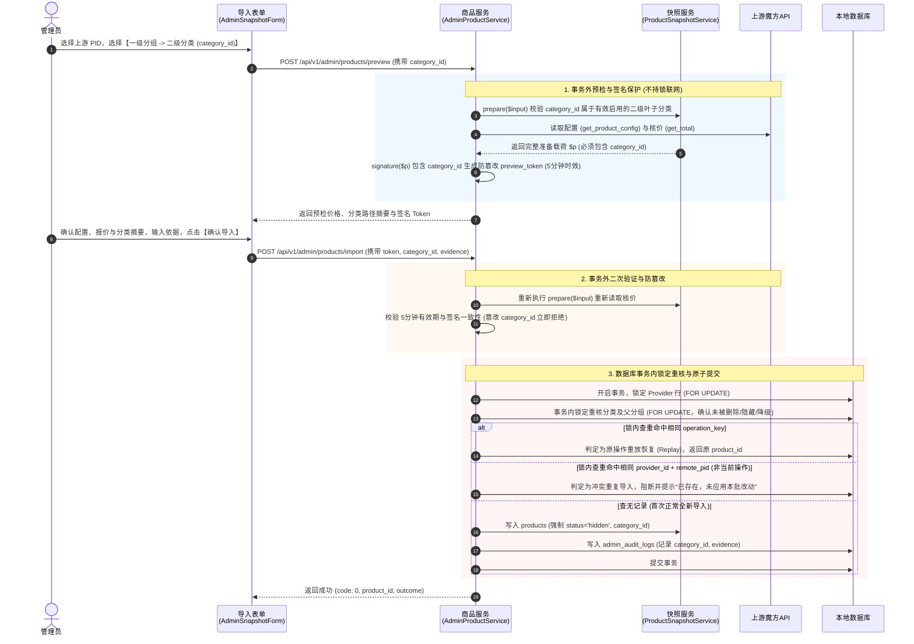

# 商城两级分类架构与商品归类工程规范（v2.1 终审定稿版）

> **接入记录（2026-11-11）**：前六节保留外部 v2.1 定稿的设计范围；仓库实施约束见第七节，隔离验收见[分类验收记录](CATEGORY_HIERARCHY_ACCEPTANCE.md)。设计中的存量盘点是当次采样，不代表本轮读取或修改了 M2。系列聚合、规格矩阵与标签仍未实施。

> **规范定位**：针对云商城商品分类膨胀、多供应商同机房混排、中国区商品过载以及导入时缺少分类选择的痛点，制定规范化的**两级分类模型（一级分组 $\rightarrow$ 二级分类）**、**导入全流程签名保护**、**跨供应商中性白标**、**存量数据兜底**与**严格事务并发约束**方案。本版本全面落实五处工程约束，确保分类管理具备版本化审计、防并发竞争、重放恢复及平滑兼容能力。

---

## 一、 架构原则与分类管理模型

### 1.1 两级分类模型与增量迁移（保持 27 表不变量）
* **现行数据结构限制**：
  设计前分类表 [`product_categories`](../database/schema.sql) 仅有 `id`, `name`, `slug`, `type`, `status` 等字段，属于**扁平单层结构**，无法可靠表达一级分组与二级分类的父子层级关系；
* **增量迁移方案（严格坚守 27 表物理不变量）**：
  * 在 `product_categories` 表中新增自引用字段：
    `parent_id INT UNSIGNED NULL DEFAULT NULL`，增加外键约束 `FOREIGN KEY (parent_id) REFERENCES product_categories(id) ON DELETE RESTRICT`；
  * **节点层级契约**：
    * **一级分组（Group）**：`parent_id IS NULL`；
    * **二级分类（Category）**：`parent_id IS NOT NULL`；
    * **树深绝对红线**：系统硬性限制最多为 **2 级**，严禁创建三级分类（即二级分类的 `id` 不可再被作为其他分类节点的 `parent_id`），禁止自引用循环依赖；
  * **商品归属规则**：商品（`products.category_id`）**只允许绑定到二级分类（叶子节点）**，严禁直接挂靠在一级分组上；
  * **迁移执行规范**：新建增量迁移文件 `2026_11_11_000010_category_hierarchy.php`，同步更新 `database/schema.sql`，迁移脚本严禁硬编码具体的商品 ID 或假设存量数据行数，物理表总数严格保持 27 张不变。

### 1.2 架构通用性：后台自由配置，非硬编码地域
* **业务解耦**：
  “中国大陆 / 中国香港 / 海外”以及“高防 / 大带宽”仅作为运营示范用例，**严禁将特定上游的地域分布硬编码写入系统底层逻辑**；
* **支持多品类通用性**：
  系统需同时支持弹性云、独立服务器、CDN、软件许可、虚拟主机等多元业务。管理员在后台可自由维护分组与分类名称（如：一级“安全与加速” $\rightarrow$ 二级“国内高防CDN”；一级“企业计算” $\rightarrow$ 二级“香港专属服务器”）；
* **类型字段兼容处理**：
  * `products.type` 保持产品底层技术类型（`cloud`, `dedicated`, `cdn`, `hosting`, `software`）；
  * 二级分类在创建时可指定或继承父级的推荐业务类型，用于前台快捷过滤，但不与单品的底层驱动调用机制耦合。

### 1.3 分类管理的权限、版本控制与审计规则
* **RBAC 权限约束**：
  * 列表与详情查看：所有当前启用的管理员（`role in ('super_admin','finance','support','operator')` 且 `status='active'`）可读；
  * 节点创建、改名、排序、隐藏与层级调整：**仅当前启用的超级管理员（`super_admin`）可写**；
* **版本并发控制（CAS Optimistic Locking）**：
  * 分类节点维护引入基于快照与审计的 `expected_version` 并发检查，更新时比对版本号，防止并发修改覆盖；
* **审计与操作依据**：
  * 分类的新增、修改、隐藏与删除必须同事务写入 [`admin_audit_logs`](../database/schema.sql)；
  * **商品归类属于日常运维编辑**：调整已有商品的 `category_id` 走既有商品编辑流程，**无需填写 10–1000 字节变更依据**（`evidence` 选填）；商品导入仍保留原依据必填要求；
  * 分类维度的所有调整**绝不修改底层计价快照、报价版本、历史账单金额或存量实例续费价**。

---

## 二、 存量数据盘点、未分类兜底与隐藏分类规则

### 2.1 存量数据实测盘点（当次采样记录）
对验收数据库进行即时只读盘点（当次状态记录，迁移不硬编码）：
* **分类表（`product_categories`）**：现有 **0 条** 记录；
* **商品表（`products`）**：现有 **5 条** 记录（3 条 `active` 在售，2 条 `hidden` 下架），且全部 `category_id = NULL`：
  1. `#1` 美国CDN · CDN体验（`active`, `category_id = null`）
  2. `#2` 洛杉矶轻量弹性云（`active`, `category_id = null`）
  3. `#3` 宁波电信·高防 ABM1（`active`, `category_id = null`）
  4. `#4` 洛杉矶高配支持win（`hidden`, `category_id = null`）
  5. `#5` CDN普通（`hidden`, `category_id = null`）

### 2.2 统一未分类、隐藏分类与旧商品刷新契约
> [!IMPORTANT]
> **分类可见性与在售门禁判定矩阵**：
> 1. **未分类定义**：前台“未分类（Uncategorized）”标签**严格且仅匹配 `category_id IS NULL` 的商品**；
> 2. **隐藏分类规则**：隐藏分类（`status = 0`）**仅不出现在前台分类导航中**；其符合原可售条件的商品仍进入“全部商品”列表，且**直链新购保持完全可用**；若需禁售某商品，必须显式修改商品本身的 `status = 'hidden'`；
> 3. **全部商品门禁完整性**：“全部商品”必须完整保留现有 [`CatalogService.php:16`](../app/Services/CatalogService.php) 的在售门禁：
>    * Provider 必须启用（`r.status = 1`）；
>    * 商品必须在售（`p.status = 'active'`）；
>    * 绝不能简化为仅检查 `products.status = 'active'`；
> 4. **旧商品快照刷新保留原归属**：无论新导入是否在 UI 上强制选择分类，**旧商品的手工刷新与计划定时刷新（`AdminProductService::refresh` / `ProductRefreshService`）必须严格保留原归属（包括 `category_id = NULL`）**，绝不被新增导入分类门禁阻断。

### 2.3 分类删除与并发防护
* **删除门禁强校验**：
  * 若一级分组下存在子分类，服务端直接拒绝删除，提示“请先移除或迁移子分类”；
  * 若二级分类下存在关联商品（`SELECT COUNT(*) FROM products WHERE category_id = ?`），服务端直接拒绝删除，提示“该分类下存在商品，请先迁移商品归属”；
* **并发一致性锁顺序**：
  分类删除、层级修改与商品归类在数据库事务中采用一致的锁定规则，事务内对受影响的分类行加 `FOR UPDATE` 排他锁，防止并发操作绕过“存在关联商品禁止删除”。

---

## 三、 商品导入集成分类选择的完整闭环

在商品导入时选择分类必须建立端到端的数据流与签名校验，杜绝任何数据丢失或隐式越权。



### 3.1 贯穿准备载荷与防篡改签名契约
1. **数据载荷贯穿（修改关键点）**：
   * 在 [`AdminProductService.php:243`](../app/Services/AdminProductService.php) 中将 `category_id` 纳入快照输入；
   * **核心约束**：[`ProductSnapshotService::prepare()`](../app/Services/ProductSnapshotService.php) 返回的准备结果数组 **必须显式包含 `category_id`**，严禁在服务层重构数组时丢失该字段；
2. **签名保护（HMAC Request Fingerprint）**：
   * `signature()` 对包含 `category_id` 的准备载荷 `$p` 计算哈希签名；
   * 导入提交时，若客户端篡改了 `category_id`，签名比对必然失败（抛出 `409 Preview or upstream changed; preview again`），强制重新预检；
3. **确认摘要与冻结**：
   * 确认对话框中向管理员明确展示分类完整路径（例如：“亚太节点 $\rightarrow$ 香港精品区”）；
   * 提交过程如遇网络闪断或结果未知（In-flight Timeout），**必须冻结原分类、原参数与原令牌**，引导管理员只读重查，严禁换分类重新发起导入。

### 3.2 事务内重核分类及父分组（防并发修改）
在 `Database::transaction()` 内部，必须执行**分类及其父分组的行锁重核**：
```sql
SELECT c.id, c.status, c.parent_id, p.status AS parent_status
FROM product_categories c
JOIN product_categories p ON c.parent_id = p.id
WHERE c.id = ? FOR UPDATE;
```
* **核验规则**：
  * 分类节点 `c.status = 1` 且父分组 `parent_status = 1`；
  * 分类节点 `c.parent_id IS NOT NULL`（确认其仍为二级叶子分类，未被并发修改为根分组）；
* 若分类在预检后被并发删除、禁用或移动，事务立即回滚并抛出 `409 Category unavailable; preview again`；
* **上游核价继续严格置于事务外**，绝不进行锁内网络调用。

### 3.3 锁内查重与重放例外细化
在事务内查重时，严格区分两种场景：
1. **原操作重放（Replay）**：
   * 查到本地已有记录，且 `admin_audit_logs` 命中相同的 `operation_key`（丢响应找回）；
   * 属于合规的幂等恢复，返回原 `product_id` 与 `outcome = 'replayed'`，不重复写库与审计；
2. **已有记录冲突（Already Exists）**：
   * 查到本地已有记录，但未命中当前操作指纹（由其他操作导入，或此前早已存在）；
   * 严禁通过再次导入修改该商品的分类、加价或账期，返回提示“已存在，未应用本批改动”（或抛出 409 Conflict）；
   * 调整已有商品的分类归属，必须走商品编辑接口（`update()`）。

---

## 四、 真实数据与中性白标治理

### 4.1 价格、库存与规格真实性（杜绝合成猜测）
1. **价格展示规则**：
   * `products.config_cache` 中的 `prices` 是**默认配置参考价**，不代表该规格的最低价（严格遵循 [`docs/M2_CONFIG_SALES.md:15`](M2_CONFIG_SALES.md) 契约）；
   * 弹性云卡片不得在未计算完整选配矩阵前宣称“¥XX 起”，明确标注“默认配置参考价 ¥XX /月”；
   * 未来固定套餐系列对比时，仅允许对比同计费周期（如均为月付）的参考价，严禁把缺失月付的补零或自行按比例折算年付；
2. **库存展示规则**：
   * 严格沿用现有的四态枚举：`in_stock` / `sold_out` / `unlimited` / `unknown`，并展示远端观察时间戳；
   * 严禁将多个商品或多规格的库存进行随意数学累加，未知或过期的观察不得展示为“有货”；
3. **规格数据源约束**：
   * 卡片展示的核心参数（CPU、内存、带宽）必须严格来自上游快照解析出的结构化字段或管理员后台显式设定的规格属性；
   * **严禁编写正规表达式从商品名称中猜测硬件参数**；
   * **绝对禁止为了渲染大厅列表向供应商实时发起在线 HTTP 请求**（避免大厅加载雪崩）。

### 4.2 跨供应商中性白标（收敛服务承诺）
* **隐藏供应商真实标识**：
  在客户端目录中，统一隐去底层供应商的公司名、账号名及内部标识；
* **中性命名与剔除未证明承诺**：
  * 不同供应商不自动构成地理容灾隔离，**严禁宣传“多可用区多活容灾”、“统一网络 SLA 承诺”或“无感跨机房漂移”**；
  * 采用客观中性的命名体系，如“香港一区”与“香港二区”（删除任何暗示物理容灾的括号标注）；
  * 遵循 [`docs/M2_INSTANCE_VNC.md:25`](M2_INSTANCE_VNC.md) 契约：客观告知在直连 VNC 或底层网络调试中可能存在技术层面的上游线索，不作虚假脱敏承诺。

---

## 五、 前台两级导航交互与任务导向验收

彻底废除僵硬的“头部高度 ≤ 115px”或“强制五档”数字红线，严格对齐 [`PAGE_BLOAT_GOVERNANCE_AND_ARCHITECTURE_SPEC.md:148`](PAGE_BLOAT_GOVERNANCE_AND_ARCHITECTURE_SPEC.md) 的任务导向原则。

```text
┌────────────────────────────────────────────────────────────────────────┐
│  一级分组胶囊 (Group Pills):                                            │
│  [ 全部商品 ]   [ 🇨🇳 中国大陆服务器 ]   [ 🇭🇰 中国香港 (免备案) ]   [ 🌐 海外节点 ]│
├────────────────────────────────────────────────────────────────────────┤
│  二级分类标签 (Category Tabs, 响应一级动态呈现):                         │
│  [ 全部 ]  [ 🛡️ 高防安全 ]  [ 🚀 多线BGP ]  [ ⚡ 游戏高频 ]  [ 💰 特惠常规 ]     │
├────────────────────────────────────────────────────────────────────────┤
│  商品卡片流 (首屏直接可见商品，无多层纵向遮挡):                         │
│  ┌─────────────────────────────┐  ┌─────────────────────────────┐     │
│  │ 洛杉矶·轻量弹性云           │  │ 宁波电信·高防 ABM1          │     │
│  │ 🇺🇸 美国·洛杉矶 · 洛杉矶一区 │  │ 🇨🇳 浙江·宁波 · 电信机房     │     │
│  │ 默认参考: ¥16.00 /月        │  │ 默认参考: ¥399.00 /月       │     │
│  │ [ 选购配置 → ]              │  │ [ 选购配置 → ]              │     │
│  └─────────────────────────────┘  └─────────────────────────────┘     │
└────────────────────────────────────────────────────────────────────────┘
```

### 5.1 任务导向的可用性验收准则
1. **触达效率**：
   * 用户进入商城大厅，无需向下滚动，**首屏必须直接看见商品卡片**（CPU、内存、价格和选购入口）；
2. **层级联动顺畅**：
   * 点击一级分组，二级分类无闪烁平滑切换；
   * 一级选择“全部商品”时，二级分类显示全部或自动收起，列表展示全量在售商品（含存量未分类商品）；
3. **按钮文案严谨性**：
   * 卡片操作按钮文案统一使用**“选购配置”**或**“查看详情”**，**严禁写成“直接去支付”**（因为点击后进入的是结账选配与报价复核页，而非直接扣款）；
4. **多视口响应式防溢出**：
   * 在 320px、390px、768px、820px、1440px 视口下无整页横向滚动条；
   * 移动端导航胶囊支持平滑横滑，不因长分类名破坏页面网格。

---

## 六、 实施顺序与分期推进路线

严格聚焦于“两级分类模型与导入归类”，系列卡片与标签延后：

```mermaid
flowchart LR
    subgraph 本期实施范围 (两级分类与归类闭环)
        P1["1. 增量迁移<br/>parent_id 字段与约束<br/>保持 27 表不变量"]
        P2["2. 后台分类管理<br/>树深=2 校验 / 版本化审计<br/>有子节点/商品禁止删除"]
        P3["3. 导入与归类闭环<br/>单品/批量选分类<br/>prepare 载荷签名与事务重核"]
        P4["4. 前台两级导航<br/>未分类兜底 / 直链可用<br/>多视口任务导向验收"]
        P1 --> P2 --> P3 --> P4
    end

    subgraph 后续独立批次增量
        S1["系列聚合模型<br/>显式 series_code 存储"]
        S2["规格矩阵抽屉<br/>固定套餐折叠选型"]
        S3["属性标签体系<br/>结构化 Tags 辅助过滤"]
        S1 --> S2 --> S3
    end

    P4 -.-> S1
```

### 6.1 第一阶段（当前批次实施任务）：两级分类模型与导入归类
1. **数据库增量迁移**：
   * 创建 `2026_11_11_000010_category_hierarchy.php`，为 `product_categories` 增加 `parent_id` 及其外键约束，同步更新 `database/schema.sql`；迁移严禁硬编码测试数据 ID；
2. **后台分类管理 API 与页面**：
   * 实现后台分类 CRUD，严格校验二级树深（父节点必须为根，子节点不可再被继承）；
   * 仅超级管理员可写，引入 `expected_version` 与同事务审计；限制删除有子节点或关联商品的分类；
3. **商品导入与编辑链路打通**：
   * 修改 `ProductSnapshotService::prepare()` 与 `AdminProductService::prepared()`，确保 `category_id` 贯穿准备结果并受 `preview_token` 防篡改签名保护；
   * 确认导入事务内锁定重核分类及父分组；保留原操作重放例外；
   * 在 `AdminSnapshotForm.vue` 增加“一级分组 $\rightarrow$ 二级分类”联动选择器；
   * 商品编辑接口 `update()` 允许调整已有商品的 `category_id`，属于日常编辑不强制要求填写变更依据；
4. **商城前台两级导航落地**：
   * 改造 `CatalogView.vue`，实现一级分组与二级分类联动过滤；
   * 保留 Provider 启用等完整可售门禁，落实未分类商品（`category_id IS NULL`）兜底与隐藏分类直链可用规则；
   * 交付 320/390/768/820/1440px 多视口验收与类型检查。

### 6.2 第二阶段（后续独立专项）：系列卡片聚合与属性标签
* 在第一阶段稳定上线后，另行排期开发：
  * 在数据库中显式引入系列标识（如 `series_code`），由管理员显式关联同系列固定套餐，取消名称自动推断；
  * 实现商城大厅固定套餐系列聚合卡片与抽屉式规格选择矩阵；
  * 完善机房与网络特性标签（Tags）辅助过滤器。


## 七、 仓库实施契约与缺口修复（2026-11-11）

### 7.1 层级与版本

- `CategoryService` 负责两级树、权限、版本与原审计，不新增通用树引擎或表。创建子节点时在同一事务锁定父节点并重核其仍是一级分组，不能用事务外观察授权。
- 二级分类有商品时不得提升为一级；一级分组有子节点时不得降为二级。归类和删除均锁定分类事实后检查，不能通过改层级规避商品只能挂二级的规则。
- 更新和删除都必须携带 64 位 `expected_version`，版本包括节点内容及最新分类审计，拒绝旧页删除和移动后复原的 ABA。删除缺版本返回 400、过期返回 409；有子节点／商品同样拒绝。
- `000010` 只增加原表的 `parent_id`、索引与自引用约束，仍 27 表；`schema.sql` 与数据库字典同步。已有库启用须先迁移，本轮未操作 M2。

### 7.2 旧归属维护与导入确认

- 新增／改变归属只接受启用父分组下的启用二级分类，`NULL` 继续表示未分类。商品维持原 `category_id` 时，隐藏父分组或分类不阻断名称／上下架／加价及手工／定时快照刷新。
- 快照刷新只能保留原归属，包括隐藏归属和 `NULL`；计划刷新未携带分类时亦不清空。修改归属只走原商品编辑。
- 准备结果包含 `category_context={id,parent_id,path,version,parent_version}`，连同配置和金额进入原预览签名。事务内再锁定重读比较整个上下文，移动、改名、隐藏、删除或版本变化须重新预览（40912）；网络读取仍在事务外。
- 分类上下文不进入 `config_cache` 或客户报价指纹，不改历史账单、冻结价格、任务或实例。原审计匹配的已提交操作仍可按原令牌恢复，不能以已有绑定认定本批成功。

### 7.3 页面契约

- 单品／批量导入选项过滤空分组与隐藏路径，不能把一级分组显示为可选叶子后暗中提交 `NULL`。已有隐藏归属在商品编辑中保留标签，不能用来新增归属。
- 批次建立后展示冻结的统一分类；逐项预检摘要展示服务端确认路径和 ID。分类变化后原确认失败，必须人工重新预检和确认，不自动替换令牌。
- 分类可选文本通过空字符串显式清空；弹窗适配 320–1440px，窄屏表单分行。保存、冲突、原载荷与权限语义保持。

### 7.4 验收边界

针对用户复核的六项缺口增加行锁竞争、隐藏归属维护、路径签名和删除 CAS 回归；数据库字典检查同步通过。实际浏览器走单品／批量原接口，证据限定于独立夹具环境，详见[验收记录](CATEGORY_HIERARCHY_ACCEPTANCE.md)。后续在基线1b739cb上独立完成[M2迁移、同版加载和既有商品归类验收](M2_CATEGORY_HIERARCHY.md)，单品／批量只核对摘要，不新增导入或购买。分类第一阶段收口，金融／邮件暂停和系列聚合延期的边界保持。
