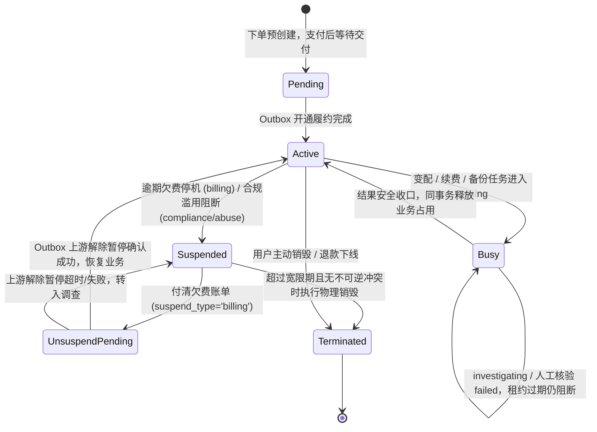
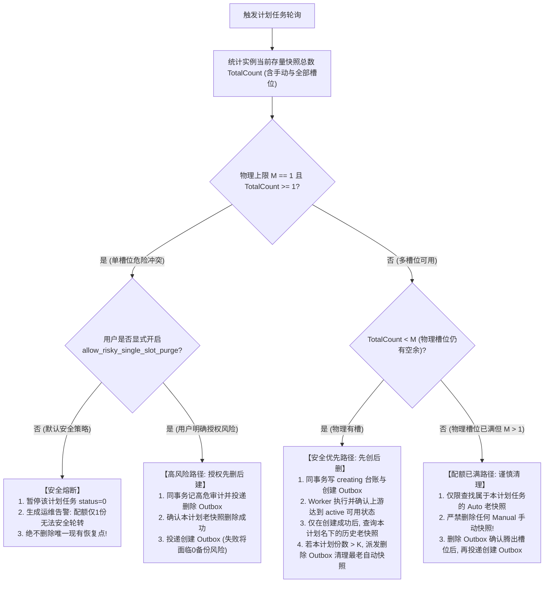

# JianYun (简云) · 实例生命周期、报价锁定期与快照调度契约 (Lifecycle & Pricing Contract)

> [!IMPORTANT]
> **本契约已被正式冻结为核心业务状态机标准。**  
> 明确规范：统一事务行级锁排它竞争、Task-as-Lock 未决业务占用与 Worker 租约分离、续费与销毁共同排他协议、挂起类型风控隔离、全额配额计算与快照创建/删除 Outbox 审计化。

---

**当前魔方代理实施边界（2026-11-09）**：下方完整生命周期含未来销毁设计。当前只读核对上游服务；到期不在简云生成停机／释放任务。明确 due 暂停才归 billing，续费付款保留暂停，原 Worker 确认远端目标日期及 Active 才恢复；未知或非财务暂停持久核验。单独看到 Active 也不能解除独立本地限制，见[本批契约](M2_EXPIRY_RECOVERY.md)。

## 1. 实例生命周期互斥状态机与 Task-as-Lock 体系

实例在整个生命周期中，**绝不允许续费、变配、暂停、销毁、备份等并发动作产生状态踩踏**。系统采用 **Task-as-Lock（任务即锁）** 极简架构，以 `tasks` 的未决业务状态作为任务执行占用单一事实来源。业务准入同时检查正常消费账单的退款冻结，不复制为第二份任务锁；租约到期不释放未决业务占用：



### 1.1 Task-as-Lock 互斥协议
简云不维护 `instances.locked_at` 与 `instances.lock_token`。统一任务 blocker 为 `pending + power/reinstall`、`running` / `investigating`，或 `failed + MANUAL_AUDIT_REQUIRED`，判断中不附加租约条件。所有入队、领取、接管、续租、结果回写和人工裁决均按“先锁实例，再锁任务”执行；持实例锁时，还必须核验下述退款业务冻结。完整协议见 [TASKS_OUTBOX.md](TASKS_OUTBOX.md) §2–§3。

```sql
START TRANSACTION;
SELECT `id` FROM `instances` WHERE `id` = :instance_id FOR UPDATE;
-- 先按 TASKS_OUTBOX §2.4 当前读检查云消费退款冻结及待销毁退款归属；
-- 普通 pending 任务须等待退款终态，不能只因任务 blocker 为空就领取。

-- 1. 当前锁定读：领取/接管排除当前任务自身，新动作入队检查全部任务
SELECT `id`, `action`, `worker_id`, `lease_until`
FROM `tasks`
WHERE `instance_id` = :instance_id
  AND `id` <> :task_id
  AND (`status` IN ('running', 'investigating')
    OR (`status` = 'pending' AND `action` IN ('power','reinstall'))
    OR (`status` = 'failed' AND `last_error` LIKE 'MANUAL_AUDIT_REQUIRED:%'))
ORDER BY `id` FOR UPDATE;
-- 有其他 blocker 则 ROLLBACK，不能因其租约过期而领取新任务

-- 2. 领取 pending 任务；affected_rows 必须为 1 才提交并调用上游
SELECT `id` FROM `tasks` WHERE `id` = :task_id AND `instance_id` = :instance_id FOR UPDATE;
UPDATE `tasks`
SET `status` = 'running',
    `worker_id` = :worker_id,
    `execution_token` = `execution_token` + 1,
    `lease_until` = DATE_ADD(UTC_TIMESTAMP(), INTERVAL 5 MINUTE),
    `updated_at` = UTC_TIMESTAMP()
WHERE `id` = :task_id 
  AND `instance_id` = :instance_id
  AND `status` = 'pending'
  AND (`next_retry_at` IS NULL OR `next_retry_at` <= UTC_TIMESTAMP());
COMMIT;

-- 3. 心跳续租是独立短事务，同样先锁实例、再锁当前任务
-- 每 2 分钟续约；影响行数不为 1 时停止工作并进入接管/调查流程
UPDATE `tasks`
SET `lease_until` = DATE_ADD(UTC_TIMESTAMP(), INTERVAL 5 MINUTE),
    `updated_at` = UTC_TIMESTAMP()
WHERE `id` = :task_id 
  AND `instance_id` = :instance_id
  AND `worker_id` = :worker_id 
  AND `execution_token` = :acquired_token
  AND `status` IN ('running', 'investigating')
  AND `lease_until` > UTC_TIMESTAMP();

-- 4. 完成也在先锁实例、再锁任务的事务内执行，并同事务应用实例/台账结果
UPDATE `tasks`
SET `status` = 'success',
    `lease_until` = NULL,
    `payload` = :final_payload,
    `updated_at` = UTC_TIMESTAMP()
WHERE `id` = :task_id 
  AND `instance_id` = :instance_id
  AND `worker_id` = :worker_id
  AND `execution_token` = :acquired_token
  AND `status` IN ('running', 'investigating')
  AND `lease_until` > UTC_TIMESTAMP();
-- affected_rows 必须为 1，否则整个事务回滚，不得更新实例/台账
```
- **核心保证**：回写同时需要正确 Worker、最新令牌、执行中状态和有效租约；过期执行权不得自行续活。`failed + MANUAL_AUDIT_REQUIRED` 即使无租约也持续阻断，只有独立受审计人工裁决才能安全收口；普通 `completeCreate()` 的租约门禁不因此放宽。
- **退款冻结跨域门禁**：正常云消费退款认领先持实例锁检查未决任务，已有任务执行中或人工核验中则拒绝认领。认领后的主账单 `refund_pending` 阻断所有新动作与既有 `pending` 任务领取，包括快照、变配、续费；迟到/多收钱包款退款不修改父账单，不触发此冻结。明确拒绝并按原状态安全恢复后，等待任务重新检查领取资格；结果未知继续冻结。退款成功须在同一终态 CAS 事务内将主账单 `refund_pending -> refunded`、令全部旧 `pending` 任务失效并禁止重试，再写入本退款唯一 `terminate`；销毁确认前保持该退款号关联的关停冻结，仅放行对应销毁。接管或回写发现退款冻结与其他在途任务冲突时转人工核对，不能自动推进或放行新动作。已终止实例禁止执行非 `terminate` 任务。

---

## 2. 协议一：续费与销毁共同事务竞争规则与到期日分立

### 2.1 共同行级锁互斥边界（Strict Row-Lock Ordering）
为彻底消灭“支付处理器查到 pending 销毁任务，但 Worker 在其取消前已抢占为 running”的严重竞态：

> [!CAUTION]
> **绝对锁定顺序铁律**：  
> **支付处理器（续费付款）与销毁 Worker（执行下线销毁）必须先以完全相同的顺序锁定同一实例行！**

#### 步骤 1：加锁与状态提取
```sql
-- 支付处理事务与销毁 Worker 事务，起始第一句强制执行：
SELECT `id`, `status`, `suspend_type`, `due_date` 
FROM `instances` 
WHERE `id` = :instance_id 
FOR UPDATE;
```

#### 步骤 2：支付处理器的互斥决策树
在持有 `instances FOR UPDATE` 锁后，支付处理器联合查询销毁任务：
```sql
SELECT `id`, `action`, `status`, `payload` 
FROM `tasks` 
WHERE `instance_id` = :instance_id 
  AND `action` = 'terminate' 
FOR UPDATE;
```
- **分支 2.1：存在未决销毁任务（`running` / `investigating`，或 `failed + MANUAL_AUDIT_REQUIRED`；不论租约是否过期）**：
  - **判定**：销毁指令已在途中或已调用上游，触碰不可逆安全分界线；
  - **处置**：**坚决阻断续费**！账单标记为 `refunded`；
  - **资金安全落库**：付进来的款项原路转入用户钱包可用余额 (`transactions` account `wallet`, type `refund_to_balance`)；
  - **机器状态**：保持原状态，绝不延长到期日；
  - **通知**：向前台告警：“实例已进入不可逆注销下线流程，续费金额已全额转入您的钱包可用余额”。
- **分支 2.2：存在待执行的销毁任务 (`status = 'pending'`)**：
  - **判定销毁原因**：检查 `tasks.payload.termination_reason`：
    - 若为 `'user_voluntary'`（用户主动退订）或 `'admin_abuse'`（违规封禁清退）：**禁止续费取消**！转为上述退款至钱包流程；
    - 若为 `'billing_overdue'`（纯欠费停机）：允许尝试取消销毁任务。
  - **原子取消与受影响行数校验**：
    ```sql
    UPDATE `tasks` 
    SET `status` = 'failed', `last_error` = 'CANCELLED_BY_RENEWAL' 
    WHERE `id` = :terminate_task_id AND `status` = 'pending';
    ```
    - **若 `affected_rows === 1`**：取消成功！继续推进续费；
    - **若 `affected_rows === 0`**：说明恰好在锁升级前被抢占为 running，取消失败！**立即回滚续费操作，转为退回钱包余额，绝不允许延长到期日**。
- **其他动作的未决占用**：除上述销毁专用资金保护分支外，仍须检查 §1.1 的全部 blocker。实例有其他未决动作时，自动代扣保留未付账单等待，不扣钱包；已收到的网关实收款按支付契约安全转入钱包，禁止并发派发续费覆盖未知结果。

### 2.2 权益到期日与上游同步交付解耦
**新购与续费分开起算**：新购 `pending` 实例的 `start_date`、`due_date` 均为 `NULL`，即使付款成功也不提前起租；交付成功时由 `InstanceActivationService::completeCreate()` 在任务完成同一事务中填入实际 UTC 起租时间，并按自然月/年、对齐月末生成首期到期日。以下付款顺延规则适用于已交付实例的续费，不用于新购占位实例。

为杜绝“用户一付款，上游尚未续费成功，系统就错误地直接恢复 active 并对外提供网络”的安全隐患：
1. **已购买权益到期日 (`instances.due_date`) 与顺延基准**：
   - 续费付款成功瞬间在支付事务内直接累加 `instances.due_date`，作为财务履约凭证；
   - **顺延基准铁律**：续费必须严格基于实例原 `due_date`（`DATE_ADD(due_date, INTERVAL 1 MONTH / 1 YEAR)`）顺延，绝不以付款时刻 `UTC_TIMESTAMP()` 起算，确保宽限期内逾期续费与上游账期 100% 对齐；
   - **唯一键释放与变配联动**：任何携带 `cycle_marker` 的账单在流转为 `cancelled`（或 SC-L02 阻断续费转为 `refunded`）时，必须同步置 `cycle_marker = NULL` 释放唯一键槽位；实例发生升降级或后台 `override_price` 改价时，必须同事务取消在途未付的 `renew` 账单并清空其 `cycle_marker`。
2. **实例运行状态解耦（单任务续费解挂合一）**：
   - 付款成功后，若实例先前处于 `suspend_type = 'billing'` 暂停状态，系统**不直接改为 `active`**，也不拆分为两条独立任务（防止 `unsuspend` 先于 `renew` 被抢占导致乱序报错），而是生成**单条** `action = 'renew'` 的 Outbox 任务，并在其 `payload` 中固化 `{"target_due_date": "...", "needs_unsuspend": true}`；
   - Outbox Worker 执行该 `renew` 任务时，先调用上游 `driver->renew()`，若 `needs_unsuspend === true` 则紧接着调用 `driver->unsuspend()`；只有当上游明确确认成功后，才在 Fencing Token 原子事务内将 `instances.status` 改为 `active`；
   - 若上游接口超时或失败，任务进入 `investigating`，实例继续保持 `suspended`，绝不上演“未续费先通网”的虚假交付。

### 2.3 挂起类型风控隔离 (`instances.suspend_type`)
- `billing`: 纯财务欠费暂停；
- `compliance`: 管理员因合规/实名/备案下发的人工暂停；
- `abuse`: 安全网关/上游通报的 DDoS/暴力破解/发信违规暂停；
- `manual`: 运维临时维护或历史割接未核准资产手动暂停。

> [!CAUTION]
> **交清续费仅可自动解挂 `suspend_type = 'billing'`！**  
> 若实例处于 `compliance`、`abuse` 或 `manual` 状态，支付成功后**仅累加其 `due_date`，实例依然保持 `suspended` 挂起状态**，并在前台提示用户联系客服处理合规工单，绝不允许财务缴费绕过安全风控！

---

### 2.4 管理员后续续费改价（2026-11-09已实现）

原实例详情展示原冻结recurring_price、可空override_price及有效价；恢复只清空覆盖，不读取当前商品价。当前启用super_admin带版本与依据操作，finance只读。先锁实例并检查任务／资金门禁，同事务修改覆盖价、将归属一致的unpaid renew单CAS作废、清空cycle_marker并写审计；所有pending任务也阻断改价。已付账单、已购账期及原资源保持，后续由原出账器生成新价账单。

与付款／代扣共用实例锁：改价先提交，旧单迟到实收按原凭证幂等入钱包，不派旧价renew；付款先提交则保留旧价已购权益，在途任务阻断改价，履约后刷新版本再调整后续价格。最新改价审计ID参与版本以拒绝ABA。无补差、变配、退款或迁移，变更原因、受影响模块及1250项隔离检查／34项页面证据见 [改价契约](M2_INSTANCE_RENEWAL_PRICE.md)。

### 2.5 已完成手工变配的单期余额补差

单独入口在实际变配完成后由超级管理员预览／确认，以当前单个原已付且履约成功账单为依据，不能取当前override_price当本期已付价。原自然周期实际剩余秒数折算、先乘后除、最后舍入至分；同周期既往补差高水位不重收，降价无自动退款。多期预付、首期无法拆分费用、历史改期或旧补差无法证明时明确拒绝。结清、未来override_price、原未付续费单作废／标记释放及审计同事务，资源／账期／冻结价保持，不投upgrade任务。该审计同样参与未来改价ABA版本。详见[人工补差契约](M2_MANUAL_ADJUSTMENT.md)。

### 当前固定商品续费的实施限制

M2 后续已实现一个原月/年账期、唯一账单、付款与 renew Outbox、提前 7 天出账和每 15 分钟余额代扣。周期请求使用原到期日防重，见 [续费契约](M2_RENEWAL_CONTRACT.md)。当前魔方驱动的收款可能自动解挂，无法可靠保留上游非财务暂停，因此仅支持 active / suspended+billing 的自动准入；§2.3 对其他暂停可按政策续费的能力仍待实现，当前交人工处理，不以付款恢复服务。欠费暂停须上游目标日期和 Active 均确认后才本地恢复；未知只读调查。

## 3. 协议一失败场景与预期结果矩阵

| 场景编号 | 场景描述 | 竞态触发时序 | 系统预期动作与终态 |
|---|---|---|---|
| **SC-L01** | 欠费销毁排队中，用户完成续费 | 支付事务加锁，销毁任务尚为 `pending` | 原子取消销毁任务 (`affected_rows=1`)；顺延 `due_date`；派发 Outbox 解挂任务；上游确认后恢复 `active` |
| **SC-L02** | 销毁已在 Worker 执行中，用户刚好扫码付款 | 支付事务加锁，发现销毁任务已为 `running` | 阻断续费；账单置为 `refunded`；续费金额转入钱包 `balance`；销毁正常执行；通知用户机器已下线 |
| **SC-L03** | 销毁任务刚刚被 Worker 抢占，取消操作返回 0 行 | 支付发起 `UPDATE tasks ... status='pending'` 返回 0 行 | 立即触发回滚；转入场景 SC-L02 钱包退款保护；严禁顺延 `due_date` |
| **SC-L04** | 用户主动退订销毁申请，随后又在待支付账单续费 | 实例关联的销毁任务为 `user_voluntary` | 拒绝自动取消主动注销；续费账单退回钱包余额；维持注销下线流程 |
| **SC-L05** | 合规/滥用被封停机器，用户付清了续费账单 | `instances.suspend_type = 'compliance'` | 顺延到期日 `due_date`；**实例继续保持 suspended 状态**；不派发上游解挂任务；前台提示联系人工审核 |
| **SC-L06** | 销毁 Worker 失联且租约过期，续费或快照任务到达 | 原销毁任务仍为 `running` / `investigating` | 原任务继续占用实例；续费使用 SC-L02 钱包保护，快照不得领取；只允许接管原任务调查 |
| **SC-L07** | 销毁结果不可查询并转人工核验失败 | `failed + MANUAL_AUDIT_REQUIRED`，`lease_until = NULL` | 仍视为未决销毁，不接受续费解挂或其他变更；须先完成人工裁决 |

---

## 4. 报价锁定机制与过期支付处置 (Price Lock & Expired Quotes)

1. **按账单类型区分的报价锁定期 (`quote_expired_at`)**：
   - **`new`（新购）与规划中的自动 `upgrade`（弹性升级补差）**：客户端下单时，系统执行 Pre-flight 预检，将当时规格明细、基准价、加价与汇率固化入 `invoices.price_snapshot`，并设定 30 分钟报价有效期 `quote_expired_at = UTC_TIMESTAMP() + INTERVAL 30 MINUTE`；超过 30 分钟未支付的账单，由 `invoices:expire` 自动取消并释放预留库存。
   - **`renew`（实例续费）与 `recharge`（钱包充值）**：续费价格取自实例已固化的 `COALESCE(override_price, recurring_price)`，不受上游购物车动态波动影响，因此 **`quote_expired_at` 置为 `NULL`**，支持提前 7 天出账并持续等待客户充值自动代扣（仅在实例发生变配、后台改价或最终逾期销毁时才作废未付续费单）。
2. **已生成二维码后报价超期的支付处理 (Expired Quote In-Flight)**：
   - 用户在报价过期前打开了支付宝二维码，但在第 35 分钟才扫码扣款成功（此时账单可能已被 `invoices:expire` 置为 `cancelled`，或报价已超期）：
   - 回调处理器严格遵循 `PAYMENTS.md` §2 的分流规则：若账单已被取消或上游已涨价/售罄，系统在同一事务内将 `payment_records.status` 记为 `'late_credited_to_balance'`，并将该笔实收款全额转充入用户的**钱包可用余额** (`transactions.type = 'late_payment_credit'`)，绝不产生吞款或账实不一致。

---

## 5. 云快照与备份安全调度规范（物理配额全额计数模型）

### 5.1 槽位全额统计定义
- **物理允许最大槽位数**：$M$（由商品规格配置指定，如节点支持最多 4 份）；
- **当前存量总份数**：$TotalCount = Count(ManualSnapshots) + Count(AutoSnapshots) + Count(OtherSnapshots)$；
- **用户设定保留份数**：$K$（如计划任务要求保留 2 份）。



### 5.2 计划任务快照归属凭证
- **创建前占位**：创建请求先落 `instance_snapshots` 台账（`status='creating'`、`remote_snapshot_id=NULL`），并关联 `instance_id`、`type` 与计划 `schedule_id`；再同事务写入创建 Outbox 和推进 `next_run_at`。唯一任务键冲突必须使整笔事务回滚，撤销新台账与调度推进，不能捕获冲突后继续提交孤立占位。
- **创建成功回写**：Worker 确认上游可用后，以有效执行租约和令牌，同事务写任务成功及台账 `remote_snapshot_id` / `status='active'`；未知结果保留原任务与占位台账，执行反查或转人工核验，重试不得另建占位。
- **远端标识作用域**：台账唯一约束为 `(instance_id, type, remote_snapshot_id)`；不同实例、上游或快照/备份类型可以出现相同远端 ID。Provider 归属从实例解析并在执行时核对，不能把远端 ID 当成全局标识。
- 滚动清理候选**严格仅限于当前 `schedule_id` 下产生的历史记录**，严禁使用模糊名称匹配，防止误删用户手动备份或同一实例其他计划的备份。

### 5.3 快照创建/删除 Outbox 化与高风险轮转审计
- **创建必须 Outbox 化**：手动和计划任务分别按资源类型派发 `snapshot_create` / `backup_create`，禁止 HTTP 或调度扫描器直接创建远端资源。计划任务幂等键为 `{action}:schedule:{schedule_id}:{scheduled_at_UTC_YYYYMMDDHHmmss}`，其中时间取本次原定 UTC 调度时刻；手动幂等键为 `{action}:manual:{instance_id}:{client_token}`。必须限制 token 长度使完整键不超过 100 字符；重复请求复用原任务/台账，不重新分配调度时刻或 token。
- **删除必须 Outbox 化**：按台账 `type` 派发 `snapshot_delete` / `backup_delete`，两类删除统一使用幂等键 `snapshot_delete:{instance_snapshots.id}`（本地台账 ID），严禁以远端 ID 作为全局任务键。同事务将台账置为 `deleting` 并投递任务；上游确认删除且任务终态安全提交后才标记台账 `deleted` 并释放配额。
- **payload 与执行归属核验**：创建携带本地台账 ID、`provider_id`、`instance_id`、`type`、`schedule_id` 和固化参数；删除额外携带 `remote_snapshot_id`。Worker 先核对任务所属实例、台账归属、类型、远端 ID、实例当前 Provider 与 payload 一致，再选择该 Provider 的凭据和驱动；任一不符应阻断并告警，禁止使用其他实例的相同远端 ID 执行删除。
- **配额与轮转依赖**：`creating`、`active`、`deleting` 均占用槽位；按真实远端存量与在途创建保留量核算，重叠部分不能重复计数。先创后删必须等待创建已确认可用；先删后创必须等待删除已确认且重新核查槽位，不能同时排队假定成功。后续轮转步骤由确认结果后的调度事务幂等投递。
- **未知结果恢复**：创建与删除均遵循 [TASKS_OUTBOX.md](TASKS_OUTBOX.md) 的幂等键、查询权威度、租约接管及持续 blocker 协议；超时先调查，不能将超时视为明确失败盲重试或释放槽位。
- **单槽位高风险轮转审计**：当命中 `allow_risky_single_slot_purge = 1` 执行先删后建路径时，系统在派发清理任务的同一事务内更新 `instance_snapshot_schedules.last_risky_purge_at = UTC_TIMESTAMP()` 并写高危审计记录。保留来源与计划归属限制，显式授权不允许删除其他计划或手动恢复点。

### 5.4 快照故障与隔离验收矩阵

| 场景编号 | 故障或冲突 | 预期结果 |
|---|---|---|
| **SC-S01** | 不同实例或 snapshot/backup 返回相同远端 ID | 复合唯一约束允许各自入账；删除以本地台账 ID 去重，只操作经 Provider/实例/类型核验的资产 |
| **SC-S02** | 同一计划时刻被重复扫描或手动请求重复提交 | 唯一创建任务键冲突使新增台账、任务、调度推进整笔回滚，复用原任务与台账，不重复创建远端资源 |
| **SC-S03** | 上游创建成功但 Worker 在本地回写前崩溃 | 原 `creating` 台账保留，过期租约不解除业务占用；接管原任务反查，确认后原子回填，禁止另建任务盲重试 |
| **SC-S04** | 删除超时或不可反查 | 保留 `deleting` 台账与配额占用；调查或转受保护人工核验，不启动依赖腾出槽位的新创建 |
| **SC-S05** | 删除 payload 指向其他 Provider/实例或类型不符 | Worker 在调用上游前阻断并告警；不能凭同名远端 ID 跨实例删除 |


M2 独立枚举配置销售已将首期价与周期续费价分别冻结；新实例 recurring_price 使用上游 signal_price 经本地加价后的售价，初装费不进入续费成本。商品目录刷新不会重定价已有实例/账单，旧固定套餐保持既有值；详见 [配置销售契约](M2_CONFIG_SALES.md)。
