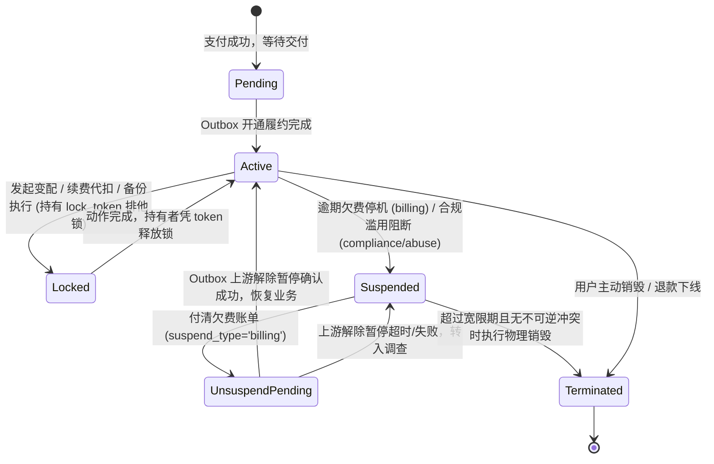
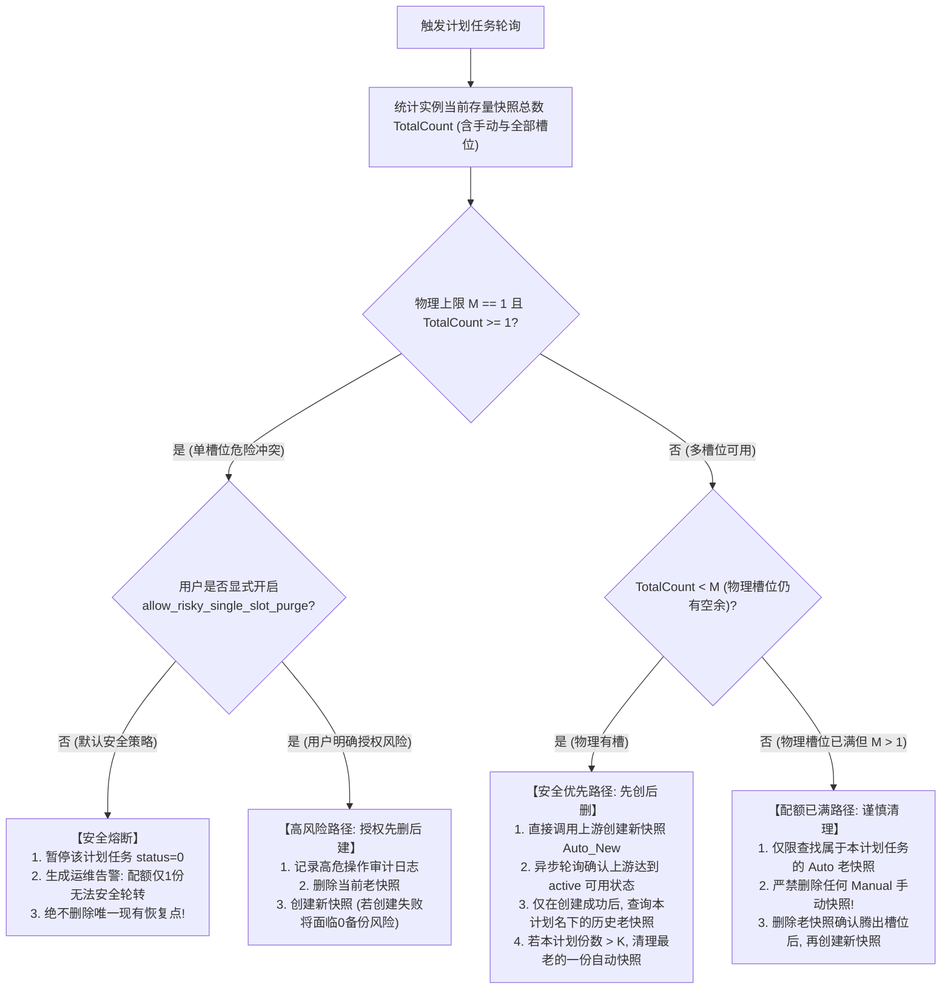

# JianYun (简云) · 实例生命周期、报价锁定期与快照调度契约 (Lifecycle & Pricing Contract)

> [!IMPORTANT]
> **本契约已被正式冻结为核心业务状态机标准。**  
> 明确规范：统一事务行级锁排它竞争、Lock Token 锁防误清、续费与销毁共同排他协议、挂起类型风控隔离、全额配额计算与单槽位安全熔断。

---

## 1. 实例生命周期互斥状态机与 Lock Token 防护

实例在整个生命周期中，**绝不允许续费、变配、暂停、销毁、备份等并发动作产生状态踩踏**：



### 1.1 排他锁所有者令牌机制 (`instances.lock_token`)
为解决“A 任务执行超时被 B 接管后，A 返回并在 `finally` 中误清空 B 的锁”的严重并发漏洞，引入 UUID 锁持有者令牌：

```sql
-- 1. 尝试原子抢占锁 (生成唯一 UUID 作为 lock_token)
UPDATE `instances` 
SET `locked_at` = NOW(),
    `lock_token` = :worker_generated_uuid
WHERE `id` = :instance_id 
  AND (`locked_at` IS NULL OR `locked_at` < DATE_SUB(NOW(), INTERVAL 10 MINUTE));

-- 2. 检查影响行数 (affected_rows)
-- 若为 0，说明被其他任务持有且未过期，当前任务自动退避并延后重试。

-- 3. 长任务续约心跳 (针对大盘备份或耗时变配，每 3 分钟执行一次)
UPDATE `instances` 
SET `locked_at` = NOW() 
WHERE `id` = :instance_id 
  AND `lock_token` = :worker_generated_uuid;

-- 4. 仅持有者可安全释放锁 (在 finally 块中执行)
UPDATE `instances` 
SET `locked_at` = NULL,
    `lock_token` = NULL 
WHERE `id` = :instance_id 
  AND `lock_token` = :worker_generated_uuid;
```
- **核心保证**：若 A 任务耗时超过 10 分钟且未续约导致锁被 B 接管，A 在 `finally` 执行释放时因 `lock_token != :worker_a_uuid` 影响行数为 0，**绝不会清掉 B 的锁**！

---

## 2. 协议一：续费与销毁共同事务竞争规则与到期日分立

### 2.1 共同行级锁互斥边界（Strict Row-Lock Ordering）
为彻底消灭“支付处理器查到 pending 销毁任务，但 Worker 在其取消前已抢占为 running”的严重竞态：

> [!CAUTION]
> **绝对锁定顺序铁律**：  
> **支付处理器（续费付款）与销毁 Worker（执行下线销毁）必须先以完全相同的顺序锁定同一实例行！**

#### 步骤 1：加锁与状态提取
```sql
-- 支付处理事务与销毁 Worker 事务，起始第一句强制执行：
SELECT `id`, `status`, `suspend_type`, `due_date`, `locked_at`, `lock_token` 
FROM `instances` 
WHERE `id` = :instance_id 
FOR UPDATE;
```

#### 步骤 2：支付处理器的互斥决策树
在持有 `instances FOR UPDATE` 锁后，支付处理器联合查询销毁任务：
```sql
SELECT `id`, `action`, `status`, `payload` 
FROM `tasks` 
WHERE `instance_id` = :instance_id 
  AND `action` = 'terminate' 
FOR UPDATE;
```
- **分支 2.1：存在已认领的销毁任务 (`status IN ('running', 'investigating')`)**：
  - **判定**：销毁指令已在途中或已调用上游，触碰不可逆安全分界线；
  - **处置**：**坚决阻断续费**！账单标记为 `refunded`；
  - **资金安全落库**：付进来的款项原路转入用户钱包可用余额 (`transactions` account `wallet`, type `refund_to_balance`)；
  - **机器状态**：保持原状态，绝不延长到期日；
  - **通知**：向前台告警：“实例已进入不可逆注销下线流程，续费金额已全额转入您的钱包可用余额”。
- **分支 2.2：存在待执行的销毁任务 (`status = 'pending'`)**：
  - **判定销毁原因**：检查 `tasks.payload.termination_reason`：
    - 若为 `'user_voluntary'`（用户主动退订）或 `'admin_abuse'`（违规封禁清退）：**禁止续费取消**！转为上述退款至钱包流程；
    - 若为 `'billing_overdue'`（纯欠费停机）：允许尝试取消销毁任务。
  - **原子取消与受影响行数校验**：
    ```sql
    UPDATE `tasks` 
    SET `status` = 'failed', `last_error` = 'CANCELLED_BY_RENEWAL' 
    WHERE `id` = :terminate_task_id AND `status` = 'pending';
    ```
    - **若 `affected_rows === 1`**：取消成功！继续推进续费；
    - **若 `affected_rows === 0`**：说明恰好在锁升级前被抢占为 running，取消失败！**立即回滚续费操作，转为退回钱包余额，绝不允许延长到期日**。

### 2.2 权益到期日与上游同步交付解耦
为杜绝“用户一付款，上游尚未续费成功，系统就错误地直接恢复 active 并对外提供网络”的安全隐患：
1. **已购买权益到期日 (`instances.due_date`)**：付款成功瞬间累加，作为财务履约凭证；
2. **实例运行状态解耦**：
   - 付款成功后，若实例先前处于 `suspend_type = 'billing'` 暂停状态，系统**不直接改为 `active`**，而是生成一个 `unsuspend` 及 `renew` 的 Outbox 任务；
   - 只有当 Outbox Worker 收到上游驱动返回明确成功响应后，才将 `instances.status` 改为 `active` 并解除暂停；
   - 若上游接口超时或失败，任务进入 `investigating`，实例继续保持 `suspended`，绝不上演“未续费先通网”的虚假交付。

### 2.3 挂起类型风控隔离 (`instances.suspend_type`)
- `billing`: 纯财务欠费暂停；
- `compliance`: 管理员因合规/实名/备案下发的人工暂停；
- `abuse`: 安全网关/上游通报的 DDoS/暴力破解/发信违规暂停；
- `manual`: 运维临时维护手动暂停；
- `migration`: 割接历史遗留未确认资产挂起。

> [!CAUTION]
> **交清续费仅可自动解挂 `suspend_type = 'billing'`！**  
> 若实例处于 `compliance`、`abuse`、`manual` 或 `migration` 状态，支付成功后**仅累加其 `due_date`，实例依然保持 `suspended` 挂起状态**，并在前台提示用户联系客服处理合规工单，绝不允许财务缴费绕过安全风控！

---

## 3. 协议一失败场景与预期结果矩阵

| 场景编号 | 场景描述 | 竞态触发时序 | 系统预期动作与终态 |
|---|---|---|---|
| **SC-L01** | 欠费销毁排队中，用户完成续费 | 支付事务加锁，销毁任务尚为 `pending` | 原子取消销毁任务 (`affected_rows=1`)；顺延 `due_date`；派发 Outbox 解挂任务；上游确认后恢复 `active` |
| **SC-L02** | 销毁已在 Worker 执行中，用户刚好扫码付款 | 支付事务加锁，发现销毁任务已为 `running` | 阻断续费；账单置为 `refunded`；续费金额转入钱包 `balance`；销毁正常执行；通知用户机器已下线 |
| **SC-L03** | 销毁任务刚刚被 Worker 抢占，取消操作返回 0 行 | 支付发起 `UPDATE tasks ... status='pending'` 返回 0 行 | 立即触发回滚；转入场景 SC-L02 钱包退款保护；严禁顺延 `due_date` |
| **SC-L04** | 用户主动退订销毁申请，随后又在待支付账单续费 | 实例关联的销毁任务为 `user_voluntary` | 拒绝自动取消主动注销；续费账单退回钱包余额；维持注销下线流程 |
| **SC-L05** | 合规/滥用被封停机器，用户付清了续费账单 | `instances.suspend_type = 'compliance'` | 顺延到期日 `due_date`；**实例继续保持 suspended 状态**；不派发上游解挂任务；前台提示联系人工审核 |

---

## 4. 报价锁定机制与过期支付处置 (Price Lock & Expired Quotes)

1. **账单报价锁定期 (`quote_expired_at`)**：
   - 客户端下单时，系统执行 Pre-flight 预检，将当时规格明细、基准价、加价与汇率固化入 `invoices.price_snapshot`；
   - 设定明确报价有效期：`quote_expired_at = NOW() + INTERVAL 30 MINUTE`；
   - 超过 30 分钟未支付的账单，再次在前端点击支付必须强制触发 Re-quote 重新核价。
2. **已生成二维码后报价超期的支付处理 (Expired Quote In-Flight)**：
   - 用户在报价过期前打开了支付宝二维码，但在第 35 分钟才扫码扣款成功（网关实际收款）：
   - 回调处理器比对 `quote_expired_at < paid_at`：
     - **上游价格与库存未变动**：系统承保交付，正常交付开通；
     - **上游已涨价或售罄**：系统自动将该笔实收款转充入用户的**钱包可用余额** (`late_payment_credit`)，账单标记为 `refunded`，并附赠关怀礼券，绝不产生账实不一致。

---

## 5. 云快照与备份安全调度规范（物理配额全额计数模型）

### 5.1 槽位全额统计定义
- **物理允许最大槽位数**：$M$（由商品规格配置指定，如节点支持最多 4 份）；
- **当前存量总份数**：$TotalCount = Count(ManualSnapshots) + Count(AutoSnapshots) + Count(OtherSnapshots)$；
- **用户设定保留份数**：$K$（如计划任务要求保留 2 份）。



### 5.2 计划任务快照归属凭证
- 每次快照创建成功后，必须将上游返回的 `remote_snapshot_id` 与本计划任务 ID 严格关联存储；
- 滚动清理候选**严格仅限于当前 `schedule_id` 下产生的历史记录**，严禁使用模糊名称匹配，防止误删用户手动备份或同一实例其他计划的备份。
