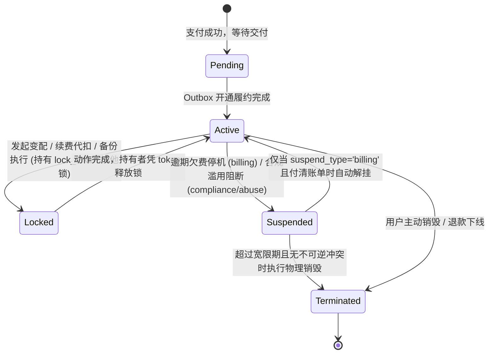
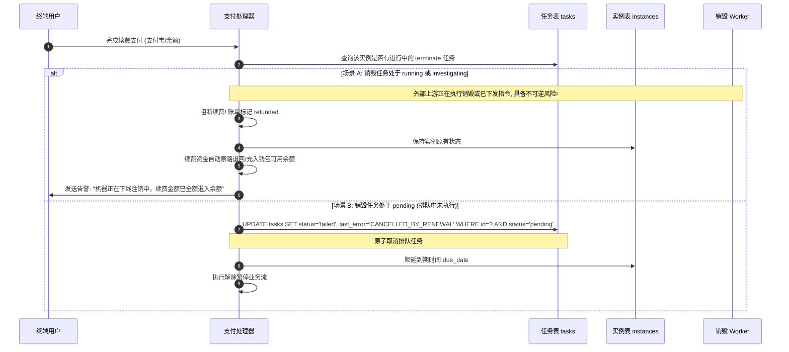
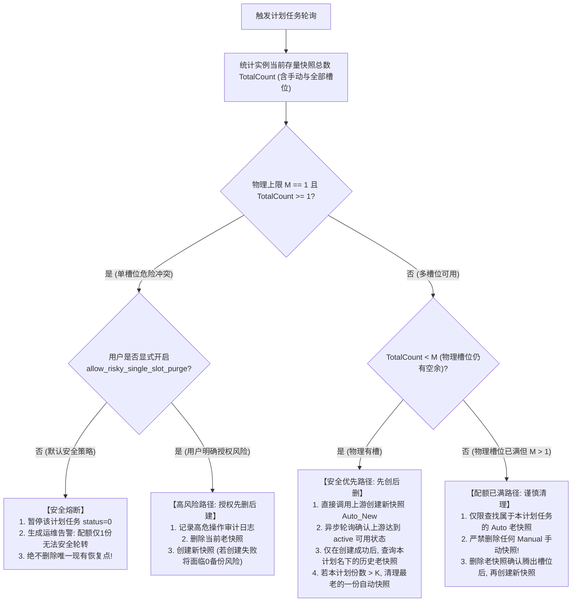

# JianYun (简云) · 实例生命周期、报价锁定期与快照调度契约 (Lifecycle & Pricing Contract)

> [!IMPORTANT]
> 本契约规范了实例全生命周期的并发互斥排他、锁持有者令牌防护、续费与销毁竞态消除、合规挂起安全边界以及快照全额配额计算。

---

## 1. 实例生命周期互斥状态机与 Lock Token 防护

实例在整个生命周期中，**绝不允许续费、变配、暂停、销毁、备份等并发动作产生状态踩踏**：



### 1.1 排他锁所有者令牌机制 (`instances.lock_token`)
为解决“A 任务执行超时被 B 接管后，A 返回并在 `finally` 中误清空 B 的锁”的严重并发漏洞，引入 UUID 锁持有者令牌：

```sql
-- 1. 尝试原子抢占锁 (生成唯一 UUID 作为 lock_token)
UPDATE `instances` 
SET `locked_at` = NOW(),
    `lock_token` = :worker_generated_uuid
WHERE `id` = :instance_id 
  AND (`locked_at` IS NULL OR `locked_at` < DATE_SUB(NOW(), INTERVAL 10 MINUTE));

-- 2. 检查影响行数 (affected_rows)
-- 若为 0，说明被其他任务持有且未过期，当前任务自动退避并延后重试。

-- 3. 长任务续约心跳 (针对大盘备份或耗时变配，每 3 分钟执行一次)
UPDATE `instances` 
SET `locked_at` = NOW() 
WHERE `id` = :instance_id 
  AND `lock_token` = :worker_generated_uuid;

-- 4. 仅持有者可安全释放锁 (在 finally 块中执行)
UPDATE `instances` 
SET `locked_at` = NULL,
    `lock_token` = NULL 
WHERE `id` = :instance_id 
  AND `lock_token` = :worker_generated_uuid;
```
- **核心保证**：若 A 任务耗时超过 10 分钟且未续约导致锁被 B 接管，A 在 `finally` 执行释放时因 `lock_token != :worker_a_uuid` 影响行数为 0，**绝不会清掉 B 的锁**！

---

## 2. 关键冲突竞态消除规则

### 2.1 续费与销毁并发竞态消除
当实例因欠费进入宽限期末期，调度器排队了 `terminate` 销毁任务，而此时用户刚好完成了续费支付：



- **销毁 Worker 执行前复核**：
  在销毁 Worker 真正调用上游 API 之前，必须执行最终复核：
  ```sql
  SELECT `status`, `due_date`, `suspend_type` FROM `instances` WHERE `id` = :instance_id;
  ```
  若发现 `due_date > NOW()`，表明最后一刻被成功续费，Worker 立即放弃调用上游销毁，将本任务置为 `failed`（标记 `CANCELLED_DUE_DATE_EXTENDED`）。

### 2.2 挂起原因类型隔离 (`instances.suspend_type`)
在 `instances` 表中，通过 `suspend_type` 严格区分停机原因：
- `billing`: 纯财务欠费暂停；
- `compliance`: 管理员因合规/实名/备案下发的人工暂停；
- `abuse`: 安全网关/上游通报的 DDoS/暴力破解/发信违规暂停；
- `manual`: 运维临时维护手动暂停；
- `migration`: 割接历史遗留未确认资产挂起。

> [!CAUTION]
> **交清续费仅可自动解挂 `suspend_type = 'billing'`！**  
> 若实例处于 `compliance`、`abuse`、`manual` 或 `migration` 状态，支付成功后**仅累加其 `due_date`，实例依然保持 `suspended` 挂起状态**，并在前台提示用户联系客服处理合规工单，绝不允许财务缴费绕过安全风控！

---

## 3. 报价锁定机制与超卖补偿 (Price Lock & Quota Guarantee)

1. **账单报价锁定期 (`quote_expired_at`)**：
   - 客户端下单时，系统执行 Pre-flight 预检，将当时规格明细、基准价、加价与汇率固化入 `invoices.price_snapshot`；
   - 设定明确报价有效期：`quote_expired_at = NOW() + INTERVAL 30 MINUTE`；
   - 超过 30 分钟未支付的账单，再次尝试支付前必须强制触发 Re-quote 重新核价。
2. **上游售罄或涨价的熔断赔付**：
   - 付款后若上游因瞬时并发售罄返回 `OUT_OF_STOCK`：
   - 账单置为 `refunded`，金额全额返还至用户**钱包余额**；
   - 自动生成代金券注入用户卡包，并触发退款通知。

---

## 4. 云快照与备份安全调度规范（物理配额全额计数模型）

彻底废除单纯按前缀过滤的配额比对方式，构建**全额槽位统计与单配额安全熔断模型**：

### 4.1 槽位全额统计定义
- **物理允许最大槽位数**：$M$（由商品规格配置指定，如节点支持最多 4 份）；
- **当前存量总份数**：$TotalCount = Count(ManualSnapshots) + Count(AutoSnapshots) + Count(OtherSnapshots)$；
- **用户设定保留份数**：$K$（如计划任务要求保留 2 份）。



### 4.2 计划任务快照归属凭证
- 每次快照创建成功后，必须将上游返回的 `remote_snapshot_id` 与本计划任务 ID 严格关联存储；
- 滚动清理候选**严格仅限于当前 `schedule_id` 下产生的历史记录**，严禁使用模糊名称匹配，防止误删用户手动备份或同一实例其他计划的备份。
