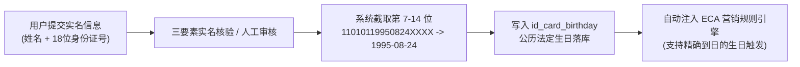

# JianYun (简云) · 自动化营销与规则引擎规范 (Marketing & Rule Engine)

## 1. 架构定位与设计哲学

本系统基于 **ECA（Event-Condition-Action / 事件-条件-动作）** 架构设计通用营销规则引擎。
系统不再针对“生日赠券”、“老客召回”、“注册有礼”编写孤立、硬编码的业务代码，而是抽象出**通用的触发时机、受众过滤指标字典、防扰冷却算法与动作调度器**。管理员可通过管理后台像“搭积木”一样自由组合，秒级上线任意客户生命周期（Customer Lifecycle）营销策略。

---

## 2. 实名认证与法定生日体系

### 2.1 权威数据源：二代身份证解析
为彻底杜绝用户手动填写生日“今天填、明天改、后天改”的薅羊毛作弊，简云将用户生日**严格绑定于中国二代居民身份证实名认证体系**：
- **提取算法**：当用户提交 18 位身份证号码（格式：`AAAAAAYYYYMMDDXXXX`）并通过核验后，系统截取第 7 至 14 位（`YYYYMMDD`），将其格式化为标准的法定公历生日 `YYYY-MM-DD` 存入 `user_verifications.id_card_birthday`。
- **数据保密**：身份证号明文经 **AES-256-GCM** 信封加密存储于数据库，前端页面永远脱敏显示（如 `110101********1234`）。
- **不可篡改性**：实名信息一旦审核通过即锁定，用户无法自行修改；同一个身份证号全局唯一，严禁注册多账号重复认证。



---

## 3. ECA 规则引擎核心架构

```mermaid
flowchart TD
    subgraph Trigger [1. 触发时钟与业务事件 (Trigger)]
        T1["定时跑批: 每日 00:05 定时扫描 (Cron Daily)"]
        T2["业务即时事件: 用户注册 / 实名通过 / 首次付款 (Event Realtime)"]
    end

    subgraph Evaluator [2. 条件过滤器与指标字典 (Condition Evaluator)]
        C_Root{"匹配 JSON DSL 条件树"}
        C_ID["实名与身份: is_verified, is_birthday_today, age"]
        C_Act["活跃与行为: days_since_last_login, registered_days"]
        C_Fin["资产与消费: total_spent, balance, paid_invoices_count"]
        C_Ins["云实例状态: active_instances_count, expired_instances_count"]
        C_Root --> C_ID & C_Act & C_Fin & C_Ins
    end

    subgraph Cooldown [3. 防扰与安全熔断 (Cooldown Guard)]
        CD_Check{"防刷与冷却校验"}
        CD_1["滚动冷却周期: N 天内未触发过该规则"]
        CD_2["自然年防重: 每年仅限 1 次 (生日特权)"]
        CD_3["全局预算上限: 策略总派发上限 (如限量1000份)"]
        CD_Check --> CD_1 & CD_2 & CD_3
    end

    subgraph Action [4. 动作执行与触达 (Action Dispatcher)]
        A_Coupon["派发专属优惠券 user_coupons (动态相对有效期)"]
        A_Notify["多渠道推送: 邮件 / Web Push / 站内通知"]
        A_Log["落库审计日志 marketing_rule_logs"]
    end

    Trigger --> Evaluator
    Evaluator -- 命中受众 --> Cooldown
    Cooldown -- 通过风控 --> Action
```

---

## 4. 内置指标字典 (Condition Attribute Dictionary)

管理员在后台配置策略时，可自由选取并组合以下系统指标：

| 分类 | 属性标识 (`field`) | 类型 | 说明与典型应用 |
| :--- | :--- | :--- | :--- |
| **实名与身份** | `user.is_verified` | `boolean` | 是否已通过实名认证（用于过滤未认证游客） |
| | `user.is_birthday_today` | `boolean` | 实名身份证今天是否生日（精确比对月-日） |
| | `user.age` | `integer` | 实名年龄（用于学生优惠或特定年龄段专享） |
| | `user.registered_days` | `integer` | 注册至今的天数（如注册满 1 年周年庆关怀） |
| **活跃与行为** | `user.days_since_last_login` | `integer` | 距离最后一次登录天数（如 $\ge 30$ 天判定为沉默流失客） |
| | `user.login_count` | `integer` | 历史累计登录次数 |
| **消费与资产** | `user.total_spent` | `decimal` | 历史累计消费总额（如 $\ge 200$ 元筛选高价值付费用户） |
| | `user.balance` | `decimal` | 当前钱包可用余额 |
| | `user.paid_invoices_count` | `integer` | 付款成功的账单总笔数 |
| **业务与实例** | `user.active_instances_count` | `integer` | **名下在运行中的云实例总数**（`=0` 为彻底流失，`>0` 为保有） |
| | `user.expired_instances_count` | `integer` | 历史已过期的机器总数 |
| | `user.has_product_ids` | `array` | 账户下是否购买过指定节点或指定分类的商品 |

---

## 5. 规则 JSON DSL 规范与典型示例

### 5.1 示例 1：高价值老客户流失召回规则 (Win-back)
- **业务诉求**：累计消费满 200 元、名下机器全部过期（`active_instances_count = 0`）、超过 30 天未登录的老客户；每 90 天最多打扰 1 次；派发一张 50 元立减券（有效期 15 天），并发送邮件提醒。
```json
{
  "name": "高价值流失客户召回计划",
  "trigger_type": "cron_daily",
  "coupon_id": 8,
  "valid_days": 15,
  "conditions": {
    "logic": "AND",
    "rules": [
      { "field": "user.is_verified", "operator": "eq", "value": true },
      { "field": "user.total_spent", "operator": "gte", "value": 200.00 },
      { "field": "user.active_instances_count", "operator": "eq", "value": 0 },
      { "field": "user.days_since_last_login", "operator": "gte", "value": 30 }
    ]
  },
  "cooldown_mode": "rolling_days",
  "cooldown_days": 90,
  "max_per_user": 3,
  "notify_channels": ["email", "web_push"],
  "notify_title": "老朋友，好久不见！专属回归礼已到账",
  "notify_content": "我们为您准备了一张 50 元全场云产品立减券，已存入您的卡券包，快回来看看吧！"
}
```

### 5.2 示例 2：实名会员法定公历生日关怀礼 (Birthday)
- **业务诉求**：已完成实名认证且身份证公历生日是今天的会员；**按自然年防重（每年只准领 1 次）**；派发 85 折终身续费特权券（有效期 30 天）；发送生日祝福推送。
```json
{
  "name": "实名会员生日关怀特权",
  "trigger_type": "cron_daily",
  "coupon_id": 2,
  "valid_days": 30,
  "conditions": {
    "logic": "AND",
    "rules": [
      { "field": "user.is_verified", "operator": "eq", "value": true },
      { "field": "user.is_birthday_today", "operator": "eq", "value": true }
    ]
  },
  "cooldown_mode": "calendar_year",
  "cooldown_days": 0,
  "max_per_user": 1,
  "notify_channels": ["email", "web_push"],
  "notify_title": "🎂 简云祝您生日快乐！",
  "notify_content": "祝您生日快乐！特为您送上一张全场 85 折专属生日特权券，已放入您的卡券包。"
}
```

### 5.3 示例 3：新用户实名认证大礼包 (Event Realtime)
- **业务诉求**：用户实名认证通过瞬间即时触发；终身限领 1 次；派发 10 元无门槛体验券（有效期 7 天）。
```json
{
  "name": "新用户实名认证大礼包",
  "trigger_type": "event_realname_verified",
  "coupon_id": 1,
  "valid_days": 7,
  "conditions": {
    "logic": "AND",
    "rules": [
      { "field": "user.is_verified", "operator": "eq", "value": true }
    ]
  },
  "cooldown_mode": "lifetime",
  "cooldown_days": 0,
  "max_per_user": 1,
  "notify_channels": ["web_push", "site_msg"],
  "notify_title": "实名认证成功！10元代金券已到账",
  "notify_content": "恭喜您完成实名认证，为您发放 10 元无门槛云产品体验券，7天内有效！"
}
```

---

## 6. 风控安全与核心防刷机制

1. **防骚扰滚动冷却锁（Rolling Cooldown）**：
   - 定时任务在批量扫描命中用户前，首先联合查询 `marketing_rule_logs`：
     ```sql
     SELECT 1 FROM `marketing_rule_logs`
     WHERE `rule_id` = :rule_id 
       AND `user_id` = :user_id 
       AND `action_status` = 'success' -- 严格仅限成功发放记录，排除 skipped 与 failed
       AND `created_at` > DATE_SUB(NOW(), INTERVAL :cooldown_days DAY)
     LIMIT 1;
     ```
   - 若存在成功记录，系统判定处于冷却期并跳过；若需写入跳过日志，不可影响下次成功判断。
1.1 **高并发卡券库存原子占位（Atomic Coupon Reservation）**：
   - 在向用户发放卡券资产（`user_coupons`）或公开优惠码核销前，必须先执行模板表原子库存扣减：
     ```sql
     UPDATE `coupons` 
     SET `used_times` = `used_times` + 1 
     WHERE `id` = :coupon_id 
       AND (`max_uses` = -1 OR `used_times` < `max_uses`);
     ```
   - 若 `affected_rows == 0`，表明卡券已被瞬间领罄或达到发放上限，直接熔断并回滚，防止超发。
1.2 **用户与规则维度的原子防重占位（User-Rule Idempotency Reservation）**：
   - 为彻底防止同一用户遭遇多个并发请求（如多个 Webhook 或高频触发）重复发放多张同规则卡券，发放前必须先向 `marketing_rule_logs` 插入原子防重占位：
     ```sql
     INSERT INTO `marketing_rule_logs` (
         `rule_id`, `user_id`, `idempotency_key`, `action_status`, `remark`
     ) VALUES (
         :rule_id, :user_id, :user_rule_idempotency_key, 'pending', '发放预占位'
     );
     ```
   - 幂等键生成规则：
     - 自然年模式：`rule:{rule_id}:user:{user_id}:year:{YYYY}`
     - 终身仅一次模式：`rule:{rule_id}:user:{user_id}:lifetime`
     - 滚动周期模式：`rule:{rule_id}:user:{user_id}:cycle:{current_cycle_marker}`
   - 利用唯一键 `uk_rule_user_cycle (idempotency_key)`：若存在并发请求，第二个请求直接报唯一键冲突并立即中止，确保单人单规则严格发放一次。发放成功后再将占位行更新为 `action_status = 'success'` 并回写 `user_coupon_id`。
2. **自然年防重硬校验（Calendar Year Check）**：
   - 针对生日策略，系统校验 `YEAR(created_at) = YEAR(CURRENT_DATE)`。一个实名身份证一年仅且只有一次生日关怀机会。
3. **退款风控（反薅羊毛）**：
   - 若用户使用了召回券/生日券购买产品，后因故发起全额退款：
     - 账单退款逻辑只退回其实际通过支付宝/余额扣减的现金金额，卡券优惠额度直接清零作废，不予退还；
     - 该张券状态变更为 `used`，不再回滚为 `unused`。
4. **订单结算底线约束（CAS 保底）**：
   - 统一账单结算计算器强制设定底线：
     $$\text{FinalAmount} = \max(0.01, \text{RawPrice} - \text{Discount})$$
   - 无论何种高额优惠券或叠加，支付总额绝不允许低于 $0.01$ 元人民币，杜绝 0 元注入或负数结算导致上游接口开通崩溃。
5. **单据互斥规则**：
   - 一笔订单默认只能核销 1 项优惠权益（用户若既有可用专属券，又输入了口令码，结算器自动比对并推荐减免金额最高的一项，严格禁止无序叠加）。
