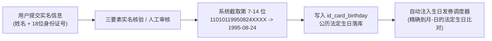
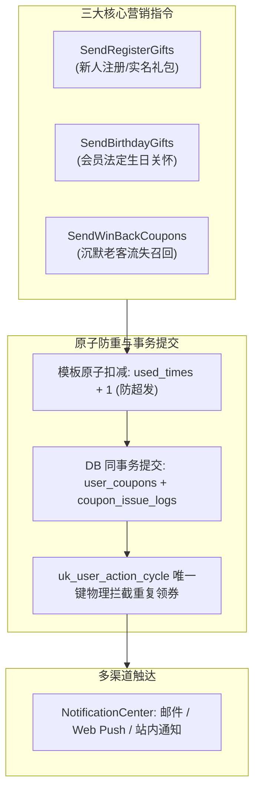

# JianYun (简云) · 精简营销发券与防重审计规范 (Marketing & Coupon Issuance)

## 1. 架构定位与极简设计哲学

为了避免“第二系统综合症”及过度工程化（Over-Engineering），系统摒弃复杂沉重的通用 ECA（事件-条件-动作）DSL 规则引擎与动态 JSON 解析器，回归 IDC 真实业务场景：
- **核心场景聚焦**：以 3 个清晰独立的控制台命令承载 99% 的营销发券需求（新人礼券、法定公历生日关怀、老客沉默召回）；
- **物理去死锁设计**：彻底废弃多状态的营销规则日志，采用单表 `coupon_issue_logs` + 数据库事务级原子提交，消除中间态 `pending` 导致的并发死锁与发券死卡；
- **零配置负担**：管理员通过配置内置的优惠券模板（`coupons`），即可自动享受确定性、高性能的营销触达。

---

## 2. 实名认证与法定生日体系

### 2.1 权威数据源：二代身份证解析
为彻底杜绝用户手动填写生日“今天填、明天改、后天改”的薅羊毛作弊，简云将用户生日**严格绑定于中国二代居民身份证实名认证体系**：
- **提取算法**：当用户提交 18 位身份证号码（格式：`AAAAAAYYYYMMDDXXXX`）并通过核验后，系统截取第 7 至 14 位（`YYYYMMDD`），将其格式化为标准的法定公历生日 `YYYY-MM-DD` 存入 `user_verifications.id_card_birthday`；
- **数据保密**：身份证号明文经 **AES-256-GCM** 信封加密存储于数据库，前端页面永远脱敏显示（如 `110101********1234`）；
- **不可篡改性**：实名信息一旦审核通过即锁定，用户无法自行修改；同一个身份证号全局唯一，严禁注册多账号重复认证。



---

## 3. 三大高内聚营销控制台命令

系统将营销逻辑收敛为 3 个独立的高性能 Console 命令，各司其职：



### 3.1 命令一：`SendRegisterGifts`（新客注册/实名大礼包）
- **触发时机**：用户实名认证通过事件触发，或每日批处理检测新实名用户；
- **业务防重键**：`cycle_marker = CONCAT('reg:', user_id)`（终身仅发一次）；
- **发放动作**：生成指定天数有效期的体验券（如 10 元无门槛券，7 天有效），同步推送站内通知与邮件。

### 3.2 命令二：`SendBirthdayGifts`（法定公历生日关怀）
- **触发时机**：每日凌晨 00:05 定时跑批执行；
- **高性能索引筛选与平闰年 2月29日 智能兼顾**：
  依托 `user_verifications.birthday_md` 物理生成列与复合索引 `idx_status_birthday_md(status, birthday_md)`，查询可直接走 B+Tree 索引范围查找，彻底消除对百万级认证表的 `DATE_FORMAT()` 全表扫描。
  
  **平年 2月29日 关怀规则**：在非闰年（当年 2 月仅 28 天）的 2 月 28 日，系统将 2 月 29 日出生的用户一并纳入关怀名单：
  ```sql
  -- 正常日期或闰年当日执行：
  SELECT v.user_id, u.email, v.birthday_md
  FROM `user_verifications` v
  JOIN `users` u ON v.user_id = u.id
  WHERE v.status = 'verified'
    AND v.birthday_md = DATE_FORMAT(CURRENT_DATE, '%m-%d');

  -- 平年 2月28日 特殊处理 (合并 02-28 与 02-29 出生用户):
  -- PHP 端判断: !checkdate(2, 29, (int)date('Y')) && date('m-d') === '02-28'
  SELECT v.user_id, u.email, v.birthday_md
  FROM `user_verifications` v
  JOIN `users` u ON v.user_id = u.id
  WHERE v.status = 'verified'
    AND v.birthday_md IN ('02-28', '02-29');
  ```
- **自然年防重键**：`cycle_marker = CONCAT('bday:', user_id, ':', YEAR(CURRENT_DATE))`；
- **业务效果**：一人一年严格只准享受一次生日关怀特权，杜绝多领。

### 3.3 命令三：`SendWinBackCoupons`（高价值沉默客户召回）
- **触发时机**：每日定时跑批执行；
- **筛选条件**：累计消费满额度（如 $\ge 200$ 元）、名下无在跑机器、超过 30 天未登录的用户；
- **周期防重键**：`cycle_marker = CONCAT('winback:', user_id, ':', DATE_FORMAT(NOW(), '%Y%m'))`（按自然月滚动冷却，每月最多打扰 1 次）。

---

## 4. `coupon_issue_logs` 消除死锁与原子提交协议

在旧方案中，采用“先插入 pending 占位日志，后调发放逻辑”的设计，一旦外部调用异常，残留的 `pending` 行因唯一键冲突将永久阻断该用户后续的重试发券，造成恶性死卡。

简云全新协议采用 **数据库同事务提交模式（Transaction-as-Lock）**：

```sql
START TRANSACTION;

-- 1. 优惠券模板库存原子扣减 (防止并发超发)
UPDATE `coupons` 
SET `used_times` = `used_times` + 1 
WHERE `id` = :coupon_id 
  AND (`max_uses` = -1 OR `used_times` < `max_uses`);
-- 若 affected_rows === 0，表示卡券已被领罄，直接 ROLLBACK 退出！

-- 2. 插入用户卡券资产
INSERT INTO `user_coupons` (
    `user_id`, `coupon_id`, `source_type`, `status`, `start_at`, `expire_at`
) VALUES (
    :user_id, :coupon_id, 'campaign', 'unused', NOW(), DATE_ADD(NOW(), INTERVAL :valid_days DAY)
);
SET @new_user_coupon_id = LAST_INSERT_ID();

-- 3. 插入发券防重审计日志 (利用唯一键 uk_user_action_cycle 物理防重)
INSERT INTO `coupon_issue_logs` (
    `user_id`, `coupon_id`, `user_coupon_id`, `action_type`, `cycle_marker`
) VALUES (
    :user_id, :coupon_id, @new_user_coupon_id, :action_type, :cycle_marker
);

COMMIT;
```
- **核心收益**：
  1. 无需任何 `pending` 中间状态，事务要么全部提交成功，要么全部回滚；
  2. 若遇到偶发网络中断或进程崩溃，数据库物理回滚，不留任何残留脏锁，下一次跑批可顺畅重试；
  3. `uk_user_action_cycle` 唯一索引在提交时提供不可绕过的物理级并发防重屏障。

---

## 5. 风控安全与核心防刷底线

1. **退款风控（反薅羊毛）与未付取消回滚机制**：
   - **已支付订单退订/退款**：
     - 账单退款逻辑只退回其实际通过支付宝/余额扣减的现金金额，卡券优惠额度直接作废清零，不予退还；
     - 该张券状态**保持为 `used`**，不再回滚为 `unused`，彻底杜绝套刷与倒买倒卖。
   - **未支付账单超时自动取消（`unpaid -> cancelled`）**：
     - 用户未获得任何云服务，亦未发生现金退款，系统安全回滚锁定的卡券：
     ```sql
     -- 1. 回滚用户卡券资产状态
     UPDATE `user_coupons` 
     SET `status` = 'unused', `used_at` = NULL, `order_invoice_id` = NULL 
     WHERE `order_invoice_id` = :invoice_id AND `status` = 'used';
     
     -- 2. 原子递减模板已使用次数 (若此前递增过)
     UPDATE `coupons` 
     SET `used_times` = `used_times` - 1 
     WHERE `id` = :coupon_id AND `used_times` > 0;
     ```
2. **订单结算底线约束（CAS 保底）**：
   - 统一账单结算计算器强制设定底线：
     $$\text{FinalAmount} = \max(0.01, \text{RawPrice} - \text{Discount})$$
   - 无论何种高额优惠券或叠加，支付总额绝不允许低于 $0.01$ 元人民币，杜绝 0 元注入或负数结算导致上游接口开通崩溃。
3. **单据权益互斥规则**：
   - 一笔订单默认只能核销 1 项优惠权益（用户若既有可用专属券，又输入了口令码，结算器自动比对并推荐减免金额最高的一项，严格禁止无序叠加）。
