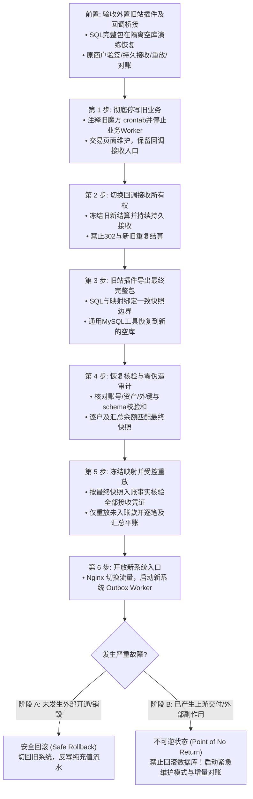

# JianYun (简云) · 生产割接与对账稽核实施规程 (Migration Runbook)

> [!IMPORTANT]
> 本文档为生产割接唯一权威实施操作指南，全面废止早期概念草案中的简易脚本。
> 任何参与生产割接的工程师或自动化 Agent 必须逐项执行本规程，严禁擅自修改判定条件。

---

## 0. 旧站插件与数据库交付边界

迁移工具独立发布，上传到旧系统后按旧站插件机制运行，负责读取旧库、转换字段并导出**指定简云版本可恢复的 SQL 数据库备份**。简云不集成旧表适配，不提供迁移页面、旧站专用 API、专用导入命令或旧库连接配置；工具不属于简云 `app/`、`plugins/` 或 `scripts/`。本系统自身的 schema 增量升级继续按正常数据库变更流程管理。

### 0.1 导出物与恢复方式

| 交付物 | 约束 |
|---|---|
| `schema.sql` | 来自指定简云发布版本的完整 `database/schema.sql`，含初始化设置、外键、唯一键和保护触发器；不以数据库字典摘录替代 |
| `data.sql` | 旧站插件已完成转换的目标表数据，按外键依赖排序；金额使用精确十进制、时间转换为 UTC，不包含旧表或跨库 `SELECT`，不依赖旧库与目标库同机 |
| `manifest.json` | 记录旧系统/插件及源 PHP、MySQL 版本，目标简云版本与 schema 校验和，导出时间、停写/结算快照边界、文件校验和、各表行数、余额分户及总额核对结果、排除项和异常清单；不含主密钥 |
| 受控映射与对账材料 | 保留旧新身份、节点、商品、实例和收款订单映射，以及稳定网关流水是否已计入旧站最终余额/账单的核验事实；涉及个人、凭据或支付数据的材料按敏感备份保护，不作为公开附件 |

操作员使用通用 MySQL 工具，先在隔离的 MySQL 8.0+ 空库恢复 `schema.sql`，再恢复 `data.sql` 并核验清单。目标数据库不得已有账号、种子或交易数据；冲突应中止，不以 `INSERT IGNORE`、自动覆盖或合并方式掩盖。恢复失败的库不得接入应用，重新核验后使用新的空库重做。恢复过程保持简云交易入口、调度器与 Worker 关闭，不触发充值、消费或历史资源的再次开通。

导出插件只读旧业务数据，不要求旧服务器安装目标版本 PHP 或执行 MySQL 8 DDL；旧端运行要求在独立交付物中按真实环境验证。包内 SQL 只面向指定目标版本，目标 schema 变化后重新生成和演练，不承诺跨版本自动转换。敏感字段必须转换为目标 `APP_KEY` 可解密的 AES-256-GCM 格式，不能直接复制不可解密的旧密文；密钥交接与重加密方式须在实现前核准，主密钥不得写入导出包或日志。导出包私有保存、受控下载转移并加密归档，恢复后验证必要凭据可解密。

### 0.2 数据快照与过渡设施

演练使用的包不能代替最终割接快照。旧业务及旧新结算冻结后，旧站插件导出最终一致的完整包，在新的空目标库恢复并复核。对照稳定网关流水核验各笔收款是否已计入最终余额/账单，已包含者留对账证明且不再次入账；仅受控重放尚未入账的凭证，包含快照前已接收但尚未结算者，不能只按接收时间筛选。读快照、停写和收款归属必须可核对，不能把多表分批读取期间变化的数据混作一致快照，也不默认将最终包增量合并到演练库或已有简云业务库。

旧支付回调持久接收、旧单号适配和受控重放属于外置过渡设施，职责见 §4.0，不扩展简云的迁移接口。数据库恢复只证明目标数据可用，不能代替驱动能力、账务防重、对账和回滚演练。以下数量与本地编号来自既有静态盘点快照，实际导出时重新核准，不写死为通用插件规则；§1、§3 为旧站插件的转换规则，不是新站跨库执行脚本。

---

## 1. 权限与身份映射纠偏（绝对排除硬编码错误）

在旧智简魔方（`idc2`）中，**管理员与终端客户存储于两张完全独立的物理表**：
- **真实管理员**：存储在 `idc2.shd_user` 表（共 3 个管理员：`yhyad`、`xia125`、`admin`）；
- **终端客户**：存储在 `idc2.shd_clients` 表（共 3,363 个客户）。其中 `id=1` 仅仅是一个普通测试客户账号（`3228696300@qq.com`）。

### 1.1 旧站插件的身份转换规则

| 目标 | 旧站来源与转换要求 |
|---|---|
| `admins.id / username / email / password` | 来自 `shd_user.id / user_login / user_email / user_pass`，与客户身份独立，保留经核准的原 ID 和密码哈希 |
| `admins.role / status` | 本次既有盘点中的真实管理员按已核准清单映射为 `super_admin / active`；不能根据客户 ID 推导管理员权限 |
| `users.id / email / phone / password` | 来自 `shd_clients.id / email / phonenumber / password`；空手机号转 `NULL`，重复或缺失的唯一身份字段列入导出校验，不靠覆盖既有账号通过 |
| `users.balance / status` | 钱包来自 `shd_clients.credit`，精确逐户及汇总核对；客户状态按原状态映射为 `active / suspended` |
| `created_at` | 将旧时间戳转换为 UTC；密码保留哈希，原密码登录兼容及热升级仍由正常认证服务负责 |

插件读取源记录后输出目标 `INSERT` 数据，不生成依赖新站访问 `idc2` 的 `INSERT ... SELECT`。主键、邮箱和手机号冲突必须在恢复前核办，不能用重复键更新合并身份。

---

## 2. 存量资产分类处置矩阵 (Active 118 / Suspended 22 / Pending 14)

根据对旧库 `shd_host` 的深度静态审计，存量实例的物理分布如下：

| 旧状态 (`domainstatus`) | 实例数 | 真实业务物理分布 | 简云迁移处置规范 |
|---|---|---|---|
| **Active** | 118 | 106 台 DCIM 云服务器、5 台 Easypanel 主机、6 台 宝塔(skymnbt)、1 台 Sub2API | 严格校验真实远端 ID。100% 验证通过导入 `active`；缺映射者强制挂起 |
| **Suspended** | 22 | 20 台 DCIM 云服务器、2 台 Easypanel 主机 | 导入为 `suspended`，`suspend_type = 'manual'`，保持停机锁闭 |
| **Pending** | 14 | 11 笔未付款订单、1 笔空测试单、**2 笔已付款未交付主机 (#1401, #4052)** | 未付款单仅转为未支付账单；2 笔已付款未交付转入工单阻断人工核办 |

### 2.1 存量驱动与逐能力交付门禁

资产导入只证明本地映射，不证明远端可控。割接前必须按实际节点完成能力清单，至少分别覆盖 DCIM/魔方、Easypanel、宝塔 `skymnbt`、Sub2API；路线图任务 2.3 必须实现所需驱动或明确人工接管。每个 Provider 记录真实远端标识取值规则、支持能力、续费结算/交付方式、状态反查权威度及验收证据：

| 存量类别 | 必须确认的链路 | 不支持时的处理 |
|---|---|---|
| DCIM / 魔方代理 | 核准 `dcimid`，验收状态查询、续费及实际支持的电源/VNC等动作 | 未核准标识继续挂起；未声明能力由服务端拒绝 |
| Easypanel | 核准面板账号和节点，验证续费、状态及实际支持的虚拟主机操作 | 不将虚拟主机伪装成 VPS；电源/VNC等不支持项禁用 |
| 宝塔 `skymnbt` | 为对应接口实现并验收专属驱动，核准远端账号与续费语义 | 无已验收驱动时显式人工接管，禁止改挂通用魔方驱动冒充支持 |
| Sub2API | 核准订阅/额度标识、续期或额度交付方式，验证查询与幂等 | 不声明不具备的重启、VNC等能力；不可查询时按人工核验门禁处理 |

人工接管必须逐节点/实例记录负责人、受理入口、响应时限及续费/退款对账流程，保存在受控割接清单并由负责人确认。只显示“联系客服”不构成接管闭环；未完成驱动验收或接管确认的存量类别禁止开放自动运维，且不得宣称全量资产自动续费/重启可用。

---

## 3. 远端 ID 映射核准与“零伪造”安全门禁

旧库中不同业务类型的远端唯一标识存储于不同字段：
- **DCIM 云服务器 (`serverid = 0`)**：远端标识存储在 `dcimid`。
- **虚拟主机面板 (`serverid IN (5, 7)`)**：远端标识存储在面板分配的 `username`。
- **Sub2API / 外部接口 (`serverid = 8`)**：远端标识存储在 `subscriptionid` 或自定义密钥。

> [!CAUTION]
> **绝对禁止使用本地 ID 冒充远端 ID！**
> 严禁写任何 `COALESCE(dcimid, h.id)` 类似的 fallback 代码。如果远端 ID 不存在或为 0，必须置为 `NULL`，并强制标记为 `unverified_missing_remote_id`，状态设为 `suspended`，绝对禁止任何远程开机、关机、重启、重装、销毁等破坏性 API 调用！

### 3.1 旧站插件的节点、商品与实例转换规则

插件先完成节点映射，再输出商品和实例数据，满足目标外键。既有快照中的对应关系如下；实际节点须重新核准，不把编号写成可跨站复用的常量。

| 旧 `serverid` | 本次目标 Provider 映射 | 远端 ID 来源 |
|---|---|---|
| `0` | `1 / zjmf` | 大于 0 的 `dcimid` 转字符串 |
| `5` | `2 / easypanel` | 核准后的非空面板 `username` |
| `7` | `3 / skymnbt` | 核准后的非空面板 `username` |
| `8` | `4 / sub2api` | 核准后的 `subscriptionid` 或该节点真实使用的非空账号标识 |

未知节点中止对应资产导出并列异常，不自动归入通用魔方节点；远端 ID 缺失按本节零伪造门禁挂起，不回退本地实例 ID。

| 目标数据 | 转换与校验要求 |
|---|---|
| `providers` | 按核准节点输出名称、驱动和配置；凭据遵守 §0.1 的目标密钥契约，能力启用须通过 §2.1 |
| `products` | 从 `shd_products` 输出迁移资产引用的商品；保留已核准本地 ID、真实上游商品 ID 与 Provider 对应，产品类型、计价及可售状态按实际商品核对 |
| `instances.id / user_id / product_id / provider_id` | 来自 `shd_host.id / uid / productid` 与核准 Provider 映射，恢复前检查全部外键归属 |
| `name / ip_address / config_snapshot` | 保留真实主机名、IP 与必要配置快照；旧本地标识可用于审计，但不能冒充远端标识或将敏感明文混入快照 |
| `billing_cycle / recurring_price / auto_renew` | 转换旧周期与 `amount`，核准周期、精确金额和续费策略后写入目标字段 |
| `status / suspend_type / suspend_reason` | 已核准远端 ID 的 Active 映射为 `active`；原 Suspended 保持 `suspended / manual`；缺远端 ID 强制为 `suspended / manual`，保留 `unverified_missing_remote_id` 原因 |
| `start_date / due_date` | 已交付资产按核准旧起租/到期时间转 UTC，异常时间列入核办；未交付实例按 §3.2 保持 `NULL` |

恢复后仅对目标库运行归属、外键及未验证远端 ID 审计；不读取旧表，不生成旧任务，也不因导入资产触发上游调用。

### 3.2 2 笔已付款未交付主机 (#1401, #4052) 专项处理

旧站插件复核实例与实收凭证归属后，为这两笔资产输出 `status='pending'`、`remote_instance_id=NULL`、`suspend_type='manual'`，`start_date/due_date` 严格为 `NULL`，并保留已收款未交付的人工核办原因。既有快照对应用户/实例分别为 `1471/1401`、`1285/4052`；生成关联的 `technical / high / open` 工单供人工核实交付或退款，不生成自动开通任务。这些编号只用于本次快照核办，不能按编号猜测其他旧站资产归属。

---

## 4. 生产割接与“不可逆分界点” (Point of No Return)

### 4.0 旧支付回调桥接与持久接收协议（割接前置）

旧收银台在停写后仍可能收款，11 笔存量未付订单也可能携旧商户单号发回调。新支付驱动只认识简云账单，不能将旧回调入口简单 `302` 到新接口，不能依赖网关自动携带原请求体重发。必须先部署并演练以下专用桥接路径，保持原商户回调 URL 可达，再进行停写与业务切流：

1. **接收与验签**：按旧渠道/商户配置解析原始请求，用原商户密钥验证签名、商户身份、实收金额、币种和成功支付状态；请求体原字节及验签所需字段必须保留，不接受浏览器“支付成功”跳转作为收款证据。无效签名拒绝受理并脱敏告警，不能进入账务重放。
2. **私有持久化后确认**：已验签回调加密写入外置接收器自己的非 Web 根工作目录，例如该独立工具部署目录下的 `storage/legacy-payments/`，不属于简云应用目录（目录仅服务账号可访问，文件最小权限）。封套保存原始报文、渠道/商户、旧商户单号、外部交易号、接收时刻、密钥配置版本及处理状态；敏感原文使用 AES-256-GCM，禁止写入明文日志。对相同 `(channel, merchant_id, gateway_trade_no)` 生成稳定防重键，先写同文件系统临时文件、刷新持久化，再在该键排他锁内原子发布；重复回调不能覆盖已有凭证。同流水报文关键事实不一致时隔离告警。只有持久化成功后才能向网关返回该渠道确认报文，落盘失败返回可重试失败。
3. **明确存储与进程边界**：接收器、旧单号适配器及重放器均独立交付部署，不写入简云的 `app/`、`plugins/` 或 `scripts/`；该私有目录是外置过渡设施的持久工作区，不是新增核心表，也不复用要求 `instance_id` 的实例 `tasks`。初始部署限定单接收节点与共享此目录的受控重放进程；重放器持凭证键文件锁完成领取、本地结算和原子回执，不在此锁内发起上游资源调用。进程崩溃由操作系统释放锁，启动恢复扫描同时纳入待处理及处理中凭证，再依数据库流水唯一键恢复，不能让 `processing` 中间态永久阻断重放。扩为多节点前必须先验证共享持久存储与跨进程/主机排他语义，不能把各机本地锁当分布式锁。接收器先于停写上线，目录加密备份、容量/写入失败监控与恢复负责人均须落实。
4. **旧新账单映射**：停写后导出受控映射清单，以 `(旧渠道, 商户ID, 旧商户订单号)` 唯一定位旧账单、客户、金额、币种及经批准的真实简云目标账单；保留旧外部交易号（若已生成）、映射版本与校验和。清单置于私有目录、最小权限并留修改审计；涉及个人或支付数据时加密。不能将旧账单 ID 直接解释为同号新账单；金额、客户或币种不一致以及无映射时转人工待核办，保留原始凭证并告警。
5. **受控重放与数据库防重**：外置重放器在映射核验后，通过核准的受控调用方式进入统一支付结算服务，传入已验签的渠道、商户、原始外部交易号与实收事实；旧单号解析与转换留在外置适配器，简云不新增旧站专用公开 API、免验签入口或数据库导入命令，不伪造 `invoiceId`。具体受控调用方式须与通用支付服务一起实现、鉴权并演练，本规程不代表已有可用入口。沿用 `payment_records` 的外部流水唯一键及账单 CAS/账本事务，已成功流水只核验并返回已有结果，不能重复入账或开通。旧商户配置需映射到明确的简云收单渠道身份，确认该身份内外部交易号唯一，禁止把不同商户的同号流水合并。已取消、已支付或过期真实目标账单按 [PAYMENTS.md](PAYMENTS.md) 的迟到/多收款规则处理；找不到真实目标账单时持续隔离核办，不为通过外键临时造账单或实例。
6. **确认、重放恢复与逐笔对账**：接收状态与业务结算状态分开记录；网关已获接收确认不表示用户已入账。仅数据库结算事务确认成功后原子写完成回执（关联真实 `payment_records.id`、账单及账本证据）；进程在数据库提交后、回执前崩溃时，按原始外部流水键重放，命中数据库防重后补回执。未映射/结果未知凭证保持待核办，不能被“成功消费”删除。按“网关实收 ↔ 私有接收凭证 ↔ payment_records ↔ transactions/账单”逐笔对账，差异有负责人和处理时限，凭证按留存策略加密归档。

旧站导出插件、上述外置桥接器、映射导出、重放器与对账工具均为待实现的外部交付依赖，不能以本协议或空目录存在替代实现和演练证据。

### 4.1 不可逆分界点 (Point of No Return) 明确定义与应急处置
系统严禁简单地“把新充值加回旧库就恢复旧魔方”。因为一旦发生以下任一**外部副作用**：
1. 客户在新系统购买，上游已真实创建了一台 VPS 并扣除了商户余额；
2. 实例到期，新系统的销毁 Worker 已经调用上游 API 删除了云服务器；
3. 客户发起了微信/支付宝原路退款，网关已经完成了资金原路返回；

此时若强行回滚旧系统数据库，将导致**物理资产、上游资金与数据库账本彻底永久撕裂**！

#### 应急防线与处置规则：
- **阶段 A（割接开放 1 小时内且未发生任何外部副作用）**：
  必须执行以下严格门禁检查：
  1. `tasks` 状态核查：`SELECT COUNT(*) FROM tasks WHERE status IN ('running', 'investigating', 'success') OR (status = 'failed' AND last_error LIKE 'MANUAL_AUDIT_REQUIRED:%')` 必须严格等于 0！执行中、调查中及人工待核验任务不论租约是否为空/过期，一律视同潜在外部副作用；尤其 `failed + MANUAL_AUDIT_REQUIRED` 可能已经在上游扣款并开通，不能按失败状态判定无副作用。另逐笔检查历史普通 `failed`，只有权威反查或受审计核验能证明未发生外部副作用才可放行；缺乏证明、旧数据无标记或结果未知均转阶段 B，禁止回滚；
  2. 本地流水审计：核实割接期间未发生任何站内余额消费、佣金划转或站外提现扣款。
  3. 独立支付链核查：旧回调待重放/待核办凭证已清点，原路退款和站外打款均无在途、成功或结果未知的外部副作用。退款不使用实例 `tasks`，不能仅凭任务计数为零认定可回滚；切回期间持久接收继续运行，并明确每笔凭证的唯一结算归属。
  - **处置规程**：新系统切维护模式；通过全账户净差额对账脚本计算每位客户在割接窗口期内的净余额变化：
    $$\Delta \text{Credit} = \sum \text{充值到账} - \sum \text{本地消费} + \sum \text{本地退款}$$
    将净差额更新回旧魔方：`UPDATE idc2.shd_clients SET credit = credit + :delta WHERE id = :user_id;`
  - 恢复旧魔方的 Nginx 与 Crontab。
- **阶段 B（一旦发生外部交付或存在未决任务，进入不可逆阶段）**：
  **绝对禁止回滚数据库到旧魔方！** 必须启动 **紧急维护模式 (Emergency Maintenance Mode)**：
  1. API 网关返回 `503 Service Temporarily in Emergency Reconciliation`，锁定所有交易与实例写操作；
  2. 运维与研发团队启动热修复（Hotfix）在线发布；
  3. 若确需修复部分异常订单，必须使用 **增量对账与状态回写脚本 (Delta Reconciliation Script)**，逐笔计算全账本分户流水，确保账实分毫不差。

### 4.2 生产开放门禁与演练矩阵

只有下列检查逐项有证据通过，或由明确负责人确认支持范围内的人工接管后，才能开放相应生产能力；回调桥接、账务防重与资金对账不允许以人工接管替代：

| 演练/检查 | 必须达到的结果 |
|---|---|
| 旧站插件运行与目标空库恢复 | 旧端 PHP/MySQL 环境可运行；完整 schema 含触发器，恢复仅访问目标库，版本/文件校验和、外键、身份及逐户/汇总余额核对通过 |
| 目标版本不符、非空库、重复身份或恢复中断 | 中止恢复并保留核办材料，不覆盖/合并已有业务；失败库不接流量，不投递历史交付任务 |
| 最终完整包与过渡期收款 | 不增量覆盖演练/业务库；最终包与映射同边界，按稳定流水证明已入账款不重放；快照前已接收未结算及后续未入账凭证均安全重放，不按接收时间遗漏收款 |
| 回调重复、并发、回执丢失 | 一份稳定接收凭证，一次数据库入账；网关重发安全确认 |
| 接收器在临时写入/持久化后/应答前崩溃 | 不确认未持久化数据；已持久化可恢复且不被覆盖 |
| 数据库提交后、完成回执前崩溃 | 原外部流水键安全重放，补回执且不重复入账/开通 |
| 旧账单 ID 与新账单 ID 碰撞、映射缺失、金额/币种错误 | 禁止按数字猜测映射，隔离凭证并告警，不误记其他用户 |
| 旧收银台迟到款、目标账单已取消/已付款 | 按统一迟到/多收款规则对真实目标处理，一笔实收有且只有一种去向 |
| 回调切换与最终余额快照并发 | 结算冻结期间仅持久接收；导入和映射冻结后再重放，无旧新双记或余额遗漏 |
| 每类存量 Provider 的续费/运维/查询 | 核准远端 ID；能力声明与验收一致；缺失能力有经确认的人工接管流程 |
| 退款在途、人工核验、应急回滚 | 独立检查外部副作用；结果未知进入维护对账，不能以任务计数为零放行 |
| 上游已扣款开通但响应丢失，任务为 `failed + MANUAL_AUDIT_REQUIRED` 且租约已清空 | 回滚 SQL 仍命中并阻断，进入阶段 B 人工核验，不删除上游资产或切回旧账本 |
| 历史普通 `failed` 无人工标记且缺少权威失败证据 | 不能因当前状态失败而认定安全；核验不能证明无副作用时禁止回滚 |

生产检查清单至少包含接收器及重放进程健康、私有目录持久性与加密备份、映射校验和、网关逐笔对账、待核办余额、存量能力/接管签认、监控告警及回滚门禁。任何资金差异未解释、回调协议未演练或资产能力未核准均阻止开放生产交易。

## 5. 契约调整记录

- **2026-11-07，旧站插件外置**：按用户明确的产品边界，将“简云内专用旧库迁移脚本”调整为“独立旧站插件导出目标 SQL 数据库备份，通用 MySQL 工具恢复至空库”，减少核心对旧系统结构的耦合。
- **影响范围**：同步 `AGENTS.md`、`README.md`、架构、API、数据库字典前言、插件手册、迁移概览与路线图；本文将跨库执行示例改为插件转换规则，并明确外置回调接收及受控重放边界。
- **兼容与数据影响**：撤销新站 `scripts/migrate_legacy.php` 的旧规划；无已实现迁移工具需要升级。本次不修改 schema、物理表、业务 API 或运行代码，不执行数据恢复；旧站插件需固定目标版本并独立验证源环境、密文兼容和空库恢复，已有业务库合并不在此契约内。
- **验证证据**：本次仅进行 schema 文档同步检查、Markdown 本地链接/代码围栏检查及 `git diff --check`；不代表导出插件、数据库恢复、支付桥接或生产割接已实现，路线图任务 5.4 保持未完成。
