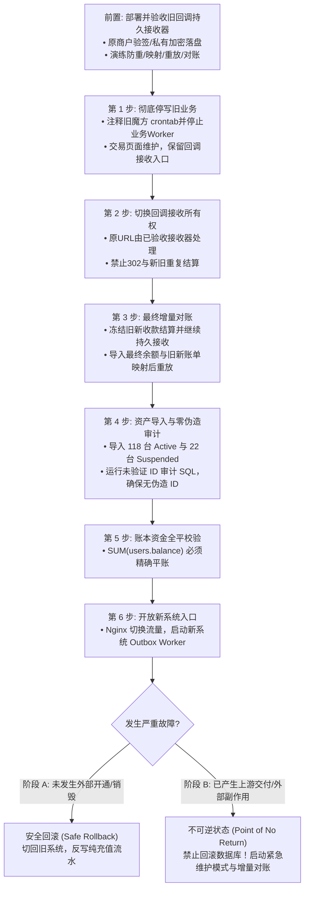

# JianYun (简云) · 生产割接与对账稽核实施规程 (Migration Runbook)

> [!IMPORTANT]
> 本文档为生产割接唯一权威实施操作指南，全面废止早期概念草案中的简易脚本。
> 任何参与生产割接的工程师或自动化 Agent 必须逐项执行本规程，严禁擅自修改判定条件。

---

## 1. 权限与身份映射纠偏（绝对排除硬编码错误）

在旧智简魔方（`idc2`）中，**管理员与终端客户存储于两张完全独立的物理表**：
- **真实管理员**：存储在 `idc2.shd_user` 表（共 3 个管理员：`yhyad`、`xia125`、`admin`）；
- **终端客户**：存储在 `idc2.shd_clients` 表（共 3,363 个客户）。其中 `id=1` 仅仅是一个普通测试客户账号（`3228696300@qq.com`）。

### 1.1 严正修正后的导入脚本
```sql
-- 步骤 1: 显式导入真实管理员至独立的 admins 物理表 (保留原始 ID，绝无主键碰撞)
INSERT INTO `jianyun`.`admins` (
    `id`, `username`, `email`, `password`, `role`, `status`, `created_at`
)
SELECT
    u.id,
    u.user_login,
    u.user_email,
    u.user_pass, -- 旧魔方密码哈希 (系统支持首次登录时透明升级为 Bcrypt)
    'super_admin',
    'active',
    FROM_UNIXTIME(u.create_time)
FROM `idc2`.`shd_user` u;

-- 步骤 2: 显式导入 3,363 位真实终端客户至纯净的 users 表 (无管理员身份污染)
INSERT INTO `jianyun`.`users` (
    `id`, `email`, `phone`, `password`, `balance`, `status`, `created_at`
)
SELECT
    c.id,
    c.email,
    NULLIF(c.phonenumber, ''),
    c.password,
    c.credit,
    IF(c.status = 1, 'active', 'suspended'),
    FROM_UNIXTIME(c.create_time)
FROM `idc2`.`shd_clients` c
ON DUPLICATE KEY UPDATE `email` = VALUES(`email`);
```

---

## 2. 存量资产分类处置矩阵 (Active 118 / Suspended 22 / Pending 14)

根据对旧库 `shd_host` 的深度静态审计，存量实例的物理分布如下：

| 旧状态 (`domainstatus`) | 实例数 | 真实业务物理分布 | 简云迁移处置规范 |
|---|---|---|---|
| **Active** | 118 | 106 台 DCIM 云服务器、5 台 Easypanel 主机、6 台 宝塔(skymnbt)、1 台 Sub2API | 严格校验真实远端 ID。100% 验证通过导入 `active`；缺映射者强制挂起 |
| **Suspended** | 22 | 20 台 DCIM 云服务器、2 台 Easypanel 主机 | 导入为 `suspended`，`suspend_type = 'manual'`，保持停机锁闭 |
| **Pending** | 14 | 11 笔未付款订单、1 笔空测试单、**2 笔已付款未交付主机 (#1401, #4052)** | 未付款单仅转为未支付账单；2 笔已付款未交付转入工单阻断人工核办 |

### 2.1 存量驱动与逐能力交付门禁

资产导入只证明本地映射，不证明远端可控。割接前必须按实际节点完成能力清单，至少分别覆盖 DCIM/魔方、Easypanel、宝塔 `skymnbt`、Sub2API；路线图任务 2.3 必须实现所需驱动或明确人工接管。每个 Provider 记录真实远端标识取值规则、支持能力、续费结算/交付方式、状态反查权威度及验收证据：

| 存量类别 | 必须确认的链路 | 不支持时的处理 |
|---|---|---|
| DCIM / 魔方代理 | 核准 `dcimid`，验收状态查询、续费及实际支持的电源/VNC等动作 | 未核准标识继续挂起；未声明能力由服务端拒绝 |
| Easypanel | 核准面板账号和节点，验证续费、状态及实际支持的虚拟主机操作 | 不将虚拟主机伪装成 VPS；电源/VNC等不支持项禁用 |
| 宝塔 `skymnbt` | 为对应接口实现并验收专属驱动，核准远端账号与续费语义 | 无已验收驱动时显式人工接管，禁止改挂通用魔方驱动冒充支持 |
| Sub2API | 核准订阅/额度标识、续期或额度交付方式，验证查询与幂等 | 不声明不具备的重启、VNC等能力；不可查询时按人工核验门禁处理 |

人工接管必须逐节点/实例记录负责人、受理入口、响应时限及续费/退款对账流程，保存在受控割接清单并由负责人确认。只显示“联系客服”不构成接管闭环；未完成驱动验收或接管确认的存量类别禁止开放自动运维，且不得宣称全量资产自动续费/重启可用。

---

## 3. 远端 ID 映射核准与“零伪造”安全门禁

旧库中不同业务类型的远端唯一标识存储于不同字段：
- **DCIM 云服务器 (`serverid = 0`)**：远端标识存储在 `dcimid`。
- **虚拟主机面板 (`serverid IN (5, 7)`)**：远端标识存储在面板分配的 `username`。
- **Sub2API / 外部接口 (`serverid = 8`)**：远端标识存储在 `subscriptionid` 或自定义密钥。

> [!CAUTION]
> **绝对禁止使用本地 ID 冒充远端 ID！**
> 严禁写任何 `COALESCE(dcimid, h.id)` 类似的 fallback 代码。如果远端 ID 不存在或为 0，必须置为 `NULL`，并强制标记为 `unverified_missing_remote_id`，状态设为 `suspended`，绝对禁止任何远程开机、关机、重启、重装、销毁等破坏性 API 调用！

### 3.1 前置节点/商品目录导入与实例映射审计 SQL

```sql
-- 步骤 3.1.A: 预置核准的 4 个核心 Provider 节点 (满足 instances.provider_id 外键约束)
INSERT INTO `jianyun`.`providers` (`id`, `name`, `driver`, `status`) VALUES
(1, 'SakuraIDC/DCIM 上游', 'zjmf', 1),
(2, 'Easypanel 虚拟主机', 'easypanel', 1),
(3, '宝塔面板节点', 'skymnbt', 1),
(4, 'Sub2API 订阅网关', 'sub2api', 1)
ON DUPLICATE KEY UPDATE `name` = VALUES(`name`), `driver` = VALUES(`driver`);

-- 步骤 3.1.B: 导入存量实例关联的商品定义 (保留原始 product_id，满足 instances.product_id 外键约束)
INSERT INTO `jianyun`.`products` (
    `id`, `provider_id`, `remote_pid`, `name`, `type`, `markup_type`, `status`
)
SELECT
    p.id,
    CASE
        WHEN p.server_group IN (5) THEN 2
        WHEN p.server_group IN (7) THEN 3
        WHEN p.server_group IN (8) THEN 4
        ELSE 1
    END AS provider_id,
    COALESCE(p.zjmf_api_pid, 0) AS remote_pid,
    p.name,
    'cloud',
    'none',
    IF(p.hidden = 1, 'hidden', 'active')
FROM `idc2`.`shd_products` p
WHERE p.id IN (SELECT DISTINCT productid FROM `idc2`.`shd_host` WHERE domainstatus IN ('Active', 'Suspended', 'Pending'))
ON DUPLICATE KEY UPDATE `name` = VALUES(`name`);

-- 步骤 3.1.C: 导入 Active 与 Suspended 存量实例
INSERT INTO `jianyun`.`instances` (
    `id`, `user_id`, `product_id`, `provider_id`, `remote_instance_id`,
    `name`, `ip_address`, `config_snapshot`, `billing_cycle`, `recurring_price`,
    `status`, `suspend_type`, `suspend_reason`, `auto_renew`, `start_date`, `due_date`
)
SELECT
    sub.id,
    sub.user_id,
    sub.product_id,
    sub.provider_id,
    sub.remote_instance_id,
    sub.name,
    sub.ip_address,
    sub.config_snapshot,
    sub.billing_cycle,
    sub.recurring_price,
    -- ⚡ 统一门禁：只要 remote_instance_id 为 NULL 或空，状态一律强制为 suspended，绝无例外！
    CASE
        WHEN sub.remote_instance_id IS NULL THEN 'suspended'
        WHEN sub.legacy_domainstatus = 'Active' THEN 'active'
        ELSE 'suspended'
    END AS status,
    CASE
        WHEN sub.remote_instance_id IS NULL THEN 'manual'
        WHEN sub.legacy_domainstatus = 'Suspended' THEN 'manual'
        ELSE 'billing'
    END AS suspend_type,
    CASE
        WHEN sub.remote_instance_id IS NULL THEN 'unverified_missing_remote_id: 割接缺少远端映射，物理阻断远程操作'
        WHEN sub.legacy_domainstatus = 'Suspended' THEN '旧魔方系统导入暂停状态，待客户工单核验'
        ELSE NULL
    END AS suspend_reason,
    1 AS auto_renew,
    sub.start_date,
    sub.due_date
FROM (
    SELECT
        h.id,
        h.uid AS user_id,
        h.productid AS product_id,
        -- 严格 Provider 校验: 未知 serverid 直接拒绝并抛出异常
        CASE
            WHEN h.serverid = 0 THEN 1
            WHEN h.serverid = 5 THEN 2
            WHEN h.serverid = 7 THEN 3
            WHEN h.serverid = 8 THEN 4
            ELSE (SELECT id FROM `jianyun`.`providers` WHERE 1=0) -- 抛出 NULL 触发 NOT NULL 约束阻断未知节点
        END AS provider_id,
        -- 远端唯一标识萃取：覆盖全部四种类型，提取失败严格置为 NULL
        CASE
            WHEN h.serverid = 0 AND h.dcimid > 0 THEN CAST(h.dcimid AS CHAR)
            WHEN h.serverid IN (5, 7) AND LENGTH(TRIM(COALESCE(h.username, ''))) > 0 THEN TRIM(h.username)
            WHEN h.serverid = 8 AND LENGTH(TRIM(COALESCE(h.subscriptionid, h.username, ''))) > 0 THEN TRIM(COALESCE(h.subscriptionid, h.username))
            ELSE NULL
        END AS remote_instance_id,
        COALESCE(NULLIF(h.domain, ''), CONCAT('vm-', h.id)) AS name,
        NULLIF(h.dedicatedip, '') AS ip_address,
        JSON_OBJECT(
            'legacy_host_id', h.id,
            'legacy_dcimid', h.dcimid,
            'legacy_username', h.username,
            'legacy_serverid', h.serverid,
            'stream_info', h.stream_info
        ) AS config_snapshot,
        LOWER(COALESCE(NULLIF(h.billingcycle, ''), 'monthly')) AS billing_cycle,
        h.amount AS recurring_price,
        h.domainstatus AS legacy_domainstatus,
        FROM_UNIXTIME(IF(h.regdate > 0, h.regdate, UNIX_TIMESTAMP())) AS start_date,
        FROM_UNIXTIME(IF(h.nextduedate > 0, h.nextduedate, UNIX_TIMESTAMP() + 2592000)) AS due_date
    FROM `idc2`.`shd_host` h
    WHERE h.domainstatus IN ('Active', 'Suspended')
) sub;
```

### 3.2 2 笔已付款未交付主机 (#1401, #4052) 专项处理
```sql
-- 将 2 笔付款但魔方未成功交付的机器插入为 pending (未交付实例 start_date/due_date 严格置为 NULL)
INSERT INTO `jianyun`.`instances` (
    `id`, `user_id`, `product_id`, `provider_id`, `remote_instance_id`,
    `name`, `recurring_price`, `status`, `suspend_type`, `suspend_reason`, `start_date`, `due_date`
)
SELECT
    h.id, h.uid, h.productid, 1, NULL,
    CONCAT('pending-legacy-', h.id),
    h.amount,
    'pending', 'manual', '旧魔方已收款但未开通成功，等待运维手动交付或退款',
    NULL, NULL
FROM `idc2`.`shd_host` h
WHERE h.id IN (1401, 4052);

-- 自动生成内部高危阻断工单
INSERT INTO `jianyun`.`tickets` (
    `user_id`, `instance_id`, `title`, `department`, `priority`, `status`
) VALUES
(1471, 1401, '【割接历史遗留】旧系统已付款未开通待交付主机 #1401', 'technical', 'high', 'open'),
(1285, 4052, '【割接历史遗留】旧系统已付款未开通待交付主机 #4052', 'technical', 'high', 'open');
```

---

## 4. 生产割接与“不可逆分界点” (Point of No Return)

### 4.0 旧支付回调桥接与持久接收协议（割接前置）

旧收银台在停写后仍可能收款，11 笔存量未付订单也可能携旧商户单号发回调。新支付驱动只认识简云账单，不能将旧回调入口简单 `302` 到新接口，不能依赖网关自动携带原请求体重发。必须先部署并演练以下专用桥接路径，保持原商户回调 URL 可达，再进行停写与业务切流：

1. **接收与验签**：按旧渠道/商户配置解析原始请求，用原商户密钥验证签名、商户身份、实收金额、币种和成功支付状态；请求体原字节及验签所需字段必须保留，不接受浏览器“支付成功”跳转作为收款证据。无效签名拒绝受理并脱敏告警，不能进入账务重放。
2. **私有持久化后确认**：已验签回调加密写入非 Web 根目录 `storage/legacy-payments/`（目录仅服务账号可访问，文件最小权限）。封套保存原始报文、渠道/商户、旧商户单号、外部交易号、接收时刻、密钥配置版本及处理状态；敏感原文使用 AES-256-GCM，禁止写入明文日志。对相同 `(channel, merchant_id, gateway_trade_no)` 生成稳定防重键，先写同文件系统临时文件、刷新持久化，再在该键排他锁内原子发布；重复回调不能覆盖已有凭证。同流水报文关键事实不一致时隔离告警。只有持久化成功后才能向网关返回该渠道确认报文，落盘失败返回可重试失败。
3. **明确存储与进程边界**：该私有目录是迁移期专用收款接收器的持久工作区，不是新增核心表，也不复用要求 `instance_id` 的实例 `tasks`。初始部署限定单接收节点与共享此目录的受控重放进程；重放器持凭证键文件锁完成领取、本地结算和原子回执，不在此锁内发起上游资源调用。进程崩溃由操作系统释放锁，启动恢复扫描同时纳入待处理及处理中凭证，再依数据库流水唯一键恢复，不能让 `processing` 中间态永久阻断重放。扩为多节点前必须先验证共享持久存储与跨进程/主机排他语义，不能把各机本地锁当分布式锁。接收器先于停写上线，目录加密备份、容量/写入失败监控与恢复负责人均须落实。
4. **旧新账单映射**：停写后导出受控映射清单，以 `(旧渠道, 商户ID, 旧商户订单号)` 唯一定位旧账单、客户、金额、币种及经批准的真实简云目标账单；保留旧外部交易号（若已生成）、映射版本与校验和。清单置于私有目录、最小权限并留修改审计；涉及个人或支付数据时加密。不能将旧账单 ID 直接解释为同号新账单；金额、客户或币种不一致以及无映射时转人工待核办，保留原始凭证并告警。
5. **受控重放与数据库防重**：重放器在映射核验后调用统一支付结算服务，传入已验签的渠道、商户、原始外部交易号与实收事实；不得走公开免验签入口或伪造 `invoiceId`。沿用 `payment_records` 的外部流水唯一键及账单 CAS/账本事务，已成功流水只核验并返回已有结果，不能重复入账或开通。旧商户配置需映射到明确的简云收单渠道身份，确认该身份内外部交易号唯一，禁止把不同商户的同号流水合并。已取消、已支付或过期真实目标账单按 [PAYMENTS.md](PAYMENTS.md) 的迟到/多收款规则处理；找不到真实目标账单时持续隔离核办，不为通过外键临时造账单或实例。
6. **确认、重放恢复与逐笔对账**：接收状态与业务结算状态分开记录；网关已获接收确认不表示用户已入账。仅数据库结算事务确认成功后原子写完成回执（关联真实 `payment_records.id`、账单及账本证据）；进程在数据库提交后、回执前崩溃时，按原始外部流水键重放，命中数据库防重后补回执。未映射/结果未知凭证保持待核办，不能被“成功消费”删除。按“网关实收 ↔ 私有接收凭证 ↔ payment_records ↔ transactions/账单”逐笔对账，差异有负责人和处理时限，凭证按留存策略加密归档。

上述桥接器、映射导出、重放器与对账脚本均为待实现项目，不能以本协议或空目录存在替代实现和演练证据。



### 4.1 不可逆分界点 (Point of No Return) 明确定义与应急处置
系统严禁简单地“把新充值加回旧库就恢复旧魔方”。因为一旦发生以下任一**外部副作用**：
1. 客户在新系统购买，上游已真实创建了一台 VPS 并扣除了商户余额；
2. 实例到期，新系统的销毁 Worker 已经调用上游 API 删除了云服务器；
3. 客户发起了微信/支付宝原路退款，网关已经完成了资金原路返回；

此时若强行回滚旧系统数据库，将导致**物理资产、上游资金与数据库账本彻底永久撕裂**！

#### 应急防线与处置规则：
- **阶段 A（割接开放 1 小时内且未发生任何外部副作用）**：
  必须执行以下严格门禁检查：
  1. `tasks` 状态核查：`SELECT COUNT(*) FROM tasks WHERE status IN ('running', 'investigating', 'success') OR (status = 'failed' AND last_error LIKE 'MANUAL_AUDIT_REQUIRED:%')` 必须严格等于 0！执行中、调查中及人工待核验任务不论租约是否为空/过期，一律视同潜在外部副作用；尤其 `failed + MANUAL_AUDIT_REQUIRED` 可能已经在上游扣款并开通，不能按失败状态判定无副作用。另逐笔检查历史普通 `failed`，只有权威反查或受审计核验能证明未发生外部副作用才可放行；缺乏证明、旧数据无标记或结果未知均转阶段 B，禁止回滚；
  2. 本地流水审计：核实割接期间未发生任何站内余额消费、佣金划转或站外提现扣款。
  3. 独立支付链核查：旧回调待重放/待核办凭证已清点，原路退款和站外打款均无在途、成功或结果未知的外部副作用。退款不使用实例 `tasks`，不能仅凭任务计数为零认定可回滚；切回期间持久接收继续运行，并明确每笔凭证的唯一结算归属。
  - **处置规程**：新系统切维护模式；通过全账户净差额对账脚本计算每位客户在割接窗口期内的净余额变化：
    $$\Delta \text{Credit} = \sum \text{充值到账} - \sum \text{本地消费} + \sum \text{本地退款}$$
    将净差额更新回旧魔方：`UPDATE idc2.shd_clients SET credit = credit + :delta WHERE id = :user_id;`
  - 恢复旧魔方的 Nginx 与 Crontab。
- **阶段 B（一旦发生外部交付或存在未决任务，进入不可逆阶段）**：
  **绝对禁止回滚数据库到旧魔方！** 必须启动 **紧急维护模式 (Emergency Maintenance Mode)**：
  1. API 网关返回 `503 Service Temporarily in Emergency Reconciliation`，锁定所有交易与实例写操作；
  2. 运维与研发团队启动热修复（Hotfix）在线发布；
  3. 若确需修复部分异常订单，必须使用 **增量对账与状态回写脚本 (Delta Reconciliation Script)**，逐笔计算全账本分户流水，确保账实分毫不差。

### 4.2 生产开放门禁与演练矩阵

只有下列检查逐项有证据通过，或由明确负责人确认支持范围内的人工接管后，才能开放相应生产能力；回调桥接、账务防重与资金对账不允许以人工接管替代：

| 演练/检查 | 必须达到的结果 |
|---|---|
| 回调重复、并发、回执丢失 | 一份稳定接收凭证，一次数据库入账；网关重发安全确认 |
| 接收器在临时写入/持久化后/应答前崩溃 | 不确认未持久化数据；已持久化可恢复且不被覆盖 |
| 数据库提交后、完成回执前崩溃 | 原外部流水键安全重放，补回执且不重复入账/开通 |
| 旧账单 ID 与新账单 ID 碰撞、映射缺失、金额/币种错误 | 禁止按数字猜测映射，隔离凭证并告警，不误记其他用户 |
| 旧收银台迟到款、目标账单已取消/已付款 | 按统一迟到/多收款规则对真实目标处理，一笔实收有且只有一种去向 |
| 回调切换与最终余额快照并发 | 结算冻结期间仅持久接收；导入和映射冻结后再重放，无旧新双记或余额遗漏 |
| 每类存量 Provider 的续费/运维/查询 | 核准远端 ID；能力声明与验收一致；缺失能力有经确认的人工接管流程 |
| 退款在途、人工核验、应急回滚 | 独立检查外部副作用；结果未知进入维护对账，不能以任务计数为零放行 |
| 上游已扣款开通但响应丢失，任务为 `failed + MANUAL_AUDIT_REQUIRED` 且租约已清空 | 回滚 SQL 仍命中并阻断，进入阶段 B 人工核验，不删除上游资产或切回旧账本 |
| 历史普通 `failed` 无人工标记且缺少权威失败证据 | 不能因当前状态失败而认定安全；核验不能证明无副作用时禁止回滚 |

生产检查清单至少包含接收器及重放进程健康、私有目录持久性与加密备份、映射校验和、网关逐笔对账、待核办余额、存量能力/接管签认、监控告警及回滚门禁。任何资金差异未解释、回调协议未演练或资产能力未核准均阻止开放生产交易。
