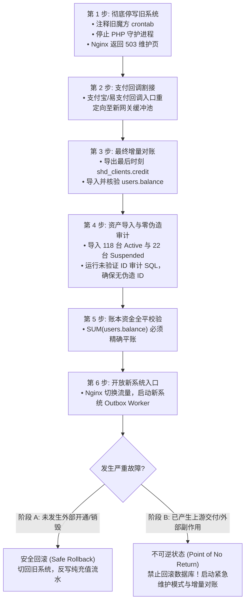

# JianYun (简云) · 生产割接与对账稽核实施规程 (Migration Runbook)

> [!IMPORTANT]
> 本文档为生产割接唯一权威实施操作指南，全面废止早期概念草案中的简易脚本。  
> 任何参与生产割接的工程师或自动化 Agent 必须逐项执行本规程，严禁擅自修改判定条件。

---

## 1. 权限与身份映射纠偏（绝对排除硬编码错误）

在旧智简魔方（`idc2`）中，**管理员与终端客户存储于两张完全独立的物理表**：
- **真实管理员**：存储在 `idc2.shd_user` 表（共 3 个管理员：`yhyad`、`xia125`、`admin`）；
- **终端客户**：存储在 `idc2.shd_clients` 表（共 3,363 个客户）。其中 `id=1` 仅仅是一个普通测试客户账号（`3228696300@qq.com`）。

### 1.1 严正修正后的导入脚本
```sql
-- 步骤 1: 显式导入真实管理员至独立的 admins 物理表 (保留原始 ID，绝无主键碰撞)
INSERT INTO `jianyun`.`admins` (
    `id`, `username`, `email`, `password`, `role`, `status`, `created_at`
)
SELECT 
    u.id,
    u.user_login,
    u.user_email,
    u.user_pass, -- 旧魔方密码哈希 (系统支持首次登录时透明升级为 Bcrypt)
    'super_admin',
    'active',
    FROM_UNIXTIME(u.create_time)
FROM `idc2`.`shd_user` u;

-- 步骤 2: 显式导入 3,363 位真实终端客户至纯净的 users 表 (无管理员身份污染)
INSERT INTO `jianyun`.`users` (
    `id`, `email`, `phone`, `password`, `balance`, `status`, `created_at`
)
SELECT 
    c.id,
    c.email,
    NULLIF(c.phonenumber, ''),
    c.password,
    c.credit,
    IF(c.status = 1, 'active', 'suspended'),
    FROM_UNIXTIME(c.create_time)
FROM `idc2`.`shd_clients` c
ON DUPLICATE KEY UPDATE `email` = VALUES(`email`);
```

---

## 2. 存量资产分类处置矩阵 (Active 118 / Suspended 22 / Pending 14)

根据对旧库 `shd_host` 的深度静态审计，存量实例的物理分布如下：

| 旧状态 (`domainstatus`) | 实例数 | 真实业务物理分布 | 简云迁移处置规范 |
|---|---|---|---|
| **Active** | 118 | 106 台 DCIM 云服务器、5 台 Easypanel 主机、6 台 宝塔(skymnbt)、1 台 Sub2API | 严格校验真实远端 ID。100% 验证通过导入 `active`；缺映射者强制挂起 |
| **Suspended** | 22 | 20 台 DCIM 云服务器、2 台 Easypanel 主机 | 导入为 `suspended`，`suspend_type = 'migration'`，保持停机锁闭 |
| **Pending** | 14 | 11 笔未付款订单、1 笔空测试单、**2 笔已付款未交付主机 (#1401, #4052)** | 未付款单仅转为未支付账单；2 笔已付款未交付转入工单阻断人工核办 |

---

## 3. 远端 ID 映射核准与“零伪造”安全门禁

旧库中不同业务类型的远端唯一标识存储于不同字段：
- **DCIM 云服务器 (`serverid = 0`)**：远端标识存储在 `dcimid`。
- **虚拟主机面板 (`serverid IN (5, 7)`)**：远端标识存储在面板分配的 `username`。
- **Sub2API / 外部接口 (`serverid = 8`)**：远端标识存储在 `subscriptionid` 或自定义密钥。

> [!CAUTION]
> **绝对禁止使用本地 ID 冒充远端 ID！**  
> 严禁写任何 `COALESCE(dcimid, h.id)` 类似的 fallback 代码。如果远端 ID 不存在或为 0，必须置为 `NULL`，并强制标记为 `unverified_missing_remote_id`，状态设为 `suspended`，绝对禁止任何远程开机、关机、重启、重装、销毁等破坏性 API 调用！

### 3.1 实例迁移与映射审计 SQL

```sql
-- 预置核准的 Provider 映射关系 (来自 providers 表)
-- 1: SakuraIDC/DCIM 上游 (driver='zjmf')
-- 2: Easypanel 虚拟主机 (driver='easypanel')
-- 3: 宝塔面板节点 (driver='skymnbt')
-- 4: Sub2API 订阅网关 (driver='sub2api')

INSERT INTO `jianyun`.`instances` (
    `id`, `user_id`, `product_id`, `provider_id`, `remote_instance_id`,
    `name`, `ip_address`, `config_snapshot`, `billing_cycle`, `recurring_price`,
    `status`, `suspend_type`, `suspend_reason`, `auto_renew`, `start_date`, `due_date`
)
SELECT 
    sub.id,
    sub.user_id,
    sub.product_id,
    sub.provider_id,
    sub.remote_instance_id,
    sub.name,
    sub.ip_address,
    sub.config_snapshot,
    sub.billing_cycle,
    sub.recurring_price,
    -- ⚡ 统一门禁：只要 remote_instance_id 为 NULL 或空，状态一律强制为 suspended，绝无例外！
    CASE 
        WHEN sub.remote_instance_id IS NULL THEN 'suspended'
        WHEN sub.legacy_domainstatus = 'Active' THEN 'active'
        ELSE 'suspended'
    END AS status,
    CASE 
        WHEN sub.remote_instance_id IS NULL THEN 'migration'
        WHEN sub.legacy_domainstatus = 'Suspended' THEN 'migration'
        ELSE 'billing'
    END AS suspend_type,
    CASE 
        WHEN sub.remote_instance_id IS NULL THEN 'unverified_missing_remote_id: 割接缺少远端映射，物理阻断远程操作'
        WHEN sub.legacy_domainstatus = 'Suspended' THEN '旧魔方系统导入暂停状态，待客户工单核验'
        ELSE NULL
    END AS suspend_reason,
    1 AS auto_renew,
    sub.start_date,
    sub.due_date
FROM (
    SELECT 
        h.id,
        h.uid AS user_id,
        h.productid AS product_id,
        -- 严格 Provider 校验: 未知 serverid 直接拒绝并抛出异常
        CASE 
            WHEN h.serverid = 0 THEN 1
            WHEN h.serverid = 5 THEN 2
            WHEN h.serverid = 7 THEN 3
            WHEN h.serverid = 8 THEN 4
            ELSE (SELECT id FROM `jianyun`.`providers` WHERE 1=0) -- 抛出 NULL 触发 NOT NULL 约束阻断未知节点
        END AS provider_id,
        -- 远端唯一标识萃取：覆盖全部四种类型，提取失败严格置为 NULL
        CASE 
            WHEN h.serverid = 0 AND h.dcimid > 0 THEN CAST(h.dcimid AS CHAR)
            WHEN h.serverid IN (5, 7) AND LENGTH(TRIM(COALESCE(h.username, ''))) > 0 THEN TRIM(h.username)
            WHEN h.serverid = 8 AND LENGTH(TRIM(COALESCE(h.subscriptionid, h.username, ''))) > 0 THEN TRIM(COALESCE(h.subscriptionid, h.username))
            ELSE NULL 
        END AS remote_instance_id,
        COALESCE(NULLIF(h.domain, ''), CONCAT('vm-', h.id)) AS name,
        NULLIF(h.dedicatedip, '') AS ip_address,
        JSON_OBJECT(
            'legacy_host_id', h.id,
            'legacy_dcimid', h.dcimid,
            'legacy_username', h.username,
            'legacy_serverid', h.serverid,
            'stream_info', h.stream_info
        ) AS config_snapshot,
        LOWER(COALESCE(NULLIF(h.billingcycle, ''), 'monthly')) AS billing_cycle,
        h.amount AS recurring_price,
        h.domainstatus AS legacy_domainstatus,
        FROM_UNIXTIME(IF(h.regdate > 0, h.regdate, UNIX_TIMESTAMP())) AS start_date,
        FROM_UNIXTIME(IF(h.nextduedate > 0, h.nextduedate, UNIX_TIMESTAMP() + 2592000)) AS due_date
    FROM `idc2`.`shd_host` h
    WHERE h.domainstatus IN ('Active', 'Suspended')
) sub;
```

### 3.2 2 笔已付款未交付主机 (#1401, #4052) 专项处理
```sql
-- 将 2 笔付款但魔方未成功交付的机器插入为 pending，并附带明确告警与 recurring_price
INSERT INTO `jianyun`.`instances` (
    `id`, `user_id`, `product_id`, `provider_id`, `remote_instance_id`,
    `name`, `recurring_price`, `status`, `suspend_type`, `suspend_reason`, `start_date`, `due_date`
)
SELECT 
    h.id, h.uid, h.productid, 1, NULL,
    CONCAT('pending-legacy-', h.id),
    h.amount,
    'pending', 'migration', '旧魔方已收款但未开通成功，等待运维手动交付或退款',
    NOW(), DATE_ADD(NOW(), INTERVAL 30 DAY)
FROM `idc2`.`shd_host` h
WHERE h.id IN (1401, 4052);

-- 自动生成内部高危阻断工单
INSERT INTO `jianyun`.`tickets` (
    `user_id`, `instance_id`, `title`, `department`, `priority`, `status`
) VALUES 
(1471, 1401, '【割接历史遗留】旧系统已付款未开通待交付主机 #1401', 'technical', 'high', 'open'),
(1285, 4052, '【割接历史遗留】旧系统已付款未开通待交付主机 #4052', 'technical', 'high', 'open');
```

---

## 4. 生产割接七步法与“不可逆分界点” (Point of No Return)



### 4.1 不可逆分界点 (Point of No Return) 明确定义与应急处置
系统严禁简单地“把新充值加回旧库就恢复旧魔方”。因为一旦发生以下任一**外部副作用**：
1. 客户在新系统购买，上游已真实创建了一台 VPS 并扣除了商户余额；
2. 实例到期，新系统的销毁 Worker 已经调用上游 API 删除了云服务器；
3. 客户发起了微信/支付宝原路退款，网关已经完成了资金原路返回；

此时若强行回滚旧系统数据库，将导致**物理资产、上游资金与数据库账本彻底永久撕裂**！

#### 应急防线与处置规则：
- **阶段 A（割接开放 1 小时内且未发生任何外部副作用）**：
  必须执行两项严格门禁检查：
  1. `tasks` 状态核查：`SELECT COUNT(*) FROM tasks WHERE status IN ('running', 'investigating', 'success')` 必须严格等于 0！凡处于 `running` 或 `investigating` 者一律视同潜在外部副作用，不可草率判定为无副作用；
  2. 本地流水审计：核实割接期间未发生任何站内余额消费、佣金划转或站外提现扣款。
  - **处置规程**：新系统切维护模式；通过全账户净差额对账脚本计算每位客户在割接窗口期内的净余额变化：
    $$\Delta \text{Credit} = \sum \text{充值到账} - \sum \text{本地消费} + \sum \text{本地退款}$$
    将净差额更新回旧魔方：`UPDATE idc2.shd_clients SET credit = credit + :delta WHERE id = :user_id;`
  - 恢复旧魔方的 Nginx 与 Crontab。
- **阶段 B（一旦发生外部交付或存在未决任务，进入不可逆阶段）**：
  **绝对禁止回滚数据库到旧魔方！** 必须启动 **紧急维护模式 (Emergency Maintenance Mode)**：
  1. API 网关返回 `503 Service Temporarily in Emergency Reconciliation`，锁定所有交易与实例写操作；
  2. 运维与研发团队启动热修复（Hotfix）在线发布；
  3. 若确需修复部分异常订单，必须使用 **增量对账与状态回写脚本 (Delta Reconciliation Script)**，逐笔计算全账本分户流水，确保账实分毫不差。
