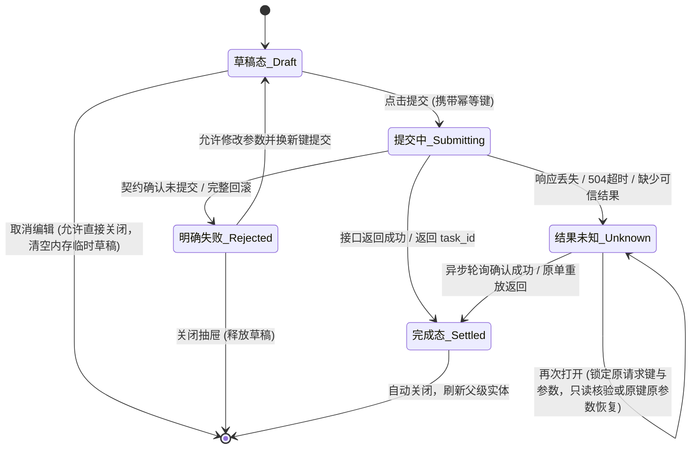

# JianYun（简云）页面防膨胀长效治理与信息架构工程规范（v2.1.0 深度校正版）

> **规范版本**：v2.1.0（开发依据正式修订版） 
> **制定日期**：2026-11-09 
> **适用范围**：复杂业务详情页、多配置管理页与长表单治理 
> **文档定位**：外部 v2.1.0 设计稿已定稿；本文件为纳入仓库的工程约束，状态、适用范围与分批验收以本节接入记录为准。外部定稿不代表仓库实现或运行验收完成。

---

## 一、 现状基线校正与真实治理对象

### 1.1 现状事实澄清（纠正前置审计偏差）
结合前端与后端源码静态核查，对前版报告中的事实偏差予以校正：
1. **重装面板现状**：
   * 在现有的 [`InstanceReinstallPanel.vue`](../web/src/components/InstanceReinstallPanel.vue) 中，重装表单默认已处于折叠状态；密码模式由上游规则指定（上游生成并在交付后同步），**目前并不包含用户手动输入 root 密码与确认文本的流程**。
2. **已有交付成果列为“回归保护项”**：
   * 结账页（[`CheckoutView.vue`](../web/src/views/CheckoutView.vue)）的吸底结算条与报价倒计时联动、后台任务列表（[`AdminTasksView.vue`](../web/src/views/AdminTasksView.vue)）的高级筛选抽屉化，在 [`docs/MOBILE_PORTRAIT_UX.md`](MOBILE_PORTRAIT_UX.md) 中已通过 154 项 Chromium 多端检查。**这些属于必须受保护的既有资产，绝不重复开发**。
3. **通知与工单现状**：
   * 后台通知配置（[`AdminNotificationSettingsView.vue`](../web/src/views/AdminNotificationSettingsView.vue)）目前**仅有单邮件渠道（`notify.mail`）**，未接入 Webhook 或多渠道配置；邮件配置（`saveMail`）与工单订阅（`saveTickets`）拥有独立的并发版本号（`version`）与保存逻辑，**必须保持各自独立保存，严禁合并为一个底部保存按钮**；
   * 工单交流页为**纯文本输入框（Textarea）**，非富文本编辑器。
4. **度量描述严谨化**：
   * 前版报告提及的“每天使用五次”、“六至十屏”、“信息率从80%降至20%”均为示意性说明，当前无本轮真实流量度量，不作为验收凭据。

### 1.2 本轮重点治理对象清单
在现有页面中，真正面临“多面板垂直堆叠、长描述侵占、表单纵向膨胀”且最需治理的页面依次为：
* **目标 1：后台实例详情页（[`AdminInstanceView.vue`](../web/src/views/AdminInstanceView.vue)）**：
  * 现状：实例与归属大表格、关联定位链接、服务状态面板、续费价格调整面板、手工账目调整面板、关联账单表格等 **5 个重型面板垂直串联**，是目前全系统最长的后台详情页，作为**样板首发治理**。
* **目标 2：客户前台实例详情页（[`InstanceView.vue`](../web/src/views/InstanceView.vue)）**：
  * 现状：长参数描述、服务状态、购买账单链接、电源面板、重装面板单列展开，需将首屏操作（VNC/电源）与次要参数清晰分流。
* **目标 3：后台通知配置页（[`AdminNotificationSettingsView.vue`](../web/src/views/AdminNotificationSettingsView.vue)）**：
  * 现状：邮件配置与工单订阅单列纵向堆叠，适合分面收敛并保持独立保存。
* **后续沿用：后台支付渠道配置**（沿用样板模式）。

---

## 二、 状态生命周期：页壳稳定与未决任务持续跟踪

将单页拆分为分面或子页后，**状态由谁持有、轮询何时启停、换页如何不销毁数据**是架构成败的关键。

### 2.1 状态持有职责划分（State Ownership）
必须实行严格的三级状态持有模型：

| 状态类型 | 持有者（Owner） | 具体涵盖数据 | 生命周期与行为约束 |
| :--- | :--- | :--- | :--- |
| **全局任务与互斥状态** | **实例页外壳（Page Shell）** | 实例基础资料、当前服务状态、未决任务跟踪、互斥锁状态（`powerBlocked`, `reinstallBlocked`）、异常与阻断摘要 | **随实例 ID 保持稳定**。切换子 Tab 或打开抽屉时绝对不销毁；**未决任务跟踪、阻断摘要和凭据失效由稳定页壳持续维护**。 |
| **局部编辑表单状态** | **子视图 / 抽屉组件** | 重装选中的镜像 ID、改密草稿、手工调价表单数据、临时筛选条件 | **子视图在内存中自主持有**。切换 Tab 时在组件树内存中保留草稿；提交完成前不得直接污染外壳数据。 |
| **敏感凭据状态** | **独立凭据卡片内存** | 实例登录用户名、明文密码、验证说明 | **离开即销与旧请求作废**。通过接口显式拉取，仅存活于当前查看区域内存中；用户离开凭据查看区域、折叠面板或切换页签时，**必须立即清除（`credentials = null`）并递增请求版本号（`credentialVersion++`），使在途延迟响应作废**。严禁写入持久存储。 |

### 2.2 轮询与未决任务持续跟踪规范
* **隐藏区与后台轮询原则**：
  * **隐藏区可暂停非必要展示查询**（例如未激活页签的静态说明、副属性明细）；
  * **未决任务跟踪绝不停止**：当存在处于 `pending`、`running`、`investigating` 状态的在途操作时，由稳定页壳（或持久挂载面板）沿用既有查询频率（如 15 秒）与有限远端观察窗口持续轮询；
  * 阻断状态（`blocked`）由页壳集中对外暴露，确保用户切到任意页签时，阻断提示与不可操作门禁始终生效，避免重复定时器泄漏。
* **路由挂载生命周期保护**：
  * 在 [`App.vue:162-166`](../web/src/App.vue#L162-L166) 中，根路由使用 `:key="$route.path === '/reset-password' ? $route.path : $route.fullPath"`；
  * **规范契约**：详情页的生命周期**必须按身份和实例 ID 保持稳定**。在详情页内部，子 Tab 切换使用组件内部响应式状态（如 `activeTab = ref('overview')`），不改变 URL query 导致全页重载；列表页（如 `/admin/tasks?page=2`）继续保留其原有的 URL 参数驱动刷新行为。

---

## 三、 抽屉与模态表单：五态闭环与原键恢复模型

抽屉不能简单地“完成或取消即关闭”。在涉及上游交互与资金账目的操作中（如补差价、重装提交、决议提交），必须遵循**严格五态闭环**：

### 3.1 五态判定与行为规则矩阵
1. **草稿态（Draft）**：用户正在输入参数。
   * *关闭规则*：允许取消关闭，清空当前草稿。
2. **提交中（Submitting）**：请求已发出，正等待服务端应答。
   * *关闭规则*：**抽屉强制锁定**，禁止点击遮罩层关闭，禁止 ESC 退出，按钮进入加载状态。
3. **明确失败（Rejected）**：
   * *判定准则*：**只有接口契约能够权威确认未提交、或业务已完整回滚（如 400 Bad Request、422 参数验证失败、409 业务门禁且状态未变），才进入明确失败**；
   * *行为规则*：抽屉保持打开显示错误原因，允许用户修改后使用新请求键重试；若用户主动取消，重置表单并关闭。
4. **结果未知（Unknown / In-flight Timeout）**：
   * *判定准则*：遭遇网络闪断、丢响应、网关 504 超时、或缺少可信响应结果；
   * *恢复与原键契约*：
     * **同实例切页签、关抽屉**：在内存中保留原操作上下文与未决状态；**主机密码、含密载荷严禁为了恢复功能写入浏览器持久存储（localStorage/IndexedDB）**；
     * **恢复操作**：按接口契约选择【只读核验】或显式使用**原键、原参数**恢复。例如后台补差服务（[`ManualAdjustmentService.php:152`](../app/Services/ManualAdjustmentService.php#L152)）已原生支持使用相同的 `request_key`（服务内部为 `checkoutKey`）重放并安全返回原账单（`replayed: true`），严禁剥夺这项合规的原键恢复能力；
     * **跨浏览器刷新（F5）范围说明**：跨刷新后的恢复依赖于后端能通过实例 ID 反查到的在途任务（`tasks`），前端内存未落盘的敏感草稿在 F5 后不承诺无条件恢复。
5. **完成态（Settled）**：
   * *判定准则*：服务端返回成功，或返回 `task_id`（表示已成功受理，进入异步跟踪）；
   * *关闭规则*：触发父级上下文刷新事件（`emit('refreshed')`），清理敏感内存数据，平滑关闭抽屉。

---

## 四、 收窄适用范围与自适应布局规则

### 4.1 通用骨架（Shell）的收窄适用边界
三层架构（常驻头部 + 分面 Tabs + 抽屉）**绝非全系统所有页面强制套用**，而是严格限定于复杂实体详情：
* **适用场景**：
  * 后台实例详情页（归属定位、服务核对、手工账务调整、关联账单）；
  * 客户实例详情页（凭据、电源、重装、账单）。
* **不适用场景（保持各自合理形态）**：
  * **独立设置表单**（如通知设置）：按业务模块分组卡片呈现，邮件与工单独立保存；
  * **工单会话（Tickets）**：上部沟通记录流 + 底部纯文本 Textarea，适合线性交互；
  * **查询列表（Directories & Tasks）**：顶部搜索筛选 + 主体表格 + 底部分页。

### 4.2 避免“无意义膨胀”的新增功能落位规则
1. **优先归入既有任务域**：
   * 后续新增功能，**优先考虑作为已有 Tab 的子模块**，严禁每增加一个 API 就新建一个 Tab，防止手机端横向 Tab 栏自身产生溢出与换行灾难；
2. **空能力不渲染**：
   * 数据库现有的 `instance_snapshots` 等表仅作未来业务归属规划，**本批改造坚决不渲染任何空白入口、不添加未实现操作**；
3. **客户前台操作触达保护**：
   * 客户实例页默认概览中，**必须保持正常状态下的独立 VNC 入口与电源操作在首屏清晰可达**，延续既有竖屏优化成果。

---

## 五、 结账页 Schema 驱动与回归保护

在选购结账页（[`CheckoutView.vue`](../web/src/views/CheckoutView.vue)）防膨胀治理中，必须严守底层通用性：

### 5.1 驱动公开 Schema 真实渲染（禁止硬编码分组）
* **禁止猜测中文字段**：商品类型涵盖 VPS、物理机、CDN、软件授权等异构形态。前端**绝对不得硬编码“系统镜像”、“算力配置”、“安全密码”等固定分组**；
* **Schema 驱动原则**：严格基于后端下发的 `ProductConfiguration.fields` 渲染；仅当驱动公开 Schema 本身提供了明确的分组元数据（`group` 字段）时才做视觉聚类，否则一律保持单层受控渲染；
* **选项形态自适应**：选项少（2~4 项）且字符短时允许双列磁贴；选项多（5 项以上）或带有长说明文本时，坚决使用 `<el-select>` 下拉框，防止磁贴反向撑爆页面。

### 5.2 结账核心逻辑回归保护清单（Regression Protection）
以下现有核心逻辑在任何 UI 调整中受到绝对保护：
1. **报价状态与失效机制**：
   * `confirmed` 包含的 `quote_token`、`quote_expires_at` 严格校验，5 分钟倒计时与失效判定保持原逻辑；
2. **提交门禁计算属性**：
   * 严格复用现有 [`canSubmit`](../web/src/views/CheckoutView.vue#L46)（兼顾 `confirmed`、`!quoteExpired`、`!loading`、`!quoting`、`!busy`）；
3. **请求幂等键与双态文案**：
   * 沿用 `checkoutKey = crypto.randomUUID()`（配置/密码变动刷新，网络重试保留同一 key）；
   * 按钮文案严格区分：`useBalance ? "确认配置与价格，余额付款" : "确认配置与价格，创建账单"`（窄屏可简写为 `余额付款 / 创建账单`，禁止使用“支付并开通”）。

---

## 六、 任务导向验收准则（取代硬性数字红线）

取消“超过 3 张卡片打回”、“超过 3 个输入框打回”等死板数值，**转为与 [`docs/MOBILE_PORTRAIT_UX.md`](MOBILE_PORTRAIT_UX.md) 完全一致的任务验收标准**：

> **核心验收原则**： 
> **正常状态检查首屏操作触达；存在异常时，操作附近优先显示阻断原因。折叠/分面展示区域后，未决任务跟踪、阻断互斥通知和凭据失效保护仍须持续稳定工作。**

### 审查与自动化支持分工
* **静态与自动化检查**：
  * Vue 严格类型检查（`vue-tsc --noEmit`）；
  * 代码规范检查（`npm run lint`，0 警告）；
  * 构建后无新增循环引用，打包正常。
* **人工 / 真实流程检查**：
  * 在 320px、390px、768px、820px 下验证首屏核心入口可点性；
  * 验证存在锁定任务或服务暂停时，阻断原因是否在操作就近位置明确呈现；
  * 抽屉在弱网丢响应后，再次打开是否保持原请求键并进入结果未知恢复模式；
  * 凭据查看后切换 Tab，验证内存凭据是否已置空且迟到响应不会重绘。

---

## 七、 实施推进步骤

本规范草案经评审校准后，按以下顺序依次推进实际代码的增量落地：

1. **步骤一：规范固化与验收规则对齐**（本文档 v2.1.0 冻结生效）；
2. **步骤二：后台实例详情样板（[`AdminInstanceView.vue`](../web/src/views/AdminInstanceView.vue)）**：
   * 将当前 5 个堆叠大卡片重塑为分面布局：概览与归属定位、服务状态核验、账务与价格调整、关联账单分面展现，提炼出成熟的生命周期控制模式；
3. **步骤三：客户实例详情页（[`InstanceView.vue`](../web/src/views/InstanceView.vue)）**：
   * 沿用样板，确保正常状态下独立 VNC 与电源面板首屏可达，次要参数与重装面板按需展开，敏感凭据离开即销；
4. **步骤四：后台通知配置页（[`AdminNotificationSettingsView.vue`](../web/src/views/AdminNotificationSettingsView.vue)）**：
   * 邮件通道配置与工单订阅通知分面展现，严格保持独立保存与各自版本号；
5. **步骤五：沉淀通用组件并应用于后续支付配置视图**。

## 八、仓库接入记录与首批边界（2026-11-09）

- **外部草案定稿**：外部文件 v2.1.0 已由本次需求确认为实施依据；原文中流量、屏数等示意数值不作为验收事实。本地原稿保持不改。
- **仓库工程约束接入**：本文件纳入 Git，AGENTS.md 与 FRONTEND.md 引用；仓库版本为后续修改入口，不维护外部副本同步工具。以上历史源码行号仅用于定位，判断行为以当前契约与源码为准。
- **本批只做后台实例页样板**：顶部紧凑摘要、关联入口与异常；分为“概览与归属、服务核对、价格与补差、关联账单”。财务／超级管理员才挂载价格与补差；其他角色保留权限说明，不读取金融接口。
- **稳定生命周期**：分区用组件内状态，不改 URL；既有业务面板持续挂载。关联账单分页也在页内读取原接口，不因 query 触发 App 的 fullPath key 重建；列表页原 URL 分页保持。实例详情刷新不销毁已挂载表单，业务提交后显式重读关联价格／补差面板。管理员页没有新增自动远端轮询，不声称具有客户页电源／重装跟踪能力。
- **按接口区分恢复**：续费改价继续“未知先重读价格及审计”，不自动重发；补差未知保留原 preview_token、request_key 和确认参数，关闭再开或切分区仍可显式恢复原结算。明确拒绝才允许重新预览；提交中不可关闭。普通草稿取消清空；切分区本身不清草稿。五态用于约束行为，不要求新增通用状态机或公共抽屉框架。
- **提炼顺序校准**：先完成并验收此页，再另批提炼公共骨架，推广客户实例页和通知配置；上文推进图是方向，不代表本批授权开发全部页面。通知仍按独立设置表单处理，不强套实体页壳。
- **兼容与成本**：仅前端信息组织、局部状态保护和文档接入；无 API／资金／权限／版本／Worker 契约、数据库或迁移变化。增加页内分区状态、面板摘要事件与显式重读，删除长页查找及路由重建导致的草稿丢失，不新增公共框架、队列或状态副本。

本批页面路径、检查和截图记录在 [后台实例页样板验收](ADMIN_INSTANCE_PAGE_SAMPLE.md)。外部定稿、工程接入和页面验收三者分别记录，不能互相代替。

## 九、客户样板接续（2026-11-09）

后台样板已独立验收。用户明确本批先做客户页“概览／系统维护／账期与续费”，单独验证跨区任务跟踪、明文凭据失效和操作意图；公共骨架等两个样板完成后再按实际共性提炼，通知配置仍待后续。此安排替代上文“后台完成立即提炼”的时序，其他生命周期、权限与独立提交规则保持。本批客户页实现与148项独立检查已通过，详情与实际证据见 [客户样板契约](CLIENT_INSTANCE_PAGE_SAMPLE.md)。
