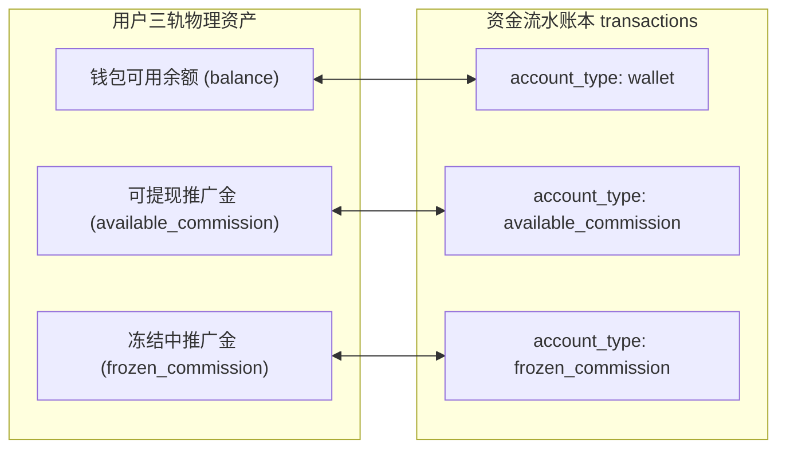
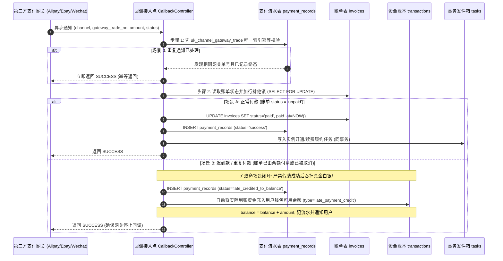
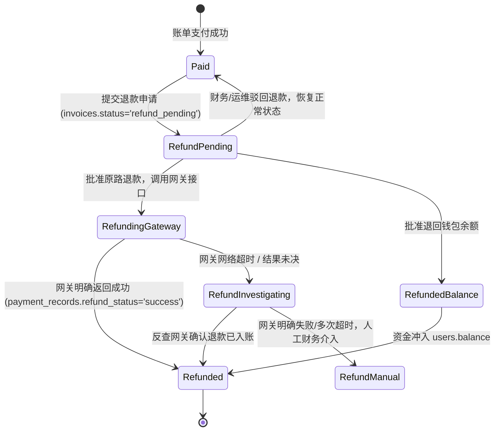

# JianYun (简云) · 支付、多收、退款与资金账本协议 (Payments & Ledger Contract)

> [!IMPORTANT]
> 本协议为系统资金收单、分户账本、并发防重、退款状态机与原路返还的**唯一权威执行规范**。  
> 核心原则：**账本物理不可变、金额绝无浮点误差、迟到款必定入账、退款必须预扣在途资金。**

---

## 1. 资金账户分立与内核级物理平衡约束

系统实行**三轨分立资金分户模型**，严格杜绝资金对账混乱与串户：



### 1.1 铁律一：内核级物理平衡与绝对只追加 (Append-Only)
每一笔资金变动必须在同一个数据库事务内更新 `users` 账户并向 `transactions` 插入明细：
$$\text{balance\_after} = \text{balance\_before} + \text{amount}$$

> [!CAUTION]
> **数据库内核物理强制**：  
> 鉴于 MySQL 5.7 默认忽略表级 `CHECK` 约束，简云在数据库内核部署了强校验触发器：
> 1. `trg_transactions_check_balance`: 在 `BEFORE INSERT` 时校验 `ROUND(balance_after, 2) == ROUND(balance_before + amount, 2)`，若不平衡直接抛出 `SQLSTATE 45000` 物理拦截；
> 2. `trg_transactions_no_update` & `trg_transactions_no_delete`: 拦截任何对 `transactions` 表的修改与删除，从数据库底层强制确保只追加特性。

### 1.2 铁律二：计算高精度与无浮点规范 (Zero-Float Policy)
1. **类型禁止**：严禁在 PHP、SQL、API 或插件中出现 `float` 或 `double` 类型；
2. **中间计算高精度**：所有涉及比例折扣（如 85 折）、返佣比例（如 15%）、日割退款比例的中间计算，强制使用 **BCMath 并设定内部精度 scale = 4**（如 `bcdiv($days, $totalDays, 4)`）；
3. **入库终值舍入**：仅在生成最终账单金额、分户流水金额时，调用四舍五入规范保留 2 位小数 (`round($val, 2, PHP_ROUND_HALF_UP)`)。

---

## 2. 支付收单生命周期与迟到款/多收款闭环



### 2.1 迟到款转余额业务规则
- **场景**：用户生成支付宝二维码后未付，改用钱包余额付清账单；半小时后又在手机扫码完成了该二维码付款。
- **闭环保证**：网关资金绝不丢失。系统在 `payment_records` 记入实收款项凭证，并在同一事务内将金额充入用户 `users.balance`，发送通知给客户。

---

## 3. 退款风控、持久化状态机与原路退回协议



### 3.1 退款持久化数据模型与状态字段
在 `invoices` 表中：
- 增加 `refund_pending` 状态：`status ENUM('unpaid', 'paid', 'refund_pending', 'refunded', 'cancelled')`。

在 `payment_records` 表中：
- `refund_status ENUM('none', 'pending', 'success', 'failed') NOT NULL DEFAULT 'none'`;
- `refund_amount DECIMAL(10,2) NOT NULL DEFAULT 0.00`;
- `refund_reason VARCHAR(255) NULL`;
- `refund_trade_no VARCHAR(128) NULL COMMENT '网关退款请求批次号'`;
- `refunded_at TIMESTAMP NULL`。

### 3.2 迟到款充入钱包后的原路退款风控（严防双重提现）
当一笔迟到款已经自动充入客户的 `users.balance` 后，若客户或客服后续要求将该笔款项**原路退回第三方支付渠道**（如退回支付宝）：

> [!CAUTION]
> **钱包余额预扣铁律**：  
> 严禁在不核验钱包余额的情况下直接调用网关退款！否则客户若已将充值的余额消费或提现，原路退款将直接导致平台出现无抵押负债和真金白银亏损！

#### 执行四步门禁：
1. **余额充裕性检查**：
   ```sql
   -- 原子尝试扣减钱包余额并加锁
   UPDATE `users` 
   SET `balance` = `balance` - :refund_amount 
   WHERE `id` = :user_id 
     AND `balance` >= :refund_amount;
   ```
2. **分支判断**：
   - **扣减成功 (affected_rows == 1)**：在 `transactions` 记入预扣流水 (`type = 'refund'`, `remark = '原路退款预扣冻结'`)。随后方可调用支付插件发起 `refundPayment()`；
   - **扣减失败 (affected_rows == 0)**：表明该笔资金已被客户用于消费其他云资源或申请了站外提现！**系统立即阻断原路退款**，标记为 `RISK_NEGATIVE_BALANCE_BLOCKED`，工单转入人工风控介入流程。
3. **网关调用结果恢复**：
   - 若网关返回超时，`payment_records.refund_status` 保持 `pending`，由退款对账任务调用 `queryRefund()`，绝不盲目重复发起扣款；
   - 若网关确认彻底失败且不再重试，则补偿回滚将预扣的金额充回用户钱包 (`type = 'refund_rollback'`)。
