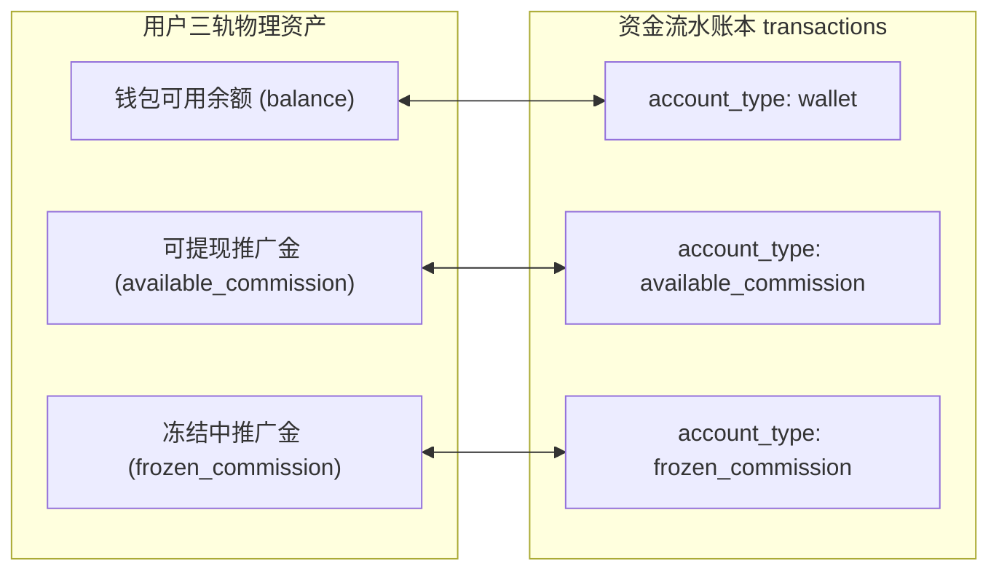
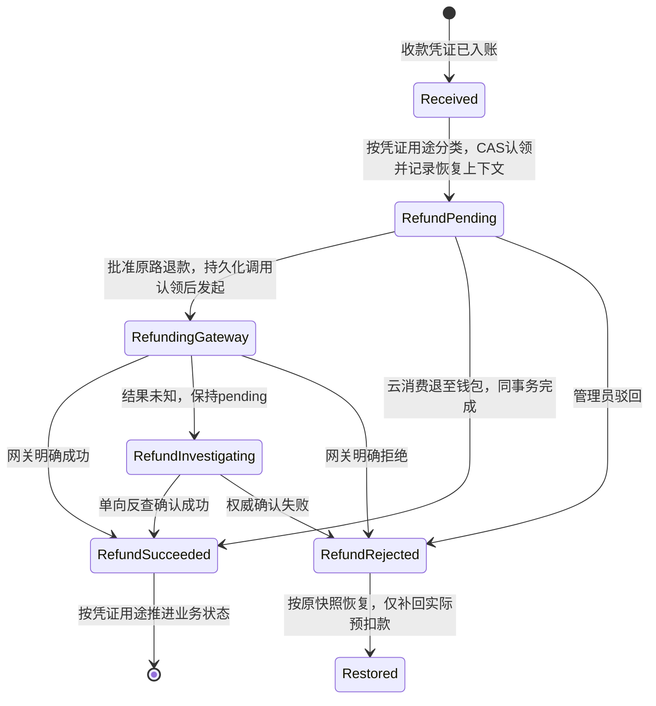

# JianYun (简云) · 支付、多收、退款与资金账本协议 (Payments & Ledger Contract)

> [!IMPORTANT]
> **本契约已被正式冻结为资金安全与账本流转核心标准。**  
> 明确规范：内核级物理平衡检查、绝对禁止浮点运算与纯字符串半五舍入、退款原子认领与防重复预扣、失败回滚补偿流水与网关超时对账协议。

<a id="manual-refund-policy"></a>

## 当前退款交付边界（2026-11-08）

用户确认：退款由管理员在相应渠道手动办理。当前不开发自动退款、自动补偿、网关退款调用或退款反查调度，不将这些能力列为本期交付或上线前置。下文 §3 的完整退款状态机、网关调用及相关故障矩阵保留为未来另行授权的参考；财务防重、用途隔离和审计约束继续有效，设计文档不代表已有可用的退款接口。

管理员办理后保留原收款凭证、实际退款金额、渠道退款凭证和经办记录；没有成功证据不得记为已退，不能把手动退款当作修改或删除历史资金记录的理由。将来若实现本地登记，仍须遵循同连接事务、CAS、防重复记账与退款用途隔离；当前没有新增登记入口，也未执行任何退款。

已有的收款 CAS、迟到/多收款幂等入钱包、SC-L02 专用资金保护及管理员显式触发的未交付新购 `cancel_compensate` 保留，本次不改其行为。退钱与资源/任务处置分别核验；手动退款本身不证明底层资产或排队请求已清理，也不自动解除未知任务占用。旧账单 3 的 ¥16.00 仍待管理员处理，不能因本策略变更认定已结清。

**契约调整记录**：原因是采用人工退款以缩小当前开发范围。同步 AGENTS、架构、支付/插件/API、数据库字段说明、M2 契约、README 与路线图；仅调整交付范围，不改代码、27 表 schema、接口或历史数据，无迁移与运行配置变更。验证限于文档链接、字典同步与差异检查，不作为实际退款或运行验收。

---

## 1. 资金账户分立与内核级物理平衡约束

**M2 已实现充值**：正常充值按实际凭证 ID 使用 recharge:pay_ID 防重；迟到／多收继续 late_credit:pay_ID。两者均锁钱包、同事务更新余额并追加流水，充值不增 total_spent 或佣金。新入账 transactions.trade_no 记录对应实收凭证 trade_no；历史流水不改写，查询通过原幂等键关联。后台只读投影，不提供改余额、删流水或退款操作。钱包容量／流水故障必须让凭证、账单 CAS、余额一起回滚，不确认未入账款。契约及验证见 [充值与资金查询](M2_WALLET_FINANCE.md)。

系统实行**三轨分立资金分户模型**，严格杜绝资金对账混乱与串户：



### 1.1 铁律一：内核级物理平衡与绝对只追加 (Append-Only)
每一笔资金变动必须在同一个数据库事务内更新 `users` 账户并向 `transactions` 插入明细：
$$\text{balance\_after} = \text{balance\_before} + \text{amount}$$

> [!CAUTION]
> **数据库内核物理强制与保证范围说明**：  
> 1. `trg_transactions_check_balance`: 在 `BEFORE INSERT` 时校验 `ROUND(balance_after, 2) == ROUND(balance_before + amount, 2)`，若不平衡直接抛出 `SQLSTATE 45000` 拦截；
> 2. `trg_transactions_no_update` & `trg_transactions_no_delete`: 拦截任何对 `transactions` 表的修改与删除；
> 3. **悲观行锁执行规范 (Pessimistic Locking Pattern)**：因为触发器物理校验 `balance_after = balance_before + amount`，应用层资金服务 (`LedgerService`) 在更新任何分户资产时，**严禁使用盲写并发更新**（如 `UPDATE users SET balance = balance - 10` 后盲猜余额），必须先执行悲观行锁锁定当前分户行：
>    ```sql
>    -- 标准资金变动标准事务模板
>    START TRANSACTION;
>    -- 1. 悲观行锁锁定用户分户资产行
>    SELECT `balance`, `available_commission`, `frozen_commission` 
>    FROM `users` WHERE `id` = :user_id FOR UPDATE;
>    -- 2. 应用层校验业务前置条件 (如扣款时: $balance >= $deduct_amount)
>    -- 3. 计算确切的 balance_after = balance_before + amount
>    UPDATE `users` SET `balance` = :balance_after WHERE `id` = :user_id;
>    -- 4. 插入资金流水 (触发器严格校验 balance_after = balance_before + amount)
>    INSERT INTO `transactions` (
>        `user_id`, `invoice_id`, `account_type`, `type`, `amount`,
>        `balance_before`, `balance_after`, `idempotency_key`, `remark`
>    ) VALUES (...);
>    COMMIT;
>    ```

---

## 2. 协议四：零浮点纯十进制高精度计算与字符串舍入规范 (Zero-Float Policy)

为彻底消灭“因过早截断比例或使用浮点 `round()` 产生的分币累计误差”：

### 2.1 先乘后除铁律（Multiply First, Divide Second）
> [!CAUTION]
> **严禁在计算日割退款、比例分摊时先计算出截断的小数比例！**  
> 必须遵循“基础金额乘以分子，再除以分母”的十进制原则。

$$\text{CalcAmount} = \frac{\text{BaseAmount} \times \text{Numerator}}{\text{Denominator}}$$

- **反例与正例对比（以 3000 元/月，剩余 1/31 周期为例）**：
  - ❌ **严重错误（过早截断比例）**：先算 $1 \div 31 = 0.0322$（截取4位），再算 $3000 \times 0.0322 = 96.60$ 元。误差高达 **0.17 元**！
  - ✔️ **正确标准（先乘后除）**：先算 $3000 \times 1 = 3000$，再计算 $3000 \div 31 = 96.774193...$，最终保留二位得到 **96.77 元**，分毫不差！

### 2.2 内部计算高精度 (scale = 6)
所有中间乘除运算强制开启 BCMath 高精度：
```php
$product = bcmul($basePrice, (string)$remainingDays, 6);
$rawResult = bcdiv($product, (string)$totalDays, 6); // scale = 6 确保除法精度
```

### 2.3 严禁 PHP 原生 `round()`，强制无浮点纯字符串半五舍入 (`bc_round`)
PHP 内置的 `round((float)$val, 2)` 会将数字隐式转换为 C 语言 double 浮点数，破坏 Zero-Float 铁律。系统统一使用纯字符串运算的 `bc_round()` 函数：

```php
function bc_round(string $number, int $precision = 2): string 
{
    if (strpos($number, '.') === false) {
        return bcadd($number, '0', $precision);
    }
    // 构造无浮点半五偏移量 (如 precision=2 时 offset 为 '0.005')
    $offset = '0.' . str_repeat('0', $precision) . '5';
    return $number[0] === '-' 
        ? bcsub($number, $offset, $precision) 
        : bcadd($number, $offset, $precision);
}
```

---

## 3. 协议三：退款幂等认领、用途隔离与失败恢复

本节完整退款编排为未来参考，当前按[人工退款策略](#manual-refund-policy)由管理员手动办理，不要求实现下述自动网关调用与调查调度。



### 3.1 按收款凭证用途分流，禁止以父账单类型替代

同一张账单可能有正常消费收款和额外的迟到/多收款；`payment_records.invoice_id` 仅表达关联，**不代表每笔凭证都购买了该实例权益**。收款入账时，服务端将不可变的 `settlement_purpose` 写入 `payment_records.payload`，保留原网关报文；退款以该用途和实际入账流水为依据，禁止采信客户端提交的用途。已有凭证缺失用途时，必须结合收款状态、原始钱包/消费流水核对后补全；无法确定则转人工，不能猜测。

| 用途 (`settlement_purpose`) | 判定依据 | 认领阶段 | 成功后的允许副作用 |
|---|---|---|---|
| `late_wallet_credit` | 凭证 `status='late_credited_to_balance'`，实际钱包入账为 `late_payment_credit`，或 SC-L02 专用 `credit_reason='termination_blocked_renewal'` 的 `refund_to_balance`；无论父账单类型/状态 | 仅该凭证 CAS + 钱包预扣；父账单只读 | 仅该凭证退款终态；**不改父账单、实例、佣金或 `total_spent`** |
| `wallet_recharge` | 独立 `type='recharge'` 账单的正常主收款，凭证 `status='success'`，实际入账流水为 `recharge` | 该凭证 CAS + 钱包预扣；仅该独立充值账单置 `refund_pending` | 该凭证与该独立充值账单置退款终态；不创建实例任务、不冲佣金/消费 |
| `cloud_consumption` | `new/renew/upgrade` 正常消费主收款，凭证 `status='success'`，已交付且消费权益归属校验通过 | 该凭证 CAS + 对应业务账单冻结；按需本地冻结实例；**不预扣钱包** | 按经批准的云资源退订方案退钱、冲消费/佣金并投递销毁任务 |

`late_wallet_credit` 的判断优先于父账单类型。例：实例已由余额支付并运行，用户又扫码支付同一张 `new` 账单；第二笔款入钱包后申请原路退回，原 `new` 账单仍为 `paid`、实例仍为 `active`、原消费额及佣金全部保留。已取消账单的迟到款退回后，原账单仍为 `cancelled`。

退款认领时，在同一 `payment_records.payload.refund_context` 中固化：用途、原账单状态（仅会修改账单的用途）、本次实际预扣金额、退款目标、原实例状态及暂停原因（仅会冻结实例的用途）、稳定退款号与审批/调用阶段。上下文由服务端写入，网关回调不得覆盖。每笔凭证当前仅支持一次退款裁决，金额须为正且不超过该凭证实收；需要多次部分退款时须先扩展契约，不能覆盖现有退款号。

#### 场景 3.1.A：迟到/多收款及独立充值退款的钱包预扣

两种用途均已将款项充入 `users.balance`，必须先预扣；其账单副作用严格按上表分开。

```sql
START TRANSACTION;

-- 按全局锁序：关联实例(若需锁定) -> 账单 -> 收款凭证 -> 用户。
-- 迟到/多收款可读取父账单，但绝不写父账单或其关联实例。
-- 校验凭证归属、服务端用途、原始入账流水及 0 < refund_amount <= amount。

UPDATE `payment_records`
SET `refund_status` = 'pending',
    `refund_amount` = :refund_amount,
    `refund_reason` = :reason,
    `refund_trade_no` = :stable_refund_trade_no,
    `payload` = :payload_with_refund_context
WHERE `id` = :payment_record_id
  AND `status` = :verified_receipt_status
  AND `refund_status` = 'none';
-- affected_rows 必须为 1，否则 ROLLBACK；不预扣、不调用网关。

SELECT `balance` FROM `users` WHERE `id` = :user_id FOR UPDATE;
-- 余额不足则 ROLLBACK；足够时通过 LedgerService 预扣并写 refund 流水。
-- 稳定流水键按 payment_record_id + refund_trade_no 生成。

-- 仅 wallet_recharge 执行：独立充值主账单 paid -> refund_pending，校验影响行数为 1。
-- late_wallet_credit 不执行任何 invoices / instances / commissions / total_spent 更新。

COMMIT;
```

#### 场景 3.1.B：正常云消费凭证的已交付资源退订

款项已经购买云资源，**不得再从用户钱包预扣**。按统一顺序锁定实例、同实例任务、相关账单、凭证，核实主收款与权益归属，遵守 [LIFECYCLE_PRICING.md](LIFECYCLE_PRICING.md) 和 [TASKS_OUTBOX.md](TASKS_OUTBOX.md) 的实例排他协议；存在执行中、调查中或人工核验未决任务时，先阻断退款认领，不改变凭证/账单/实例。仅有 pending 任务时可以认领退款，但它们必须在退款冻结期间停止领取，成功退订后永久取消。

```sql
START TRANSACTION;

SELECT `id`, `status`, `suspend_type`, `suspend_reason`
FROM `instances` WHERE `id` = :instance_id FOR UPDATE;
SELECT `id`, `status`, `last_error` FROM `tasks`
WHERE `instance_id` = :instance_id ORDER BY `id` FOR UPDATE;
-- 只要存在 running/investigating 或 failed+MANUAL_AUDIT_REQUIRED，立即ROLLBACK；不按租约过滤。
-- pending任务暂不执行：本事务即将写入的云消费refund_pending是其领取门禁。
SELECT `id`, `user_id`, `instance_id`, `type`, `status`
FROM `invoices`
WHERE `instance_id` = :instance_id AND `type` IN ('new', 'renew', 'upgrade')
ORDER BY `id` FOR UPDATE;
-- 从锁定结果中取得本次invoice_id，确认不存在另一笔退款冻结或退款销毁待执行。
-- 校验本次业务账单paid、凭证/实例/用户归属及cloud_consumption用途。
-- 保存原状态至服务端refund_context后再修改。

UPDATE `payment_records`
SET `refund_status` = 'pending',
    `refund_amount` = :refund_amount,
    `refund_reason` = :reason,
    `refund_trade_no` = :stable_refund_trade_no,
    `payload` = :payload_with_refund_context
WHERE `id` = :payment_record_id
  AND `invoice_id` = :invoice_id
  AND `status` = 'success'
  AND `refund_status` = 'none';
-- affected_rows 必须为 1，否则整个事务回滚。

UPDATE `invoices` SET `status` = 'refund_pending'
WHERE `id` = :invoice_id AND `status` = 'paid';
-- affected_rows 必须为 1。

-- 仅原为 active 的实例设置本地退款审核冻结；将稳定退款号写入冻结原因，作为恢复 CAS 的归属标记。
-- 原为 compliance/abuse/manual 等暂停的实例保留原状态及原因，不能覆盖。
-- 本地冻结不是上游停机凭证；退款审核期间禁止其他业务动作绕过此冻结。
-- 未决阶段不投递 terminate，不调用物理销毁接口。

COMMIT;
```

**退款冻结与 Worker 的共同门禁**：所有普通入队、pending 领取及人工重试都先锁同一实例并检查同实例云消费账单。`refund_pending` 期间不能领取原有续费/变配/快照等任务，也不能通过另一张未付账单付款绕过冻结。若 Worker 先领取，退款事务看到未决 task 必须回滚；若退款先认领，Worker 看到退款冻结必须等待。两者不可能各自通过旧快照执行。SC-L02 转钱包的账单不代表资源退订，其凭证用途不能触发这个云消费退款门禁。

> [!IMPORTANT]
> **已付订单退款不退券（MARKETING_ENGINE §5.1）**：正常消费退款后优惠券仍为 `used`；迟到/多收款退款不改原订单用券状态。只有未付账单取消流程可以回滚其锁定的优惠券。

### 3.2 外部调用与终态 CAS 门控

1. **持久化调用认领后调用网关**：认领事务提交、审批通过后，先在凭证行锁内将同退款号的 `refund_context.dispatch_state` 从未调用推进为已认领，提交后仅该认领者可调用 `refundPayment()`。并发审批、进程重启或 HTTP 超时不能再次发起；悬空认领按结果未知处理，使用稳定退款号单向 `queryRefund()` 或人工核验。云消费退站内余额无需外部网关，在批准事务内直接裁决。退款目标及用途一经认领不能修改。
2. **同事务终态闸门**：网关返回、异步反查、人工裁决使用相同入口，均先校验凭证/退款号及服务端上下文，再执行下列 CAS；所有账单变化、钱包入账、消费冲减、返佣冲正、实例恢复或销毁投递都必须位于 CAS 成功的同一事务。CAS 影响 0 行时读取已有结果并结束，**绝不继续副作用**。

```sql
START TRANSACTION;
-- 先按统一锁序锁定本用途会变更的资源，重读 refund_context。
UPDATE `payment_records`
SET `refund_status` = :terminal_status,
    `refunded_at` = CASE WHEN :is_success = 1 THEN UTC_TIMESTAMP() ELSE `refunded_at` END
WHERE `id` = :payment_record_id
  AND `refund_trade_no` = :stable_refund_trade_no
  AND `refund_status` = 'pending';
-- affected_rows 必须为 1 才可执行下一节副作用；否则结束事务并返回既有结果。
-- 在此执行 §3.3 对应用途的全部副作用，再提交；不能先提交 CAS 再另起事务。
-- 任一副作用失败时，连同该终态 CAS 一并 ROLLBACK。
COMMIT;
```

3. **未知结果保持 pending**：超时、进程崩溃、非权威的“未查到”均不等于退款失败，不退还预扣款、不恢复资源、不重复请求退款。退款对账按 `payment_records.refund_status='pending'` 扫描，结合服务端审批/调用阶段进行单向查询；无法权威裁决则保留冻结并告警人工。审批驳回仅允许尚未认领外部调用的阶段；一旦调用已认领，人工也不能仅凭本地超时判定失败，须有网关权威拒绝/未执行且以后不会执行的证据。任何人工结果也要走同一终态 CAS。

### 3.3 成功与拒绝的用途专属副作用

**成功（终态 CAS `pending -> success`，影响 1 行）**：

- `late_wallet_credit`：此前钱包已经预扣，只更新本凭证退款终态；父账单无论为 `paid/cancelled/refund_pending/refunded` 均原样保留。禁止按父账单类型冲减 `total_spent`、冲佣金、改实例或派发 `terminate`。
- `wallet_recharge`：此前钱包已经预扣，仅将上下文指向的独立充值主账单 `refund_pending -> refunded`；CAS 影响必须为 1。无实例任务、消费冲减或佣金副作用。
- `cloud_consumption`：仅该正常消费主账单 `refund_pending -> refunded`，同步释放 `cycle_marker`；通过 `LedgerService` 按批准方案退至站内余额（`refund_to_balance`）或由已确认成功的网关原路退回。只在此用途冲减 `users.total_spent`、级联冲正 `commissions`。在持有实例行锁的**同一终态事务**中，先将该实例原有全部 pending 任务（包含原有暂停、销毁、变配及快照任务）置 `failed`、写入 `CANCELLED_BY_REFUND:{refund_trade_no}`、递增 `execution_token` 并清空 Worker/租约，再投递唯一退款 `terminate`（`termination_reason='user_voluntary'`，payload绑定凭证ID及稳定退款号）。取消与销毁入队任一步失败均整体回滚；幂等键包含本地凭证 ID 与稳定退款号。旧任务取消标记属于永久终止，通用重试/强制重试不得复活。退款成功到销毁确认之间，其他新动作也须被这条退款销毁任务阻断；只允许对应销毁领取，不能因 refund_pending 消失而放行旧动作或新续费。不能以“父账单有 instance_id”代替用途校验。

**明确拒绝或审批驳回（终态 CAS `pending -> failed`，影响 1 行）**：

- 仅当 `refund_context.wallet_pre_deducted_amount > 0` 且存在对应预扣流水时，通过 `LedgerService` 将**实际预扣额**退回钱包并写 `refund_rollback`；使用同凭证/退款号派生的稳定幂等键。正常云消费从未预扣，拒绝时不能凭空加钱。
- `late_wallet_credit` 从未改变父账单或实例，无任何业务状态要恢复；包括原 `cancelled` 账单也不能被改回 `paid`。
- `wallet_recharge` 只将被本次退款改为 `refund_pending` 的独立充值账单恢复为 `refund_context` 中的原状态，禁止无条件写 `paid`。
- `cloud_consumption` 只恢复本次退款实际改变的账单和本地实例冻结，使用原状态快照及冻结所属退款号做 CAS；原来被 `compliance/abuse/manual` 暂停的实例继续保持原暂停。若期间另有安全处置或状态已变化，不覆盖新状态，保留暂停交人工核验；不能统一恢复 `active/billing`。未下发物理销毁，因此拒绝不能额外创建云资源或盲目上游解挂；原 pending 任务在冻结解除后仍须重新校验实例、报价及所有门禁再领取，不能直接补执行。

---

## 4. 协议三与协议四失败场景与预期结果矩阵

| 场景编号 | 场景描述 | 故障触发点 | 系统预期动作与终态 |
|---|---|---|---|
| **SC-P01** | 同一笔迟到款凭证遭到前台客户与客服后台两路并发发起退款 | 两个请求在同一毫秒到达 | 第一个事务成功执行 CAS 认领 (`affected_rows=1`)；第二个事务 `affected_rows=0` 立即回滚并报错；绝不产生两次网关退款与两次预扣 |
| **SC-P02** | 迟到款已被消费，随后发起原路退款 | `users.balance < refund_amount` | 用户行锁内校验余额失败，认领事务整体回滚；不调用网关，不产生预扣，返回 `RISK_NEGATIVE_BALANCE_BLOCKED` |
| **SC-P03** | 调用网关退款时遭遇三方接口 504 响应丢失 | HTTP 客户端抛出网络超时 | `payment_records.refund_status` 保持 `pending`；退款查询任务调度反查；网关确认入账后置为 `success`，无重复退款 |
| **SC-P04** | 钱包预扣退款被网关明确驳回 | 网关权威拒绝 | 终态 CAS 成功后按预扣证明补回实际预扣额，写 `refund_rollback`；迟到款不改父账单，独立充值仅恢复自身原状态 |
| **SC-P05** | 高额机型（¥3000）日割折算退款 (31天剩1天) | 浮点截断计算导致分币差 | 强制使用 `bcmul` 先乘后除与 `bc_round`；精确得出 96.77 元；流水、入账与网关传参分毫不差 |
| **SC-P06** | 已交付实例的账单收到第二笔扫码款，用户仅退这笔多收款 | 父账单 `paid` 且实例 `active`，凭证为 `late_wallet_credit` | 仅认领/预扣并退回第二笔款；原账单仍 paid、实例仍 active、消费额/佣金/用券状态不变，无销毁任务 |
| **SC-P07** | 已取消订单的迟到款退款被拒绝或成功 | 父账单原为 `cancelled` | 拒绝只补回实际预扣额，成功只完成凭证；两种结局父账单始终 cancelled，不复活待交付实例 |
| **SC-P08** | 云消费退款申请在原合规暂停实例上被驳回 | 原实例 `suspended/compliance`，钱包未预扣 | 正常消费账单按快照恢复；实例继续原合规暂停，钱包不加款，不产生解挂/销毁任务 |
| **SC-P09** | 网关结果与退款反查同时确认成功，或重复确认拒绝 | 两路竞争同凭证、同退款号终态 CAS | 仅 affected_rows=1 的事务执行业务副作用；其余读取既有结果，消费/钱包/佣金/任务均只变更一次 |
| **SC-P10** | 退款调用认领后进程崩溃，不能确定请求是否发出 | dispatch_state 已认领且 refund_status pending | 不重发 refundPayment、不提前补回预扣；同退款号单向反查或人工核验，最终仍经 CAS 裁决 |
| **SC-P11** | 普通变配/快照任务未决时收到续费网关实收 | 父续费单仍 unpaid，存在非销毁 blocker | 仅 late_payment_credit 入钱包，父单/周期标记不变，不延长到期日；自动代扣路径不扣钱；解除门禁后重新正常结算 |
| **SC-P12** | 退款认领与 pending 任务领取竞争 | 同时锁定同实例 | Worker先领取则退款回滚；退款先写refund_pending则Worker等待；退款成功后原pending永久取消，仅退款terminate可执行 |
| **SC-P13** | 不可逆销毁时续费扫码到账并重复回调 | SC-L02专用保护 | invoice仅一次置refunded清周期标记，实收仅一笔refund_to_balance入钱包；立即结束，不追加late_payment_credit、不再按云消费退订退款 |
| **SC-P14** | 旧云消费账单正在退款，另一张续费账单收到网关款 | 同实例另一张账单refund_pending | 同实例门禁命中；仅将新实收转钱包，续费单仍unpaid、原退款保持不变，不派续费或解挂 |


## 当前续费异常的实施边界

已正常扣款但上游续费未成功时，当前策略是保留 paid 账单与消费凭证、只读调查并告警管理员，不自动退款、撤销本地顺延或销毁原资源。§3 的通用退订/退款设计不代表存在续费失败自动退款入口；新购未交付补偿也不能套用于续费。确认已续费只回填原任务，其余交管理员核验，见 [续费契约](M2_RENEWAL_CONTRACT.md#续费异常通知与人工核验2026-11-08)。
