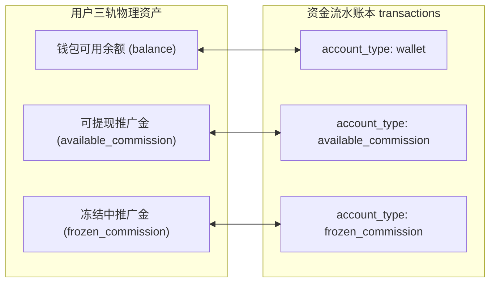
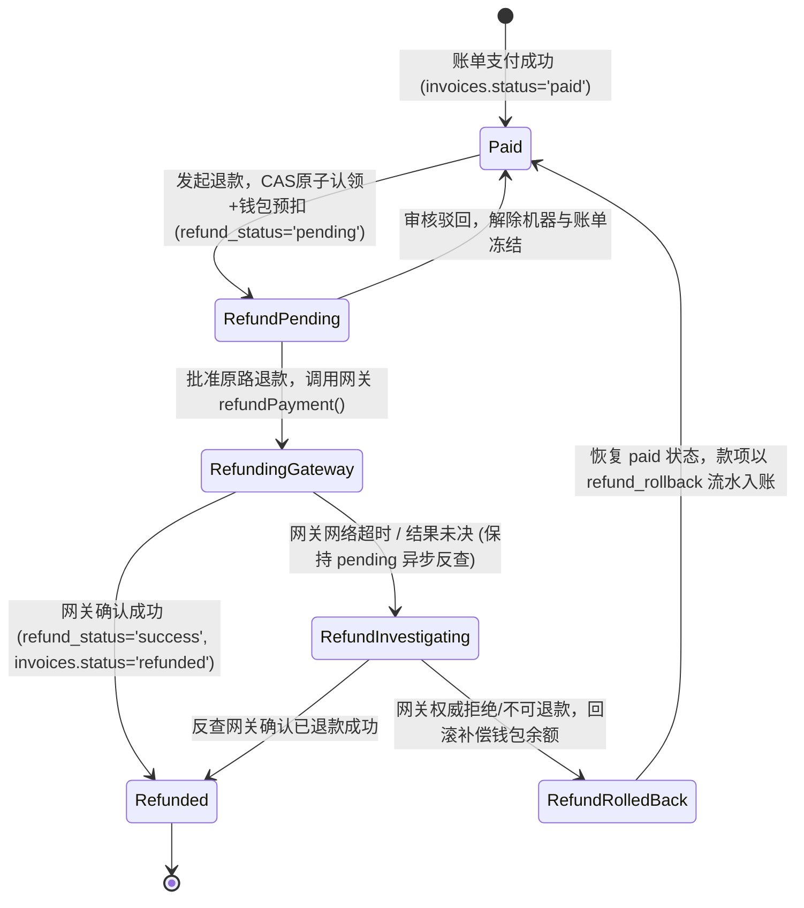

# JianYun (简云) · 支付、多收、退款与资金账本协议 (Payments & Ledger Contract)

> [!IMPORTANT]
> **本契约已被正式冻结为资金安全与账本流转核心标准。**  
> 明确规范：内核级物理平衡检查、绝对禁止浮点运算与纯字符串半五舍入、退款原子认领与防重复预扣、失败回滚补偿流水与网关超时对账协议。

---

## 1. 资金账户分立与内核级物理平衡约束

系统实行**三轨分立资金分户模型**，严格杜绝资金对账混乱与串户：



### 1.1 铁律一：内核级物理平衡与绝对只追加 (Append-Only)
每一笔资金变动必须在同一个数据库事务内更新 `users` 账户并向 `transactions` 插入明细：
$$\text{balance\_after} = \text{balance\_before} + \text{amount}$$

> [!CAUTION]
> **数据库内核物理强制与保证范围说明**：  
> 1. `trg_transactions_check_balance`: 在 `BEFORE INSERT` 时校验 `ROUND(balance_after, 2) == ROUND(balance_before + amount, 2)`，若不平衡直接抛出 `SQLSTATE 45000` 拦截；
> 2. `trg_transactions_no_update` & `trg_transactions_no_delete`: 拦截任何对 `transactions` 表的修改与删除；
> 3. **悲观行锁执行规范 (Pessimistic Locking Pattern)**：因为触发器物理校验 `balance_after = balance_before + amount`，应用层资金服务 (`LedgerService`) 在更新任何分户资产时，**严禁使用盲写并发更新**（如 `UPDATE users SET balance = balance - 10` 后盲猜余额），必须先执行悲观行锁锁定当前分户行：
>    ```sql
>    -- 标准资金变动标准事务模板
>    START TRANSACTION;
>    -- 1. 悲观行锁锁定用户分户资产行
>    SELECT `balance`, `available_commission`, `frozen_commission` 
>    FROM `users` WHERE `id` = :user_id FOR UPDATE;
>    -- 2. 应用层校验业务前置条件 (如扣款时: $balance >= $deduct_amount)
>    -- 3. 计算确切的 balance_after = balance_before + amount
>    UPDATE `users` SET `balance` = :balance_after WHERE `id` = :user_id;
>    -- 4. 插入资金流水 (触发器严格校验 balance_after = balance_before + amount)
>    INSERT INTO `transactions` (
>        `user_id`, `invoice_id`, `account_type`, `type`, `amount`,
>        `balance_before`, `balance_after`, `idempotency_key`, `remark`
>    ) VALUES (...);
>    COMMIT;
>    ```

---

## 2. 协议四：零浮点纯十进制高精度计算与字符串舍入规范 (Zero-Float Policy)

为彻底消灭“因过早截断比例或使用浮点 `round()` 产生的分币累计误差”：

### 2.1 先乘后除铁律（Multiply First, Divide Second）
> [!CAUTION]
> **严禁在计算日割退款、比例分摊时先计算出截断的小数比例！**  
> 必须遵循“基础金额乘以分子，再除以分母”的十进制原则。

$$\text{CalcAmount} = \frac{\text{BaseAmount} \times \text{Numerator}}{\text{Denominator}}$$

- **反例与正例对比（以 3000 元/月，剩余 1/31 周期为例）**：
  - ❌ **严重错误（过早截断比例）**：先算 $1 \div 31 = 0.0322$（截取4位），再算 $3000 \times 0.0322 = 96.60$ 元。误差高达 **0.17 元**！
  - ✔️ **正确标准（先乘后除）**：先算 $3000 \times 1 = 3000$，再计算 $3000 \div 31 = 96.774193...$，最终保留二位得到 **96.77 元**，分毫不差！

### 2.2 内部计算高精度 (scale = 6)
所有中间乘除运算强制开启 BCMath 高精度：
```php
$product = bcmul($basePrice, (string)$remainingDays, 6);
$rawResult = bcdiv($product, (string)$totalDays, 6); // scale = 6 确保除法精度
```

### 2.3 严禁 PHP 原生 `round()`，强制无浮点纯字符串半五舍入 (`bc_round`)
PHP 内置的 `round((float)$val, 2)` 会将数字隐式转换为 C 语言 double 浮点数，破坏 Zero-Float 铁律。系统统一使用纯字符串运算的 `bc_round()` 函数：

```php
function bc_round(string $number, int $precision = 2): string 
{
    if (strpos($number, '.') === false) {
        return bcadd($number, '0', $precision);
    }
    // 构造无浮点半五偏移量 (如 precision=2 时 offset 为 '0.005')
    $offset = '0.' . str_repeat('0', $precision) . '5';
    return $number[0] === '-' 
        ? bcsub($number, $offset, $precision) 
        : bcadd($number, $offset, $precision);
}
```

---

## 3. 协议三：退款幂等认领、预扣、回滚与状态机



### 3.1 退款业务场景双轨分流与原子认领规范

退款在业务上有两种本质不同的来源，系统严格做场景分流，严禁混淆：

#### 场景 3.1.A：钱包余额/迟到款原路退款 (Balance / Late-Credited Refund)
- **资金现状**：款项此前已通过充值或迟到款入账存放在 `users.balance` 中。用户申请原路退款时，必须先扣除钱包余额，防止用户在网关退款在途期间再次使用该余额消费。
- **原子事务规范**：
```sql
START TRANSACTION;

-- 1. CAS 原子认领退款请求 (锁定 payment_records 凭证行，解耦收款状态与退款状态)
UPDATE `payment_records` 
SET `refund_status` = 'pending',
    `refund_amount` = :refund_amount,
    `refund_reason` = :reason,
    `refund_trade_no` = :stable_refund_trade_no -- 稳定退款幂等键 (如 ref_inv_1024_01)
WHERE `id` = :payment_record_id 
  AND `status` IN ('success', 'late_credited_to_balance')
  AND `refund_status` = 'none';
-- ⚡ 关键行级校验: 若 affected_rows === 0 说明已被其他并发请求认领，立即 ROLLBACK 并返回并发报错！

-- 2. 悲观行锁锁定用户钱包并校验余额
SELECT `balance` FROM `users` WHERE `id` = :user_id FOR UPDATE;
-- ⚡ 校验: 若 balance < :refund_amount，说明用户已将款项消费，立即 ROLLBACK 并阻断原路退款！

-- 3. 原子扣减钱包余额并计算 balance_after
UPDATE `users` 
SET `balance` = `balance` - :refund_amount 
WHERE `id` = :user_id;

-- 4. 插入预扣资金流水 (触发器物理校验 balance_after = balance_before + amount)
INSERT INTO `transactions` (
    `user_id`, `invoice_id`, `account_type`, `type`, `amount`, 
    `balance_before`, `balance_after`, `idempotency_key`, `remark`
) VALUES (
    :user_id, :invoice_id, 'wallet', 'refund', -:refund_amount,
    :balance_before, :balance_after, :pre_deduct_idempotency_key, '原路退款在途预扣冻结'
);

-- 5. 账单状态置为退款审批中
UPDATE `invoices` SET `status` = 'refund_pending' WHERE `id` = :invoice_id;

COMMIT;
```

#### 场景 3.1.B：已交付云资源退订/故障销毁退款 (Cloud Instance Decommissioning Refund)
- **资金现状**：款项已在开通时交付为云资源，用户钱包余额中**不存在**此笔款项。**严禁从用户 `users.balance` 扣钱**！
- **原子事务规范**：必须在同一事务中完成“锁账单凭证 + CAS认领 + Outbox下发销毁任务 + 推广佣金追回/取消 + 优惠券回滚”：
```sql
START TRANSACTION;

-- 1. 悲观行锁锁定账单与收款凭证
SELECT `id`, `user_id`, `instance_id`, `status` FROM `invoices` 
WHERE `id` = :invoice_id AND `status` = 'paid' FOR UPDATE;

-- 2. CAS 原子认领退款凭证 (保持 status='success', 仅推进 refund_status)
UPDATE `payment_records` 
SET `refund_status` = 'pending',
    `refund_amount` = :refund_amount,
    `refund_reason` = :reason,
    `refund_trade_no` = :stable_refund_trade_no
WHERE `id` = :payment_record_id 
  AND `status` = 'success' 
  AND `refund_status` = 'none';

-- 3. 账单状态推进至退款中
UPDATE `invoices` SET `status` = 'refund_pending' WHERE `id` = :invoice_id;

-- 4. 发件箱投递实例销毁排他任务 (Outbox Task-as-Lock)
INSERT INTO `tasks` (
    `instance_id`, `invoice_id`, `idempotency_key`, `action`, `status`, `payload`
) VALUES (
    :instance_id, :invoice_id, CONCAT('terminate:refund_inv_', :invoice_id), 'terminate', 'pending',
    JSON_OBJECT('refund_amount', :refund_amount, 'reason', :reason)
);

-- 5. 级联处理推广返佣 (基于 uk_invoice_affiliate 唯一索引)
-- 若佣金在冻结期 (status='pending')：直接置为 cancelled，并扣减推荐人的 frozen_commission
-- 若佣金已入账 (status='available')：置为 clawbacked，并从推荐人 available_commission 扣除 (或产生待收欠款记录)

-- 6. 若使用了单次优惠券，回滚优惠券使用标记 (user_coupons.status = 'unused')
UPDATE `user_coupons` 
SET `status` = 'unused', `used_at` = NULL, `order_invoice_id` = NULL 
WHERE `order_invoice_id` = :invoice_id;

COMMIT;
```
> [!NOTE]
> 事务提交后，若退款方式为**原路退回**，则调用网关 `refundPayment()`；若客户选择**退回站内余额**（场景 SC-L02），则直接调用 `LedgerService` 插入 `type='refund_to_balance'` 的增额流水并将资金充入用户钱包。

### 3.2 外部网关调用与失败补偿协议 (`refund_rollback`)
1. **调用时机**：上述数据库事务提交成功后，方可调用支付插件发起 `refundPayment()`；
2. **场景 A：网关返回成功**：
   ```sql
   START TRANSACTION;
   UPDATE `payment_records` SET `refund_status` = 'success', `refunded_at` = NOW() WHERE `id` = :id AND `refund_status` = 'pending';
   UPDATE `invoices` SET `status` = 'refunded' WHERE `id` = :invoice_id;
   COMMIT;
   ```
3. **场景 B：网关网络超时 / 结果未知**：
   - `payment_records.refund_status` **继续保持 `pending`**；
   - 绝不重复调用发起退款！由退款对账定时任务调用 `queryRefund(refund_trade_no)` 进行单向查询确认。
4. **场景 C：网关明确拒绝退款（如账户注销/渠道超期不可退）**：
   - 系统执行**单事务补偿回滚**，将此前预扣的款项返还至用户钱包：
   ```sql
   START TRANSACTION;
   UPDATE `payment_records` SET `refund_status` = 'failed' WHERE `id` = :id AND `refund_status` = 'pending';
   UPDATE `users` SET `balance` = `balance` + :refund_amount WHERE `id` = :user_id;
   INSERT INTO `transactions` (
       `user_id`, `account_type`, `type`, `amount`,
       `balance_before`, `balance_after`, `idempotency_key`, `remark`
   ) VALUES (
       :user_id, 'wallet', 'refund_rollback', :refund_amount,
       :before, :after, :rollback_idempotency_key, '原路退款网关拒绝补偿返还'
   );
   UPDATE `invoices` SET `status` = 'paid' WHERE `id` = :invoice_id;
   COMMIT;
   ```

---

## 4. 协议三与协议四失败场景与预期结果矩阵

| 场景编号 | 场景描述 | 故障触发点 | 系统预期动作与终态 |
|---|---|---|---|
| **SC-P01** | 同一笔迟到款账单遭到前台客户与客服后台两路并发发起退款 | 两个请求在同一毫秒到达 | 第一个事务成功执行 CAS 认领 (`affected_rows=1`)；第二个事务 `affected_rows=0` 立即回滚并报错；绝不产生两次网关退款与两次预扣 |
| **SC-P02** | 迟到款充入钱包后被客户购买了其他主机，随后发起原路退款 | `users.balance < refund_amount` | 事务步骤 2 扣减余额失败 (`affected_rows=0`)；事务回滚；系统阻断退款并标记 `RISK_NEGATIVE_BALANCE_BLOCKED` |
| **SC-P03** | 调用网关退款时遭遇三方接口 504 响应丢失 | HTTP 客户端抛出网络超时 | `payment_records.refund_status` 保持 `pending`；退款查询任务调度反查；网关确认入账后置为 `success`，无重复退款 |
| **SC-P04** | 原路退款被第三方网关明确驳回（如原银行卡已注销） | 网关返回业务拒绝错误码 | 触发回滚补偿事务；状态置为 `failed`；生成 `refund_rollback` 流水将款项全额返充回用户钱包可用余额 |
| **SC-P05** | 高额机型（¥3000）日割折算退款 (31天剩1天) | 浮点截断计算导致分币差 | 强制使用 `bcmul` 先乘后除与 `bc_round`；精确得出 96.77 元；流水、入账与网关传参分毫不差 |
