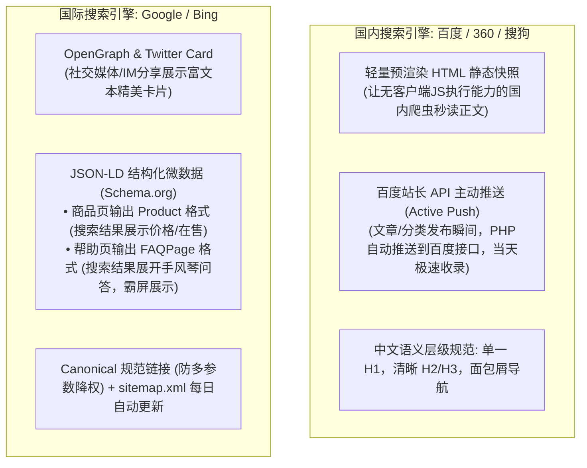
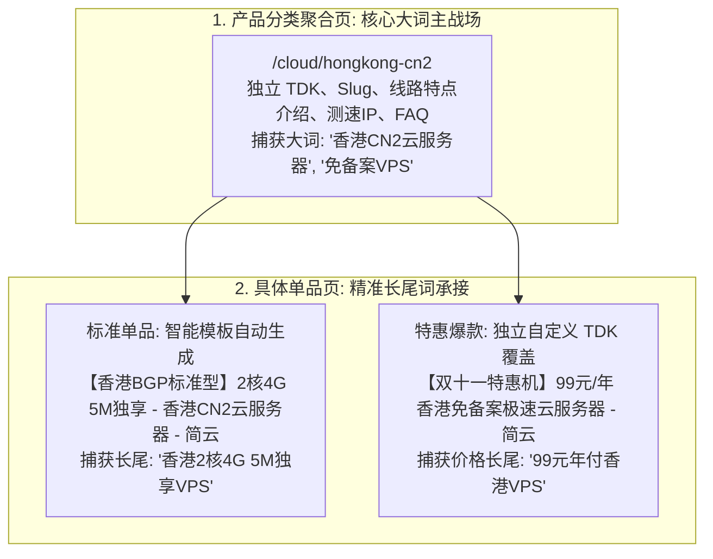

# JianYun (简云) · 全栈 SEO 架构与长尾流量获客规范 (SEO & Organic Growth)

## 1. 业务定位与双轨引擎体系

在 IDC 与云产品销售系统中，SEO 是终身低成本获客的核心驱动力。简云针对**国内搜索引擎（百度、360、搜狗）与国际搜索引擎（Google、Bing）**的算法差异，打造双轨驱动引擎：



---

## 2. 关键词架构：分类与单品的分层继承体系

为了兼顾**高频核心行业词（大词）**与**精准长尾词（长尾转化）**，系统采用“分类聚合页承载大词，单品模板自动继承 + 重点款独立覆盖”的组合拳：



### 2.1 继承优先级逻辑（就近覆盖原则）
1. **优先读取单品自定义 TDK**：若管理员在单品后台填入了 `seo_title` / `seo_keywords` / `seo_description`，系统 100% 优先输出自定义内容。
2. **缺省自动模板回落（Fallback Template）**：若单品 SEO 字段留空，系统自动提取配置变量进行组装，**零运营成本实现全站数百个单品长尾覆盖**：
   - **Title**: `【{商品名称}】{CPU}核{内存}G {带宽}M - {所属分类名称} - 简云`
   - **Description**: `简云为您提供{商品名称}，配置包含{CPU}核CPU、{内存}G内存、{带宽}M优化带宽，适用于网站部署与业务运行，支持自动化交付与弹性升级...`
   - **Keywords**: `{商品名称}, {所属分类名称}, {CPU}核{内存}G云服务器, 便宜VPS`

---

## 3. 文章与知识库系统：长尾词挖掘与流量变现闭环

**帮助中心的技术教程是 IDC 平台获客的第一大自然流量入口**（大量开发者通过搜索“CentOS 挂载磁盘”、“Nginx 502 排查”、“宝塔面板安装”进入网站）。

### 3.1 字段级完全独立控制
在 `articles` 表中提供独立属性支持：
- **`slug`（自定义 URL 别名）**：如 `/help/centos7-install-bt-panel`，URL 语义化大幅提升搜索引擎权重。
- **`seo_title`**：针对搜索习惯定制长标题（如：*“CentOS 7 安装宝塔面板完整图文教程 (解决502报错) - 简云帮助中心”*）。
- **`seo_keywords`**：录入核心长尾词（如：*`CentOS7安装宝塔, Linux挂载数据盘, 宝塔面板打不开`*）。
- **`seo_description`**：页面摘要，精准决定搜索结果列表中的点击率（CTR）。

### 3.2 长尾流量变现闭环（文章内嵌推荐商品）
- 搜索技术教程进来的用户是最高意向的潜在买家。
- 文章表增加 `related_product_id`（关联推荐商品）。
- **页面呈现**：在文章末尾或侧边栏浮动展示**【教程推荐机型】卡片**（如讲解 Linux 网站搭建的教程，旁边智能展示“推荐机型：香港 CN2 GIA 云服务器，延迟低至 15ms，仅 19 元/月起 [立即选购]”），**直接实现自然搜索流量的现场付费转化**！

---

## 4. 国际化与富媒体微数据规范 (Schema.org / JSON-LD)

面向 Google 和 Bing，系统在公共页面自动注入结构化微数据：

### 4.1 商品详情页 (Product Schema)
Google 搜索结果下方会直接展示价格、现货状态、货币符号：
```html
<script type="application/ld+json">
{
  "@context": "https://schema.org/",
  "@type": "Product",
  "name": "香港 CN2 GIA 弹性云服务器 (2核4G)",
  "description": "电信直连 CN2 GIA 专线，三网极速互联，延迟低至 15ms",
  "offers": {
    "@type": "Offer",
    "priceCurrency": "CNY",
    "price": "39.00",
    "availability": "https://schema.org/InStock"
  }
}
</script>
```

### 4.2 帮助中心与问答页 (FAQPage Schema)
Google 搜索结果会直接以手风琴样式展开问答，实现**搜索结果结果页霸屏展现**：
```html
<script type="application/ld+json">
{
  "@context": "https://schema.org",
  "@type": "FAQPage",
  "mainEntity": [{
    "@type": "Question",
    "name": "云服务器支持重装哪些操作系统？",
    "acceptedAnswer": {
      "@type": "Answer",
      "text": "简云支持全自动一键重装 CentOS 7/8/9、Ubuntu 20/22/24、Debian 11/12 以及 Windows Server 2016/2019/2022 数据中心版。"
    }
  }]
}
</script>
```

---

## 5. 百度 API 主动推送与自动 Sitemap

### 5.1 百度快速收录接口（主动推送）
系统在文章发布、更新或分类上架时，由后端异步触发推送：
```php
// 示例：向百度资源平台主动提交新 URL
$urls = ['https://yourdomain.com/help/' . $article->slug];
$api = 'http://data.zz.baidu.com/urls?site=https://yourdomain.com&token=' . config('seo.baidu_token');

$ch = curl_init();
curl_setopt_array($ch, [
    CURLOPT_URL => $api,
    CURLOPT_POST => true,
    CURLOPT_RETURNTRANSFER => true,
    CURLOPT_POSTFIELDS => implode("\n", $urls),
    CURLOPT_HTTPHEADER => ['Content-Type: text/plain'],
]);
curl_exec($ch);
curl_close($ch);
```

### 5.2 自动生成 `sitemap.xml`
- 路径：`https://yourdomain.com/sitemap.xml`
- 每日凌晨 03:00 自动聚合所有有效的分类页、公开商品页、已发布文章与下载条目，标注正确的 `lastmod` 与 `changefreq`。

---

## 6. 权限隔离与隐私安全防线 (`robots.txt`)

系统严格将私有业务域与公共展示域物理隔离：

```text
# /robots.txt
User-agent: *
Disallow: /client/
Disallow: /admin/
Disallow: /api/
Disallow: /cart/checkout
Disallow: /invoice/pay/

# 允许抓取公共流量域
Allow: /
Allow: /cloud/
Allow: /products/
Allow: /help/
Allow: /news/
Allow: /downloads/

Sitemap: https://yourdomain.com/sitemap.xml
```
私有控制台页面（`/client/*` 与 `/admin/*`）并在 HTML `<head>` 中统一写入：
`<meta name="robots" content="noindex, nofollow" />`，从根本上防止爬虫扫描私密数据或造成账务安全隐患。
