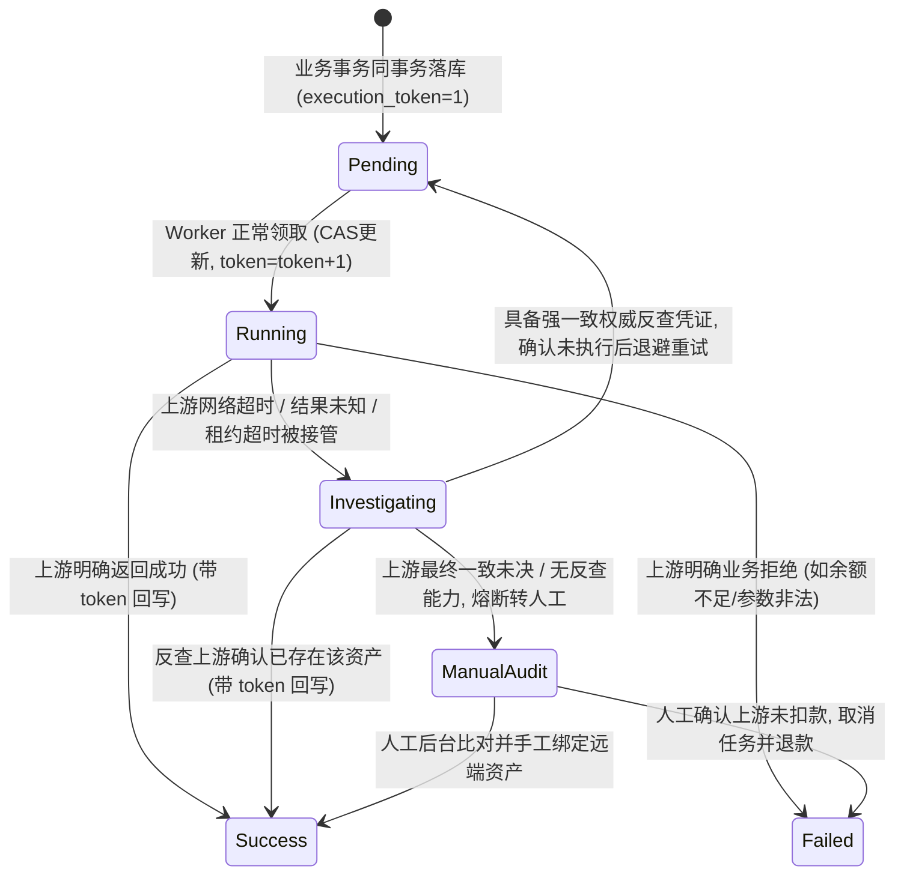
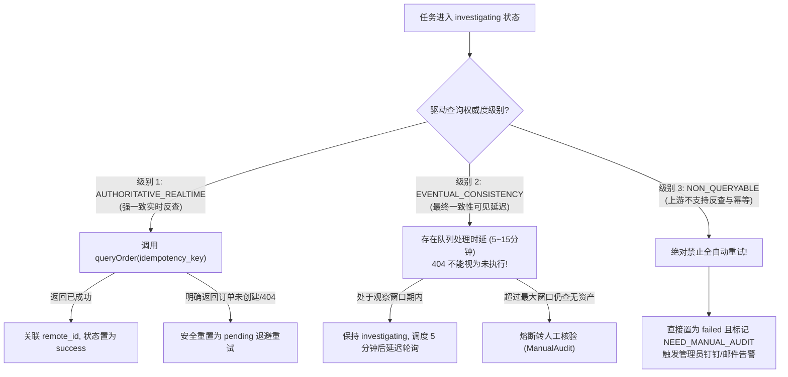

# JianYun (简云) · 事务发件箱与未知结果恢复协议 (Tasks & Outbox Protocol)

> [!IMPORTANT]
> 本协议为异步任务流转与外部系统交付的**唯一权威执行规范**。  
> 核心原则：**租约过期只证明旧执行者失联，绝不证明上游未执行；网络超时或查无记录绝不等于未扣款。**

---

## 1. 核心挑战：网络超时与失联接管的重试风险

在调用异构上游系统（如智简魔方、PVE、Easypanel）时，资金与资源交付最危险的故障链是：
1. **开通成功但回写前崩溃**：上游成功扣除商户余额并交付云主机，但简云 Worker 在执行回写数据库前因 OOM、物理机断电或网络超时崩溃；
2. **盲目接管导致重复购买**：5 分钟后分布式租约超时，新 Worker 接管任务，若将其直接置为 `running` 重新调用创建接口，将导致上游账户被二次扣费，开出重复的废弃机器；
3. **续费接口相对累加**：上游若仅提供“续费 1 个月”而非“指定到期日”，盲目重试将扣除多个周期款项。

因此，发件箱必须建立**Fencing Token（防护令牌）、失联接管转核验、驱动权威度分级与业务参数全固化**机制。

---

## 2. 状态机流转与 Fencing Token 防护



### 2.1 任务表核心字段与防脑裂字段
在 `tasks` 表中，必须维护：
- `execution_token INT UNSIGNED NOT NULL DEFAULT 1`: 单调递增的防护令牌 (Fencing Token)；
- `worker_id VARCHAR(50)`: 领取者唯一标识；
- `lease_until TIMESTAMP`: 租约有效截止时间；
- `status`: `pending` / `running` / `investigating` / `success` / `failed`。

---

## 3. 租约抢占与接管规程 (Lease Claim & Takeover)

### 3.1 正常新任务领取 (`pending` -> `running`)
```sql
UPDATE `tasks`
SET `status` = 'running',
    `worker_id` = :worker_id,
    `execution_token` = `execution_token` + 1,
    `lease_until` = DATE_ADD(NOW(), INTERVAL 5 MINUTE),
    `updated_at` = NOW()
WHERE `id` = :task_id 
  AND `status` = 'pending';
```

### 3.2 崩溃接管规程 (`running` 租约超时 -> `investigating`)
> [!CAUTION]
> **严禁将租约过期的 `running` 任务直接抢占为 `running` 再次执行！**  
> 租约过期只能证明上一个 Worker 失联，不能证明上游 API 未执行。接管必须直接进入 `investigating` 状态！

```sql
UPDATE `tasks`
SET `status` = 'investigating',
    `worker_id` = :worker_id,
    `execution_token` = `execution_token` + 1,
    `lease_until` = DATE_ADD(NOW(), INTERVAL 5 MINUTE),
    `last_error` = 'Worker lease expired; taken over into investigating state',
    `updated_at` = NOW()
WHERE `id` = :task_id 
  AND `status` = 'running' 
  AND `lease_until` < NOW();
```

### 3.3 Fencing Token 结果安全回写
任何 Worker 在写回任务执行终态（`success` 或 `failed`）时，**必须带上自己领取时获得的 `execution_token`**：
```sql
UPDATE `tasks`
SET `status` = 'success',
    `lease_until` = NULL,
    `payload` = :final_payload,
    `updated_at` = NOW()
WHERE `id` = :task_id 
  AND `execution_token` = :my_acquired_token;
```
- **影响行数校验**：若影响行数 (`affected_rows`) 为 0，表明该任务的租约已失效并被其他 Worker 抢占接管，**当前 Worker 必须立即丢弃回写，记录告警日志，严禁继续修改关联的 `instances` 表**。

---

## 4. 上游驱动权威度分级与未知结果反查协议

当任务进入 `investigating`（因 HTTP 504 超时、连接重置或崩溃接管）时，Worker 依据上游驱动声明的**查询权威度能力 (Query Authority)** 执行不同恢复策略：



### 4.1 驱动权威度能力规范
驱动插件必须在 `getSupportedFeatures()` 中显式声明其反查级别：

```php
interface UpstreamDriverInterface
{
    // 返回值枚举:
    // 'AUTHORITATIVE_REALTIME': 支持基于 idempotency_key 的强一致订单状态反查
    // 'EVENTUAL_CONSISTENCY': 仅支持通过 listInstances 查询, 且存在可见性延迟
    // 'NON_QUERYABLE': 无法通过 API 可靠核验历史执行结果
    public function getQueryAuthority(): string;
    
    // 权威反查接口
    public function queryByIdempotencyKey(string $idempotencyKey): DriverQueryResult;
}
```

### 4.2 续费接口相对周期的幂等防御
很多老旧上游 API 仅支持 `renew(host_id, "monthly")`，即每调用一次上游机器就延期一个月。
针对此类上游：
1. 固化本地 `target_due_date`（例如目标到期日为 `2026-12-07`）；
2. **执行前探测**：Worker 调用 `queryRemoteInstance(remote_id)` 获取上游控制台当前的真实到期日；
3. **状态比对**：
   - 若上游真实到期日 $\ge$ `target_due_date`：表明续费事实上已由先前超时请求完成！Worker 直接将本地 `instances.due_date` 对齐，任务回写 `success`，**绝不调用上游续费 API**；
   - 若上游真实到期日 $<$ `target_due_date`：方可发起调用。

---

## 5. 固化业务参数（消除重试漂移）

任务表中的 `payload` 字段保存的必须是**完全确定性的静态目标参数**，任何动态计算表达式必须在入库前求值完毕：

| 动作类型 | 严禁的动态 Payload | 强制规范的确定性 Payload |
| :--- | :--- | :--- |
| **开通 (create)** | `{"months": 1}` | `{"idempotency_key": "create_inv_1024", "plan_id": 481, "hostname": "hk-vm-1"}` |
| **续费 (renew)** | `{"add_cycle": "1 month"}` ❌ (重试会累加多月) | `{"target_due_date": "2026-12-07 15:30:00", "billing_cycle": "monthly"}` ✔️ (重试十次目标到期日永恒不变) |
| **快照 (snapshot)** | `{"action": "create"}` | `{"target_name": "Auto_20261107_0300", "schedule_id": 5}` |
| **改价 (upgrade)** | `{"diff": 20.00}` | `{"target_spec_id": 88, "locked_diff_amount": "20.00"}` |
