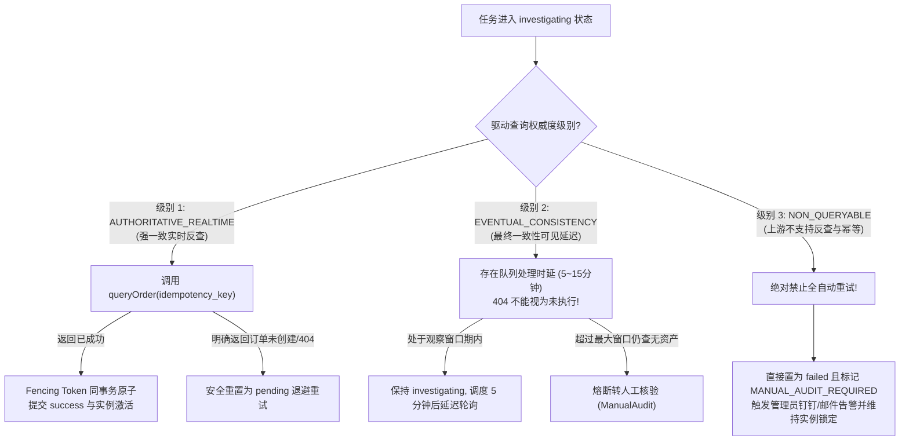

# JianYun (简云) · 事务发件箱与未知结果恢复协议 (Tasks & Outbox Protocol)

> [!IMPORTANT]
> **本契约已被正式冻结为异步交付与发件箱执行标准。**  
> 明确规范：Task-as-Lock 业务占用与 Worker 执行租约分离、Fencing Token 原子事务回写、崩溃调查接管、退避窗口硬校验、未知结果持续阻断与人工核验防盲重试。

---

## 1. 核心挑战：网络超时与失联接管的重试风险

在调用异构上游系统（如智简魔方、PVE、Easypanel）时，资金与资源交付最危险的故障链是：
1. **开通成功但回写前崩溃**：上游成功扣除商户余额并交付云主机，但简云 Worker 在执行回写数据库前因 OOM、物理机断电或网络超时崩溃；
2. **盲目接管导致重复购买**：5 分钟后分布式租约超时，新 Worker 接管任务，若将其直接置为 `running` 重新调用创建接口，将导致上游账户被二次扣费，开出重复的废弃机器；
3. **旧任务延迟回写覆盖新状态**：若慢 Worker 耗时过长被新 Worker 接管后，旧慢任务依然可能写库覆写新数据。

---

## 2. 协议二：Task-as-Lock 与 Fencing Token 原子回写协议

### 2.0 实例预创建与外键生命周期契约 (Instance Pre-creation on Checkout)
`tasks` 表通过严格的外键约束 `FOREIGN KEY (instance_id) REFERENCES instances(id) ON DELETE RESTRICT` 保护实例数据完整性。新购订单触发开通交付时，系统**严禁**在任务中写入伪造或未持久化的实例 ID，必须遵循以下前置落库与异步交付规范：

1. **下单阶段即时预创建（`POST /api/v1/orders/checkout`）**：
   - 用户提交订单时即提供了 `hostname` 与初始 Root/面板 `password`；
   - 系统在下单事务中，**立即预创建 `status='pending'` 的 `instances` 记录**，将密码经 `Security::encrypt($password)` AES-256-GCM 信封加密存入 `instances.encrypted_password`（彻底解决 10 分钟后三方支付异步回调丢失明文密码的致命缺陷）；
   - 同时将生成的 `instances.id` 回填绑定至 `invoices.instance_id`，确保账单与实例强关联；
   - `remote_instance_id`、`start_date` 与 `due_date` 初始均为 `NULL`，等待开通成功回写；付款只投递任务，不提前起租。
2. **付款成功投递发件箱任务**：
   - **余额直付场景**：扣除余额并标记账单 `paid` 的同一事务内，直接向 `tasks` 表插入 `action='create'` 发件箱任务（`instance_id = invoices.instance_id`）；
   - **网关回调场景（`POST /api/v1/payments/notify/{gateway}`）**：CAS 校验并标记 `invoices.status='paid'` 时，读取 `invoices.instance_id` 向 `tasks` 插入 `action='create'` 交付任务；
   - 业务幂等键统一采用 `instance_create:inv_{invoice_id}`。
3. **交付完成原子激活**：
   Worker 异步调用上游开通接口成功后，调用 `InstanceActivationService::completeCreate()`，在第 2.2 节的 Fencing Token 原子事务内，将 `instances.status` 由 `pending` 推进至 `active`，并写入真实的 `remote_instance_id` 与 `ip_address`。同时以本地交付成功入库的 UTC 时间写入 `start_date`，通过 `DATE_ADD(start_date, INTERVAL 1 MONTH/1 YEAR)` 生成首期 `due_date`，按目标月末截断，避免 PHP 自然月溢出；未付时间及交付排队不消耗租期。完成方法只接受已支付新购、有效执行令牌及未过期的所属 Worker 租约，激活失败时任务终态一并回滚。M2 已由 OutboxWorker 调用；CLI 为 `php artisan outbox:work`，单次处理加 `--once`。
4. **超时未付安全清理**：
   未支付账单超时自动取消（`unpaid -> cancelled`，同步置 `cycle_marker = NULL`）时，定时清理任务同步将关联的 `status='pending'` 实例软终止置为 `terminated`（严禁物理 `DELETE`，遵守外键 `ON DELETE RESTRICT`），并释放锁定的优惠券 `user_coupons.status = 'unused'`。

### 2.1 Task-as-Lock：业务占用与执行租约分离
`tasks` 仍是实例任务执行占用的唯一事实来源，不新增实例锁字段或锁表。任务 blocker 与账单退款冻结分别由各自领域持久状态决定，业务准入必须同时检查。两种任务语义必须分别判断：
- **业务占用（blocker）**：`status IN ('running', 'investigating')`，或 `status = 'failed' AND last_error LIKE 'MANUAL_AUDIT_REQUIRED:%'`。这些任务的外部结果尚未安全收口，**无论 `lease_until` 是否过期、为空，都阻断同实例的其他动作**。
- **Worker 执行权**：`worker_id`、`execution_token`、任务执行状态与未过期的 `lease_until` 共同决定哪个 Worker 可续租、查询并回写。租约过期只允许其他 Worker 接管同一任务进行调查，不释放业务占用。
- **统一锁顺序**：新动作入队、领取、接管、续租、回写和人工裁决均先锁 `instances`，再锁关联 `tasks`。所有 blocker 检查使用锁定读，避免事务快照读到旧状态。
- **安全释放**：明确成功、证实未执行后安排安全重试，或完成人工裁决，才能在同一事务中释放对应业务占用。人工核验标记必须保留为 `last_error` 前缀，追加诊断信息不得覆盖该前缀。

### 2.2 任务终态与实例变更同事务提交（Fencing Token Atomic Commit）
> [!CAUTION]
> **绝对保证原子提交！**  
> 任务的完结（`tasks.status = 'success'`）与实例物理属性的变更（`instances` 状态/IP/到期日）**必须在同一个数据库事务内提交**，严格带【任务递增令牌 `execution_token`】校验：

```sql
START TRANSACTION;

-- 1. 先锁实例，再锁所属任务；校验 task.instance_id、action、已付账单及实例状态
SELECT `id` FROM `instances` WHERE `id` = :instance_id FOR UPDATE;
-- 按 §2.4 核验退款冻结与当前任务归属；异常冲突阻断自动回写并转人工核对。
SELECT `id`, `instance_id`, `status`, `worker_id`, `execution_token`, `lease_until`
FROM `tasks` WHERE `id` = :task_id FOR UPDATE;

-- 2. 同时校验任务归属、Worker、执行状态、令牌及有效租约
UPDATE `tasks`
SET `status` = 'success',
    `lease_until` = NULL,
    `payload` = :final_payload,
    `updated_at` = NOW()
WHERE `id` = :task_id
  AND `instance_id` = :instance_id
  AND `worker_id` = :worker_id
  AND `execution_token` = :acquired_execution_token
  AND `status` IN ('running', 'investigating')
  AND `lease_until` > UTC_TIMESTAMP();
-- affected_rows 必须为 1，否则立即 ROLLBACK；即使尚未被接管，过期租约也不能回写

-- 3. 同事务原子回写实例业务变更（此处为已校验的新购月付示例）
UPDATE `instances`
SET `status` = 'active',
    `remote_instance_id` = :remote_id,
    `ip_address` = :ip,
    `start_date` = UTC_TIMESTAMP(),
    `due_date` = DATE_ADD(UTC_TIMESTAMP(), INTERVAL 1 MONTH), -- 月付示例；年付为 1 YEAR
    `updated_at` = NOW()
WHERE `id` = :instance_id;

COMMIT;
```
- **原子保证**：若第 2 步更新影响行数不为 1，整个事务立即回滚，内存中执行结果直接作废。任务终态与实例、快照台账等业务结果一起提交；不得仅凭令牌未变化就接受已过期 Worker 回写。

### 2.3 结果未知期间实例锁持续占用原则
当外部调用返回超时或异常中断，任务进入 `investigating` 状态：
- **业务占用持续保留**：调查 Worker 应续租；若其崩溃导致租约过期，任务仍阻断其他动作，等待同任务安全接管。转人工核验 `failed` 也不解除占用。
- **统一互斥查询**：任何其他尝试针对该实例创建、领取或接管动作（如升降级、注销、快照）的事务，先锁 `instances`，再执行锁定读：
  ```sql
  SELECT `id` FROM `tasks`
  WHERE `instance_id` = :instance_id
    AND (`status` IN ('running', 'investigating')
      OR (`status` = 'pending' AND `action` IN ('power','reinstall'))
      OR (`status` = 'failed' AND `last_error` LIKE 'MANUAL_AUDIT_REQUIRED:%'))
  ORDER BY `id` FOR UPDATE;
  ```
  若存在记录，阻断新动作排队或领取，提示“该实例存在未决交付或人工核验任务”。接管或裁决当前任务时，仅可通过 `id <> :current_task_id` 排除自身；若仍存在其他 blocker，必须回滚并告警冲突，禁止任意挑选一条继续执行。

### 2.4 退款业务冻结与任务准入联动
正常 `cloud_consumption` 主收款退款不复用实例 `tasks` 执行网关退款，因此必须将账单退款状态接入实例业务准入。与 [PAYMENTS_LEDGER.md](PAYMENTS_LEDGER.md) §3 保持以下同一边界：

- **认领互斥**：云消费退款认领先锁实例，检查本节任务 blocker；已有 `running` / `investigating` 或受保护人工核验任务时，拒绝退款认领，不能先冻结实例再踩到上游在途动作。
- **入队与领取门禁**：持实例锁后，以当前锁定读查询该实例 `new/renew/upgrade` 正常消费主账单是否存在 `status='refund_pending'`。该状态只能由经服务端用途核验的云消费退款认领写入；任何历史用途不明记录保守冻结并转人工核对。存在退款冻结时，新动作不得入队，已有 `pending` 的快照、变配、续费等任务也不得领取；它们保留等待退款终态，不自动视作失败或重发。
- **退款成功后的关停门禁**：仅正常消费退款终态 CAS 成功的事务可以把对应主账单 `refund_pending -> refunded`，使该实例所有旧 `pending` 任务失效（`failed`，标注 `CANCELLED_BY_REFUND:{稳定退款号}`，禁止通用重试），再投递由本次退款号唯一标识的 `terminate`。上述操作及退款审计同事务提交；实例维持绑定退款号的待销毁冻结，直至销毁确认。即使 `refund_pending` 已消失，也不得开放新动作，仅允许该退款对应的销毁任务领取；实例已 `terminated` 时禁止执行任何非 `terminate` 任务。
- **拒绝与未知结果**：明确拒绝按原状态快照及退款归属 CAS 恢复本次改变的状态；只有退款冻结安全解除后，原 `pending` 任务才重新具备领取资格，仍须重新校验实例状态和任务 blocker。网关结果未知则保持冻结，不提前放行。原已因其他原因暂停的实例，不因拒绝而恢复 `active`。
- **既有未决任务异常冲突**：接管、续租和结果回写也必须核验退款冻结与当前任务的归属。若发现退款冻结与已在途的非退款任务并存，说明认领互斥被破坏，阻断自动推进并告警人工核对；保留原任务 blocker 和反查证据，既不能放行新动作，也不能盲重试或因冻结直接判定远端未执行。退款生成的 `terminate` 只有在核准关联退款号后才允许正常接管与回写。
- **迟到款隔离**：`late_wallet_credit` 退款只修改该收款凭证与实际预扣钱包款，不修改父账单，也不冻结其关联实例；不能因为凭证引用了同一个 `invoice_id` 就触发上述云消费冻结。

---

## 3. 租约抢占、退避与调查接管流水线

### 3.1 正常新任务领取 (`pending` -> `running`，强制实例行锁互斥)
为防止同一实例名下多条 `pending` 任务被并发抢占，领取事务必须先锁定所属 `instances` 行并确认无其他未决业务占用，同时严格遵守退避窗口 `next_retry_at`：
```sql
START TRANSACTION;

-- 1. 锁定所属实例行，串行化同一实例的所有任务认领
SELECT `id` FROM `instances` WHERE `id` = :instance_id FOR UPDATE;
-- 同时执行 §2.4 退款门禁：refund_pending 或已退款待销毁冻结阻断普通任务。
-- 仅经归属核验的退款 terminate 例外；旧 pending 任务不能绕过此检查。

-- 2. 当前读校验其他未决任务；不得按 lease_until 过滤 blocker
SELECT `id` FROM `tasks`
WHERE `instance_id` = :instance_id
  AND `id` <> :task_id
  AND (`status` IN ('running', 'investigating')
    OR (`status` = 'pending' AND `action` IN ('power','reinstall'))
    OR (`status` = 'failed' AND `last_error` LIKE 'MANUAL_AUDIT_REQUIRED:%'))
ORDER BY `id` FOR UPDATE;
-- 若存在记录，立即 ROLLBACK 跳过本任务，等待前序任务完结！

-- 3. 锁定并原子认领当前 pending 任务；校验 instance_id 与候选一致
SELECT `id` FROM `tasks` WHERE `id` = :task_id AND `instance_id` = :instance_id FOR UPDATE;
UPDATE `tasks`
SET `status` = 'running',
    `worker_id` = :worker_id,
    `execution_token` = `execution_token` + 1,
    `lease_until` = DATE_ADD(UTC_TIMESTAMP(), INTERVAL 5 MINUTE),
    `updated_at` = UTC_TIMESTAMP()
WHERE `id` = :task_id 
  AND `instance_id` = :instance_id
  AND `status` = 'pending'
  AND (`next_retry_at` IS NULL OR `next_retry_at` <= UTC_TIMESTAMP());
-- affected_rows 必须为 1；否则 ROLLBACK，不得调用上游

COMMIT;
```

### 3.2 崩溃接管流水线（失联任务转核验）
> [!CAUTION]
> **严禁将租约过期的任务直接重置为 `running` 重新调用上游开通/续费！**

以下接管 SQL 均在同一个短事务内执行：先 `SELECT instances ... FOR UPDATE`，再按 §2.3 检查其他 blocker（`id <> :task_id`）并核验 §2.4 退款归属冲突，然后锁当前任务并执行对应 CAS；影响行数必须为 1 才提交。领取与接管使用相同锁顺序；外部反查在事务提交后执行。`lease_until <= UTC_TIMESTAMP()` 或 NULL 只表示执行权失效，不代表上游未执行。

- **分支 A：`running` 状态超时接管**：
  ```sql
  UPDATE `tasks`
  SET `status` = 'investigating',
      `worker_id` = :worker_id,
      `execution_token` = `execution_token` + 1,
      `lease_until` = DATE_ADD(UTC_TIMESTAMP(), INTERVAL 5 MINUTE),
      `last_error` = 'Worker lease expired; taken over into investigating state',
      `updated_at` = UTC_TIMESTAMP()
  WHERE `id` = :task_id 
    AND `instance_id` = :instance_id
    AND `status` = 'running' 
    AND (`lease_until` IS NULL OR `lease_until` <= UTC_TIMESTAMP());
  ```
- **分支 B：`investigating` 状态超时接管（调查 Worker 自身崩溃）**：
  ```sql
  UPDATE `tasks`
  SET `worker_id` = :worker_id,
      `execution_token` = `execution_token` + 1,
      `lease_until` = DATE_ADD(UTC_TIMESTAMP(), INTERVAL 5 MINUTE),
      `updated_at` = UTC_TIMESTAMP()
  WHERE `id` = :task_id 
    AND `instance_id` = :instance_id
    AND `status` = 'investigating' 
    AND (`lease_until` IS NULL OR `lease_until` <= UTC_TIMESTAMP());
  ```
  新 Worker 继续保持 `investigating` 状态，带新令牌执行上游反查协议。

### 3.3 人工核验任务防盲目重发与双路径收口 (Manual Audit Guard & Dual Resolution)
当任务最终判定为不可自动恢复并转为 `failed` 且标注 `last_error LIKE 'MANUAL_AUDIT_REQUIRED:%'` 时：
- **保留业务占用**：清除 Worker 执行租约可以停止自动调查，但该任务仍是 blocker；销毁、变配、续费和快照等其他任务均被阻断。告警失败也不能释放占用。
- **阻断通用重试**：通用【一键重试所有失败任务】只允许明确未执行且可安全重试的失败任务，必须在锁定读后再次拒绝人工核验前缀；不能仅靠列表筛选防重发。
- **专职双路径人工裁决（需 `super_admin` 与核验材料，均写入 `admin_audit_logs`）**：先锁实例、检查其他 blocker 并锁定当前任务；校验其仍是 `failed + MANUAL_AUDIT_REQUIRED`。裁决 CAS 同时校验原状态、标记及所读 `execution_token`，将令牌递增并清空 `worker_id` / `lease_until`，使旧 Worker 永久失效；裁决、业务变更与审计必须同事务提交。
  1. **路径 A（核实未执行 $\rightarrow$ `POST /api/v1/admin/tasks/{id}/force-retry`）**：确认上游未创建资产、未扣款，显式提交核验工单号，才可清除人工核验标记并重置为 `pending`。后续领取仍需重新检查其他 blocker 与退避窗口。
  2. **路径 B（核实已交付 $\rightarrow$ `POST /api/v1/admin/tasks/{id}/manual-fulfill`）**：仅处理 `action='create'`、实例仍为 `pending` 且关联新购账单已支付的任务。提交真实 `remote_instance_id`、`ip_address` 与核验备注，同事务置任务 `success`、实例 `active`，按本地交付确认时间起租。`ManualAdminDriver` 待人工交付也进入上述受保护的人工核验状态。
- **与普通 Worker 完成门禁分离**：人工裁决使用独立受审计命令，不伪造 Worker 租约调用 `InstanceActivationService::completeCreate()`，也不得放宽该方法要求有效 Worker、令牌和未过期租约的门禁。非新购任务的人工成功收口必须由对应生命周期处理器应用结果，不能调用新购激活入口。

---

## 4. 驱动查询权威度分级与未知结果反查协议



---

## 5. 协议二失败场景与预期结果矩阵

| 场景编号 | 场景描述 | 故障触发点 | 系统预期动作与终态 |
|---|---|---|---|
| **SC-T01** | 开通 Worker 调上游成功，但在本地回写前由于 OOM 崩溃 | 5 分钟后租约过期，新 Worker 接管 | 接管 SQL 将状态置为 `investigating`，令牌 +1；新 Worker 执行反查获取真实 remote_id；Fencing Token 原子提交为 `success`，开通完成且无重复购买 |
| **SC-T02** | 变配任务 A 耗时超长导致租约超时，被任务 B 接管并递增 execution_token | 任务 A 执行完毕尝试回写 | 事务更新 `tasks` 校验 `execution_token = :token_a` 失败（0 行）；触发强制回滚；任务 A 回写作废，任务 B 租约与实例状态未被破坏 |
| **SC-T03** | 调查 Worker 在反查上游时自身进程遭遇宿主机断电 | `investigating` 状态且租约超时 | 接管 SQL 命中分支 B，保持 `investigating` 并递增 `execution_token`；后续 Worker 继续完成资产反查 |
| **SC-T04** | 上游开通接口返回 504 超时，驱动为 `NON_QUERYABLE` | 上游无反查 API 且不支持幂等键 | 任务熔断置为 `failed` 并注入 `MANUAL_AUDIT_REQUIRED`；系统阻断通用批量重试；报警人工核对后手动绑定资产 |
| **SC-T05** | 任务重试退避时间为 10 分钟后 (`next_retry_at > NOW()`) | 定时 Poller 在第 2 分钟扫描 | Poller 的 SQL `AND next_retry_at <= NOW()` 严格阻断领取；任务静默等待退避时钟到达 |
| **SC-T06** | 任务 A 租约过期，尚无新 Worker 接管；同实例任务 B 尝试入队或领取 | A 仍为 `running` / `investigating` | A 的业务占用持续有效；B 被阻断；只允许接管 A 进入/保持调查，绝不出现跨任务执行空窗 |
| **SC-T07** | 不可反查任务转为 `failed + MANUAL_AUDIT_REQUIRED` 且租约已清空 | 新的销毁、变配或快照动作到达 | blocker 查询仍命中 A；拒绝新动作与通用重试，直至受审计人工裁决完成 |
| **SC-T08** | 慢 Worker 回写时租约已过期但令牌尚未被递增 | 新 Worker 尚未接管 | 终态 CAS 因有效租约检查失败而回滚，实例和任务不变；禁止仅凭相同令牌接受结果 |
| **SC-T09** | 人工回填与旧 Worker 结果同时到达 | 双方竞争同实例行锁 | 人工裁决递增令牌且同事务完成激活与审计；旧 Worker 因状态/Worker/令牌/租约任一条件不符被拒绝，不重复起租 |
| **SC-T10** | 接管自己的过期任务时，同实例还存在另一条人工核验任务 | 排除当前 task_id 后仍有 blocker | 接管回滚并告警冲突；不能因排除了自身而跳过其他未决任务 |
| **SC-T11** | 云消费退款审核期间，既有 pending 快照/变配/续费被扫描；或退款成功后销毁尚 pending | 主账单为 refund_pending，或已退款且实例处于该退款的待销毁冻结 | 普通任务不得入队/领取；拒绝安全解除后重新检查资格；成功同事务令旧 pending 失效并只允许本退款 terminate，迟到钱包款退款不触发父实例冻结 |

## M2 运行与永久取消

当前 Worker 执行 create 和 renew；五分钟租约，网络调用总时长受驱动请求超时限制，空闲 500ms 扫描，每次最多看 100 候选，实例锁使用 SKIP LOCKED。长耗时生命周期/公平调度仍延期。心跳同样要求有效旧租约与 token，不能复活失效执行权。结果回写失败保留原状态，由过期接管调查；严禁重新投 pending。

未知结果每分钟只读调查，一小时仍未知或 NON_QUERYABLE 转 `failed + MANUAL_AUDIT_REQUIRED:`，记 critical 事件（只含 task_id）；必须配合日志监控和 `outbox:inspect` 人工值守。证明未执行的退避为 5/15/30 分钟，达到重试上限转人工。Provider 禁用、查询失败与最终一致性查无不释放占用。

人工入口：`POST /api/v1/admin/tasks/{id}/resolve`，或 `php artisan outbox:resolve TASK_ID ADMIN_ID < resolution.json`。当前取代规划中的分散 force-retry/manual-fulfill 路径；同一 Vue 应用已接入 /admin/tasks 列表与详情，权限、分页与安全投影见 [API](API.md#admin-operations)。均要求有效 super_admin、`expected_execution_token`、10–1000 UTF-8 字节 evidence（去首尾空白）；action 为 retry/fulfill/cancel_compensate，以及续费专用 investigate（见后文）。retry/cancel_compensate 还需显式 `confirmed_no_execution_or_pending_request=true`，核验材料必须证明没有资产、扣款及后续可执行请求；不能只提交“没查到”。fulfill 需真实 remote_instance_id，可空 ip_address。

永久取消只适用待交付、已支付新购、唯一正常消费收款凭证且无历史佣金/在途退款的订单。它同事务递增令牌并永久终止该任务及其他 pending，实例本地 terminated、账单 refunded、恢复预留库存、真实原额入钱包、冲累计消费并追加管理员审计。收款凭证标注 refund_status=success、refund_method=to_balance，防止后续再次原路退款。没有远端资产时不派 terminate。已有佣金拒绝处理并要求专项冲正，不能略过资金保证。重复或旧 token 裁决拒绝，无第二次补偿。

旧任务缺少明确自动开通快照时转人工，不猜测能否自动交付。远端资源绑定由数据库唯一约束防止同 Provider 内重复归属，违反约束则交付/任务终态一起回滚，保留调查材料。


魔方首链主机名兼容：新订单将驱动预检返回的 `driver_context.hostname_rule=alnum8` 随 price_snapshot 固化，按原始订单键稳定生成 8 位、含数字及大小写字母的远端名。已提交且没有此规则标识的旧任务继续使用原身份调查；不能为适应新规则重算旧任务身份后盲目创建。已取得账号范围稳定远端 ID 的任务，按 ID、PID、账期和首付金额调查，不因上游改名失去身份；必须核对响应 ID 正好等于已记录 ID。没有已知 ID 且名称不再匹配时保留人工核验门禁，不猜测绑定。

## 当前固定套餐续费扩展

续费支付以 `instance_renew:inv_{invoice_id}` 唯一键投递单条 renew，沿用同一认领、token、租约、退款冻结与人工核验机制。付款事务已按原本地到期日顺延权益；Worker 不再累加日期，只确认上游目标日期，并仅在需要且仍为 billing 暂停时恢复 active。魔方组合执行由支付后观察上游恢复承接，不拆分另一条 unsuspend，也不对未知结果重发解挂。

renew 的人工 retry/fulfill 使用现有 resolve 入口和审计，fulfill 必须保留原资源 ID，调用续费完成处理器；不能调用新购起租方法。cancel_compensate 仅适用新购，不能拿它销毁原续费实例。完整边界及兼容证据见 [M2_RENEWAL_CONTRACT.md](M2_RENEWAL_CONTRACT.md)。

**人工退款边界（2026-11-08）**：退款由管理员手动办理，本期不建设自动退款/补偿或网关退款任务。已有 `cancel_compensate` 仍是管理员显式裁决入口，不由 Worker 自动触发。手动退钱本身不解除 Task-as-Lock；资源与待执行请求仍按各自证据核验。本轮没有执行退款或任务裁决，见 [人工退款策略](PAYMENTS_LEDGER.md#manual-refund-policy)。


**续费异常通知策略**：首次执行未确认续费成功在事务提交后记录含账单/实例/任务编号的 warning，只读调查不逐分钟重复 warning，进入人工门禁升级 critical；已提交的 tasks 是待办事实，日志不能证明管理员已读，须配合 outbox:inspect（增加 action 字段）巡检。已扣款续费不自动退款、不撤回本地权益、不派销毁；由管理员处理。人工 action=investigate 仅对已付 renew 的 failed+MANUAL_AUDIT_REQUIRED 开启新只读观察窗口，保留原上游单号、冻结参数和重试计数，递增 token 并写审计；queryRenewal 不再次付款/续费。完整证据与通知边界见 [续费契约](M2_RENEWAL_CONTRACT.md#续费异常通知与人工核验2026-11-08)。


**运行部署（2026-11-08）**：现有 M2 验收环境已接入独立 systemd Worker 与每分钟 schedule:run timer，异常日志和调度子命令输出进入 journal，任务列表仍是持久待办事实。22 项独立运行检查覆盖守护重启、租约门禁、原任务只读恢复、日志及待办保留；正式环境另行部署，不改变未知结果/不自动退款策略或业务占用。配置、故障演练及时间验证边界见 [运行部署规程](DEPLOYMENT_RUNTIME.md)。


### 网页人工核验入口边界（2026-11-08）

管理员查询复用 tasks 与 admin_audit_logs，不增加任务副本或处置状态表。所有启用管理员可读，只有数据库当前启用 super_admin 可写。候选动作与裁决服务共享状态规则；只读投影另外排除其他未决任务、退款冻结及不合条件的钱包补偿，最终仍由原 resolve 的实例优先锁顺序、当前读、证据、旧 token 和同事务审计裁决。

页面不直接修改任务或调驱动；提交时不强制覆盖当前状态，不为 UI 放宽 Worker 令牌/租约门禁。旧弹窗及重复请求 409，失败操作不产生成功审计。续费调查保留原资源与上游操作编号、款项和已顺延本地权益，绝不套用新购取消。既有显式 cancel_compensate 仍只针对已证实永久未交付新购，且只退钱包；人工渠道退款继续按独立财务证据处理，不增加自动退款。

变更原因是补齐运营入口，影响 TaskInspectionService、TaskController、管理员认证及单 Vue 页面；resolve 载荷兼容，未新增 schema/驱动能力。证据最短长度按有效非空白字节校验，非法 IP 返回 400。安全与并发验证见 tests/admin.php；没有操作真实待核验旧单。


<a id="power-tasks"></a>

## 实例电源任务增量（2026-11-08）

新增 action=power，invoice_id=NULL，payload 冻结 power_action/Provider/PID/远端资源/账期/请求人，唯一键 instance_power:{instance_id}:{request_key}，max_retries=0。客户端请求仅在实例锁及确认/门禁通过后插入任务；pending power 即阻断冲突动作，运行、调查与人工核验继续沿用原业务占用和执行令牌。不能把关机复用 suspend 或通过开机解挂。

Worker 成功只说明命令接受，不改实例状态/资金/日期；丢响应、重启/崩溃接管不得重新 executePower。魔方缺少请求级查询，读当前状态后仍不能证明原重启，转人工核验。专用人工选项保留证据、同事务审计及旧令牌，只有确认未执行且无延迟请求才允许结束占用；不提供通用重试。完整兼容和验证边界见 [电源契约](M2_INSTANCE_POWER.md)。

## 客户重装增量（2026-11-08）

action=reinstall、invoice_id=NULL、max_retries=0，唯一键 instance_reinstall:{instance_id}:{request_key}；payload 冻结原资源／账期／请求客户、镜像和重装能力，不含密码。pending reinstall 与 pending power 同样占用业务门禁；提交还拒绝所有其他 pending，支付／续费／电源／VNC 继续调用统一 TaskGate。认领无支付前置，但须资源归属和服务有效，接管只读。Worker 保存 reinstall_accepted／reinstall_monitor_version 和 reinstall_execution_observed；正常受理每 15 秒只读跟踪，不立即转人工。空闲预检、明确受理、观察本次重装后恢复空闲、原资源凭据及再次空闲齐备才记录 execution_ended 并原子结束占用；不证明系统重装成功。未知、漏观察、旧任务和查询失败继续调查，最长一小时后转原持久人工告警。

确认成功仅更新 delivery 的已核实用户名／镜像和 encrypted_password；execution_ended 自动分支仅同步 upstream_reported 凭据、清除旧已确认镜像，并同事务记录原任务结果；人工完成要求原令牌、归属、证据、新凭据及确认，和管理员审计同事务。close_unexecuted 不改凭据，任何未知结果禁止通用重试／取消／资金动作；旧令牌不能覆盖终态。迁移与完整边界见 [重装契约](M2_INSTANCE_REINSTALL.md)。
