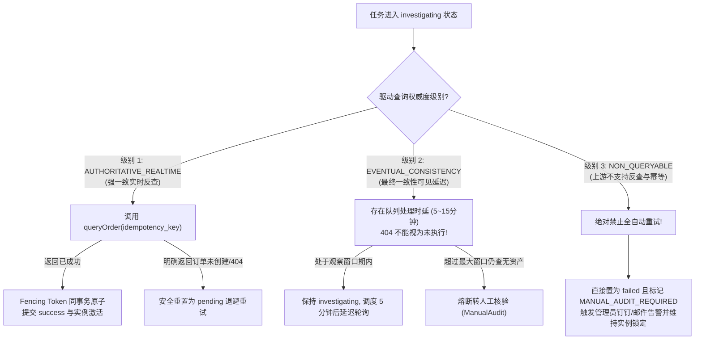

# JianYun (简云) · 事务发件箱与未知结果恢复协议 (Tasks & Outbox Protocol)

> [!IMPORTANT]
> **本契约已被正式冻结为异步交付与发件箱执行标准。**  
> 明确规范：Task-as-Lock 任务租约即排他锁、Fencing Token 原子事务回写、崩溃调查接管、退避窗口硬校验、未知结果实例租约锁定防踩踏与人工核验防盲重试。

---

## 1. 核心挑战：网络超时与失联接管的重试风险

在调用异构上游系统（如智简魔方、PVE、Easypanel）时，资金与资源交付最危险的故障链是：
1. **开通成功但回写前崩溃**：上游成功扣除商户余额并交付云主机，但简云 Worker 在执行回写数据库前因 OOM、物理机断电或网络超时崩溃；
2. **盲目接管导致重复购买**：5 分钟后分布式租约超时，新 Worker 接管任务，若将其直接置为 `running` 重新调用创建接口，将导致上游账户被二次扣费，开出重复的废弃机器；
3. **旧任务延迟回写覆盖新状态**：若慢 Worker 耗时过长被新 Worker 接管后，旧慢任务依然可能写库覆写新数据。

---

## 2. 协议二：Task-as-Lock 与 Fencing Token 原子回写协议

### 2.1 Task-as-Lock 任务即排他锁
系统严格遵循 **Task-as-Lock** 原则：`tasks` 表自身即是实例分布式排他租约的唯一事实来源：
- 实例是否处于互斥占用中，仅需查询是否存在状态为 `running` 或 `investigating` 且 `lease_until > NOW()` 的活跃任务；
- 避免了在 `instances` 维护 `locked_at` 与 `lock_token` 导致的两表状态撕裂与双锁死锁问题。

### 2.2 任务终态与实例变更同事务提交（Fencing Token Atomic Commit）
> [!CAUTION]
> **绝对保证原子提交！**  
> 任务的完结（`tasks.status = 'success'`）与实例物理属性的变更（`instances` 状态/IP/到期日）**必须在同一个数据库事务内提交**，严格带【任务递增令牌 `execution_token`】校验：

```sql
START TRANSACTION;

-- 1. 带 execution_token 原子回写任务终态并释放租约
UPDATE `tasks`
SET `status` = 'success',
    `lease_until` = NULL,
    `payload` = :final_payload,
    `updated_at` = NOW()
WHERE `id` = :task_id 
  AND `execution_token` = :acquired_execution_token;
-- 检查影响行数: 若 affected_rows === 0，说明租约已超时被新 Worker 接管（令牌已被递增），立即 ROLLBACK 并终止！

-- 2. 同事务原子回写实例业务变更
UPDATE `instances`
SET `status` = 'active',
    `remote_instance_id` = :remote_id,
    `ip_address` = :ip,
    `updated_at` = NOW()
WHERE `id` = :instance_id;

COMMIT;
```
- **原子保证**：若第 1 步更新影响行数不为 1，整个事务立即回滚，内存中执行结果直接作废，杜绝慢 Worker 覆写已被新任务占用的实例！

### 2.3 结果未知期间实例锁持续占用原则
当外部调用返回超时或异常中断，任务进入 `investigating` 状态：
- **租约持续持有**：任务保持 `investigating` 状态并维持 `lease_until > NOW()`（或由接管 Worker 持续续租）；
- **全表互斥约束**：任何其他尝试针对该实例创建新动作（如升降级、注销、快照）的事务，必须首先执行互斥查询：
  ```sql
  SELECT 1 FROM `tasks` 
  WHERE `instance_id` = :instance_id 
    AND `status` IN ('running', 'investigating')
    AND `lease_until` > NOW();
  ```
  若存在记录，**立即物理阻断新动作排队**，报错：“该实例当前正处于外部交付状态核实中，禁止并发操作”。

---

## 3. 租约抢占、退避与调查接管流水线

### 3.1 正常新任务领取 (`pending` -> `running`)
调度器必须严格遵守退避窗口 `next_retry_at`：
```sql
UPDATE `tasks`
SET `status` = 'running',
    `worker_id` = :worker_id,
    `execution_token` = `execution_token` + 1,
    `lease_until` = DATE_ADD(NOW(), INTERVAL 5 MINUTE),
    `updated_at` = NOW()
WHERE `id` = :task_id 
  AND `status` = 'pending'
  AND (`next_retry_at` IS NULL OR `next_retry_at` <= NOW());
```

### 3.2 崩溃接管流水线（失联任务转核验）
> [!CAUTION]
> **严禁将租约过期的任务直接重置为 `running` 重新调用上游开通/续费！**

- **分支 A：`running` 状态超时接管**：
  ```sql
  UPDATE `tasks`
  SET `status` = 'investigating',
      `worker_id` = :worker_id,
      `execution_token` = `execution_token` + 1,
      `lease_until` = DATE_ADD(NOW(), INTERVAL 5 MINUTE),
      `last_error` = 'Worker lease expired; taken over into investigating state',
      `updated_at` = NOW()
  WHERE `id` = :task_id 
    AND `status` = 'running' 
    AND `lease_until` < NOW();
  ```
- **分支 B：`investigating` 状态超时接管（调查 Worker 自身崩溃）**：
  ```sql
  UPDATE `tasks`
  SET `worker_id` = :worker_id,
      `execution_token` = `execution_token` + 1,
      `lease_until` = DATE_ADD(NOW(), INTERVAL 5 MINUTE),
      `updated_at` = NOW()
  WHERE `id` = :task_id 
    AND `status` = 'investigating' 
    AND `lease_until` < NOW();
  ```
  新 Worker 继续保持 `investigating` 状态，带新令牌执行上游反查协议。

### 3.3 人工核验任务防盲目重发保护 (Manual Audit Guard)
当任务最终判定为不可自动恢复并转为 `failed` 时，若标注了 `last_error LIKE 'MANUAL_AUDIT_REQUIRED:%'`：
- **物理阻断通用重试**：控制台通用的【一键重试所有失败任务】API 强制过滤 `WHERE last_error NOT LIKE 'MANUAL_AUDIT_REQUIRED:%'`；
- **专职审批接口**：只有具备 `super_admin` 权限并在指定接口 `POST /api/v1/admin/tasks/{id}/force-retry` 显式提交人工核验工单号后，方可由人工授权重新放入 `pending` 队列。

---

## 4. 驱动查询权威度分级与未知结果反查协议



---

## 5. 协议二失败场景与预期结果矩阵

| 场景编号 | 场景描述 | 故障触发点 | 系统预期动作与终态 |
|---|---|---|---|
| **SC-T01** | 开通 Worker 调上游成功，但在本地回写前由于 OOM 崩溃 | 5 分钟后租约过期，新 Worker 接管 | 接管 SQL 将状态置为 `investigating`，令牌 +1；新 Worker 执行反查获取真实 remote_id；Fencing Token 原子提交为 `success`，开通完成且无重复购买 |
| **SC-T02** | 变配任务 A 耗时超长导致租约超时，被任务 B 接管并递增 execution_token | 任务 A 执行完毕尝试回写 | 事务更新 `tasks` 校验 `execution_token = :token_a` 失败（0 行）；触发强制回滚；任务 A 回写作废，任务 B 租约与实例状态未被破坏 |
| **SC-T03** | 调查 Worker 在反查上游时自身进程遭遇宿主机断电 | `investigating` 状态且租约超时 | 接管 SQL 命中分支 B，保持 `investigating` 并递增 `execution_token`；后续 Worker 继续完成资产反查 |
| **SC-T04** | 上游开通接口返回 504 超时，驱动为 `NON_QUERYABLE` | 上游无反查 API 且不支持幂等键 | 任务熔断置为 `failed` 并注入 `MANUAL_AUDIT_REQUIRED`；系统阻断通用批量重试；报警人工核对后手动绑定资产 |
| **SC-T05** | 任务重试退避时间为 10 分钟后 (`next_retry_at > NOW()`) | 定时 Poller 在第 2 分钟扫描 | Poller 的 SQL `AND next_retry_at <= NOW()` 严格阻断领取；任务静默等待退避时钟到达 |
