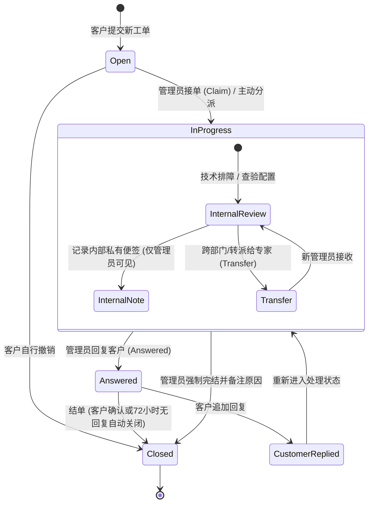

# JianYun (简云) · 客服工单与管理员内部协同规范 (Ticket Workflow)

## 1. 业务定位与隔离原则

- **上游完全解耦**：简云的工单系统为**全自建独立客服域**。终端客户在平台提交的技术、财务、退款等工单，**绝对不转派或同步给任何异构上游系统**（如魔方代理或自营虚拟主机平台）。所有技术支持与服务承诺由本站运维团队闭环承担。
- **核心诉求**：聚焦于**管理员之间的协同流转、跨部门转派、接单认领与内部私密便签**。

---

## 2. 工单流转状态机与处理流水线



---

## 3. 管理员内部协同核心机制

### 3.1 内部私有便签（Internal Notes / 隔离防泄漏）
- **痛点**：运维人员在分析用户机器为何蓝屏、排障网络路由、或是记录“该客户为重点高净值客户，建议酌情补偿”时，这些文字绝不能被终端客户看到。
- **机制**：
  - 在 `ticket_replies` 表中定义 `type = 'internal_note'`。
  - **管理端呈现**：高亮黄色背景 + 醒目的锁形图标 🔒，标明“【内部便签】由管理员 `admin_A` 记录，仅内部可见”。
  - **客户端呈现**：前端 API 在响应普通客户请求时，强制注入 SQL 条件：`WHERE type = 'reply'`，在 Controller 层与 ORM 作用域（Global Scope）形成双重防护，从物理上杜绝内部备忘向客户泄漏。

### 3.2 接单、指派与跨部门流转（Dispatch & Transfer）
- **公共工单池与主动接单（Claim）**：
  - 新工单创建时 `assigned_admin_id = NULL`，属于对应部门（如财务、技术支持、售前）的公共工单池。
  - 部门内任一管理员点击“开始处理 / 接单”，工单的 `assigned_admin_id` 原子更新为当前管理员，状态流转为 `in_progress`。
- **转派与升级（Transfer & Escalate）**：
  - 当一线客服排查判定需要底层网络运维或财务介入时，执行“转派”操作：
    - 选择目标部门（如 `technical` -> `financial`）或直接指定具体管理员 `assigned_admin_id = admin_B`。
    - **必填转派留言（Transfer Note）**：系统自动在回复轴生成一条 `type = 'transfer_log'` 记录，记录“管理员 A 于 `15:30` 转派给 管理员 B，备注：用户要求按天折算退款差价”。

---

## 4. 关键数据结构规范

### 4.1 工单主表扩展 (`tickets`)
```sql
ALTER TABLE `tickets`
ADD COLUMN `assigned_admin_id` BIGINT UNSIGNED NULL COMMENT '当前承办管理员ID',
ADD COLUMN `closed_at` TIMESTAMP NULL COMMENT '结单时间',
ADD INDEX `idx_assigned_status` (`assigned_admin_id`, `status`);
```

### 4.2 工单回复流表扩展 (`ticket_replies`)
```sql
ALTER TABLE `ticket_replies`
ADD COLUMN `type` ENUM('reply', 'internal_note', 'transfer_log') NOT NULL DEFAULT 'reply' COMMENT '消息类型',
ADD COLUMN `transfer_to_admin_id` BIGINT UNSIGNED NULL COMMENT '转派目标管理员ID (type=transfer_log时有效)';
```
