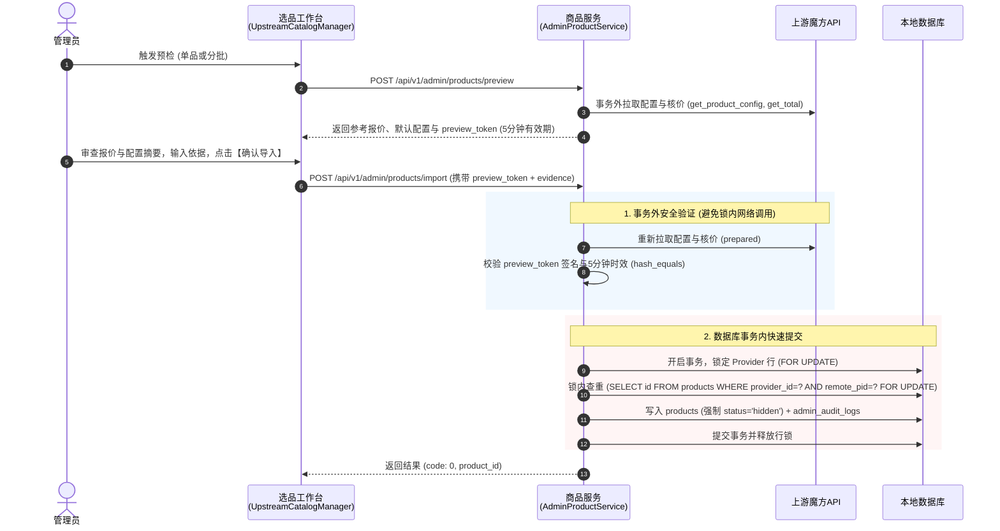

# 上游商品目录发现与批量导入工程规范（v2.1.0 深度订正与分期定案版）

> **规范定位**：针对上游商品手工查找盲填 PID 的痛点，提出在上游连接详情页（`/admin/providers/:id`）集成上游商品目录浏览与顺序导入的工程方案。本版本全面落实最新代码级复审意见，对齐 `ApiResponse`（`code: 0`）、`StockObservation`（`sold_out`）、事务外远端核价安全时序、权限与缓存边界、以及两阶段实施落地范围。

---

## 一、 现状基线与概念纠偏

### 1.1 目录候选不等于已经可售
* **上游候选定义**：
  查阅智简魔方控制器源码（`/www/wwwroot/sakuraidc.cc/app/home/controller/CartController.php:537`），上游接口 `/cart/all` 本身带有其自身的业务过滤（包括隐藏商品、停售商品及隐藏产品组），且上游**并未逐项验证简云是否支持其配置类型、多周期核价规则或交付方式**。
  > **规范契约**：接口返回的数据严格定义为**“该账号本次请求返回的可见商品候选”**；某个候选能否导入并成功销售，**完全由后续的单品配置解析与在线核价验证决定**。
* **采样数量与本地生命周期解耦**：
  实测的 266 个商品仅代表当前上游账号在当前时间点的**一次瞬态采样**。若上游后续删除或隐藏某款商品，**简云绝不能据此自动下架或删除本地已导入的商品**；本地商品的销售状态由本地数据库中的 `products.status` 及本地管理员显式操作独立管辖。

### 1.2 现行痛点与设计目标
* 现有导入入口（[`AdminProductImportView.vue`](../web/src/views/AdminProductImportView.vue)）虽支持 URL 预填 `provider_id`，但核心痛点是**缺乏上游可用商品的直观浏览、导入状态关联比对以及连续导入能力**；
* 目标是在上游连接详情页（[`AdminProviderView.vue`](../web/src/views/AdminProviderView.vue)）集成目录浏览，复用现有的商品预检与快照持久化服务，杜绝新造第二套导入框架。

---

## 二、 跨驱动抽象契约与安全投影

系统未来将扩展其他上游驱动（如 Easypanel、宝塔/Skymnbt、云厂商等）。为保持通用性，定义平台中立的只读目录发现契约。

```mermaid
flowchart TD
    subgraph 驱动层 (Driver Implementations)
        D1["ZjmfDriver (魔方)<br/>解析 /cart/all"]
        D2["其他驱动 (Easypanel/云厂商)<br/>解析原生套餐列表"]
    end

    subgraph 契约抽象层 (Plugin Contract)
        IF["CatalogDiscoveryDriverInterface<br/>+ discoverCatalog(credentials): array"]
        DTO["UpstreamCatalogItem 标准规范<br/>{ remotePid: int, name, category, type, stockState, ... }"]
    end

    subgraph 业务服务层 (Service & Security Layer)
        SVC["AdminProviderService::catalog()<br/>1. 检查超级管理员与 Provider 启用状态<br/>2. Laravel Cache 瞬态缓存 (凭据修订版本隔离)<br/>3. 每次实时叠加本地 products 状态<br/>4. 剥离敏感凭据，严禁透传 credentials_scope"]
    end

    subgraph 前端控制台 (UI Layer)
        UI["<UpstreamCatalogManager><br/>分类筛选 · 状态过滤 · 检索 · 预填导入 / 顺序批量导入"]
    end

    D1 -.-> IF
    D2 -.-> IF
    IF --> DTO
    DTO --> SVC
    SVC --> UI
```

### 2.1 驱动接口定义：`CatalogDiscoveryDriverInterface`
在 [`App\Plugins\Providers`](../app/Plugins/Providers) 命名空间下定义：
```php
namespace App\Plugins\Providers;

interface CatalogDiscoveryDriverInterface
{
    /**
     * 发现上游候选商品列表（只读调用，严禁写状态）
     *
     * @param array $credentials 已解密的连接配置与凭据
     * @return UpstreamCatalogItem[]
     * @throws \RuntimeException 上游网络或协议错误时抛出
     */
    public function discoverCatalog(array $credentials): array;
}
```

### 2.2 数据实体收窄：`UpstreamCatalogItem`
严格约束字段类型与安全投影范围，与系统既有模型强类型对齐：
```php
namespace App\Plugins\Providers;

final class UpstreamCatalogItem
{
    public function __construct(
        public int $remotePid,               // 严格正整数，与 DB INT 及驱动入参强类型对齐
        public string $name,                 // 商品原始名称
        public string $category,             // 上游分组/机房/可用区名称
        public string $type,                 // 归一化类型: cloud/dedicated/cdn/hosting/software/unsupported
        public string $stockState,           // 四态库存: 'in_stock' | 'sold_out' | 'unlimited' | 'unknown'
        public ?int $stockQty = null,        // 数量（仅当 stockState 为 in_stock 且开启库存时提供）
        public bool $hidden = false,         // 上游是否隐藏
        public ?string $description = null,  // 纯文本描述（必须 strip_tags 过滤 HTML，不超过 500 字符）
        public int $observedAt = 0           // 远端观察时间戳（UTC 秒数）
    ) {}
}
```

> [!IMPORTANT]
> **安全投影与状态对齐红线**：
> 1. **售罄状态必须沿用 `sold_out`**：严格与 [`StockObservation.php:12`](../app/Plugins/Providers/StockObservation.php#L12) 的四态枚举（`in_stock` / `sold_out` / `unlimited` / `unknown`）保持一致，严禁另造 `out_of_stock`；
> 2. **类型严谨**：`remotePid` 必须为大于 0 的整型，严禁定义为 `string` 导致与当前数据库 `remote_pid INT` 产生断层；
> 3. **未知类型不可盲目归为 `cloud`**：若上游返回非简云已知类型，一律标记为 `unsupported`，并在前端提示“需人工核验”，禁止静默按云服务器入库；
> 4. **库存四态模型**：严禁将目录缓存声称为“实时库存”，统一按“有货／售罄／不限／未知”展示，并标注观察时间；
> 5. **描述脱敏**：彻底删除任意 `extra` 字段透传，避免上游回显中携带内部 Token 或调试信息；
> 6. **凭据安全隔离**：`credentials_scope` 必须严格留在服务端内部，严禁投影给前端客户端（严格遵循 [`ProviderService.php:29`](../app/Services/ProviderService.php#L29) 规程）。

### 2.3 权限门禁、缓存边界与本地状态叠加
1. **权限门禁**：
   * 目录读取属于管理员敏感情报接口，首版严格限定为**当前启用的超级管理员**权限（复用 `authorize($admin)` 校验）；
   * **缓存命中也必须重核身份与连接状态**：即使底层 Redis/Laravel Cache 命中已有目录，服务端在返回前也必须校验当前请求的管理员会话有效性及 Provider 的 `status = 1`。若 Provider 已被禁用，立即拒绝返回；
2. **缓存键版本隔离与限频**：
   * 缓存键隔离：`catalog:p{provider_id}:{app_env}:{credential_fingerprint}`（凭据变更时指纹自动变化，旧缓存自动作废）；
   * 缓存有效期：默认 10 分钟（600 秒）；
   * 强制刷新频率限制：管理员点击【强制同步】时，服务端实行限频保护（如同一连接 30 秒内最多强制刷新一次），防止恶意刷击上游；
3. **本地状态实时叠加（不读缓存）**：
   在向客户端输出响应时，**每次都实时查询本地数据库**：
   ```sql
   SELECT id, remote_pid, name, status FROM products WHERE provider_id = ?;
   ```
   动态叠加以下字段：
   * `imported`: `true | false`
   * `local_product_id`: `int | null`
   * `local_status`: `'hidden' | 'active' | 'retired' | null`
   **杜绝因上游目录缓存导致“刚刚导入成功的商品在接下来的 10 分钟内仍显示为未导入”的严重体验缺陷。**

---

## 三、 导入执行引擎：对齐现有预览确认与重放契约

导入操作涉及价格计算与规格固化，绝不能为了批量操作开辟绕过核价确认的暗道。

### 3.1 严格遵循事务外远端核价安全时序
现有 [`AdminProductService.php:283-288`](../app/Services/AdminProductService.php#L283) 的正确安全时序为：
> **远端读取、核价与签名校验必须在数据库事务外完成；只有在签名通过后，才进入数据库事务执行行锁、查重与持久化。**



* **令牌有效窗口**：`preview_token` 生命周期为 **300 秒（5 分钟）**；
* **防篡改与变价失效**：若在确认期间上游价格或配置发生漂移，或超过 5 分钟，服务端校验签名或时间戳拒绝入库，提示管理员重新预检。

### 3.2 已存在跳过与原操作重放的严格区分
在 [`AdminProductService.php:288`](../app/Services/AdminProductService.php#L288) 的事务流程中：
* **核心事实**：`products` 表目前对 `(provider_id, remote_pid)` **没有数据库联合唯一约束**，并发安全完全依赖事务内行锁保证。
* **严格防护流程**：
  1. 事务外完成远端拉取与签名校验；
  2. 开启事务，锁定所属 Provider 行：
     `SELECT status FROM providers WHERE id=? FOR UPDATE;`（若 Provider 处于禁用状态则立即阻断）；
  3. 锁内查重：
     `SELECT id FROM products WHERE provider_id=? AND remote_pid=? LIMIT 1 FOR UPDATE;`
  4. 权限重核：
     `SELECT id FROM admins WHERE id=? AND status='active' AND role='super_admin' FOR UPDATE;`
* **三种终态判定矩阵**：
  | 锁内检查结果 | 判定类别 | 业务行为与审计 | 前端响应 |
  | :--- | :--- | :--- | :--- |
  | 查到本地记录，且 `admin_audit_logs` 命中相同 `operation_key` | **原操作重放 (Replay)** | 遭遇网络丢响应后的安全找回；不重复写库，不重复写审计 | 标记为 `replayed`，返回原 `product_id` |
  | 查到本地记录，但未命中当前 `operation_key` | **已存在跳过 (Already Exists)** | 属于此前已导入或并发冲突；**绝对不记录为本次成功，不修改原有加价与账期**，不覆盖旧数据 | 标记为 `already_exists`，提示“已存在，未应用本批改动” |
  | 查无本地记录 | **首次全新导入 (Fresh Import)** | 调用 `ProductSnapshotService::persist` 落库（**强制 `status='hidden'`**），同事务写入 `admin_audit_logs` | 标记为 `success`，返回新 `product_id` |

### 3.3 第二阶段批量流程的关键约束（规划澄清）
1. **自动预检不能自动代替人工确认**：
   * 严禁静默自动换取新 Token 并直接提交；
   * 必须严格实行：**分批预检 $\rightarrow$ 管理员确认价格/配置摘要 $\rightarrow$ 顺序提交已确认项**；
   * 若某商品在确认时已超过 5 分钟有效窗口或上游价格发生漂移，该商品**必须重新等待管理员确认**，严禁未经确认自动落库。
2. **丢响应与超时允许进入“待核对”**：
   * 若请求遭遇网络超时、断网或网关 504，前端**立即停止派发后续未发送的请求**；
   * 将当前在途的商品状态标记为**“待核对（In-flight Timeout）”**，保留原请求上下文；
   * 因现有导入接口在第 275 行优先检查令牌有效期（`(int)$m[1] < time()`），**超过 5 分钟的超时请求不能承诺直接重放找回**；此时引导管理员点击【刷新核对】，通过本地 `products` 和 `admin_audit_logs` 确认是否入库即可。
3. **故障熔断分流**：
   * “单项失败继续”**仅适用于商品自身的规则错误**（如某款 VPS 上游未配置月付价格、某款配置选项不被支持）；
   * 若遇到**鉴权失效（401）、超管权限被撤销（403）或上游连接被禁用（409 Provider disabled）**，必须**立即熔断并暂停整个批次**，不再继续派发后续商品。

---

## 四、 页面架构改造与防膨胀约束（落位在上游连接详情）

功能收敛挂载于上游连接详情页（[`AdminProviderView.vue`](../web/src/views/AdminProviderView.vue)）。

### 4.1 双分面布局与批次生命周期保护
严格遵守 [`PAGE_BLOAT_GOVERNANCE_AND_ARCHITECTURE_SPEC.md`](../docs/PAGE_BLOAT_GOVERNANCE_AND_ARCHITECTURE_SPEC.md)（v2.1.0）：

```text
┌────────────────────────────────────────────────────────────────────────┐
│  ← 返回上游接入                                                         │
│  上游连接 #1 · SakuraIDC M2验收                  [ 刷新详情 ] [ 状态: 启用 ] │
├────────────────────────────────────────────────────────────────────────┤
│  [ Tab 1: 连接概况与维护 ]       [ Tab 2: 上游商品与选品导入 (候选 266) ]   │
├────────────────────────────────────────────────────────────────────────┤
│                                                                        │
│  (Tab 2: 挂载选品工作台组件 <UpstreamCatalogManager>)                     │
│                                                                        │
│  ┌───────────────────────┬──────────────────────────────────────────┐  │
│  │ 分类导航与快捷过滤     │ 候选商品表格                             │  │
│  │ --------------------- │ ---------------------------------------- │  │
│  │ [全部商品 (266)]      │ [ ] PID | 商品名称 | 类型 | 观察库存 | 状态  │  │
│  │ [洛杉矶精品区 (14)]   │ ---------------------------------------- │  │
│  │ [宁波电信高防 (6)]    │ [ ] #14 洛杉矶轻量弹性云  cloud  有货  已导入(#2)│  │
│  │ [美国CDN (4)]         │ [ ] #16 洛杉矶高配支持win cloud  有货  [导入]   │  │
│  │ --------------------- │ [ ] #18 洛杉矶超频裸机    cloud  售罄  [导入]   │  │
│  │ [x] 仅看未导入        │                                          │  │
│  │ [x] 仅看有库存        │                                          │  │
│  │ [ 搜索名称/PID... ]   │                                          │  │
│  └───────────────────────┴──────────────────────────────────────────┘  │
│                                                                        │
│  (第一阶段：点击 [导入] 唤起预填好 PID 的抽屉，走现有预览确认流程)         │
│  (第二阶段增量：多选 Checkbox 与精简吸底栏)                               │
└────────────────────────────────────────────────────────────────────────┘
```

### 4.2 批次生命周期与分页保护
* **父级操作隔离**：
  在 `AdminProviderView.vue` 中，管理员进行**操作审计分页**（改变 URL `audit_page`）或点击顶部**【刷新详情】**（`load()` 重新拉取连接）时，**绝不能清空或重置目录浏览状态与正在执行的批次，更不能重复启动调度**；
* **浏览器刷新（F5）边界**：
  明确告知管理员，F5 刷新会清除前端内存待办，但**已入库的商品已经落地在数据库并有完整审计**；F5 刷新后，重新拉取目录会自动把已入库商品标记为“已导入”，未导入的商品保持未勾选，管理员可随时继续勾选剩余商品继续导入。不作虚妄的“跨 F5 自动无缝断点恢复”承诺。

### 4.3 窄屏与移动端适配（Mobile Portrait）
* **宽度防溢出**：390px/320px 视口下单列显示，分类导航折叠为 Element Plus 下拉选择器；
* **吸底栏极简原则**：在窄屏下，**吸底栏仅保留“已选 N 项”与主按钮【批量导入】**；加价配置、账期选择和变更依据保留在页面滚动区域或呼出式抽屉中，严禁在底部塞满多行输入框重新阻塞手机视口。

---

## 五、 接口契约规范

接口统一遵循既有 `/api/v1` 路由前缀与 `{code: 0, msg: "ok", data: ...}` 统一响应格式（严禁将成功状态码写为 200，见 [`ApiResponse.php:13`](../app/Support/ApiResponse.php#L13)）。

### 5.1 获取上游候选目录（叠加本地状态）
* **请求**：`GET /api/v1/admin/provider-connections/{id}/catalog?refresh=0`
* **权限要求**：当前启用的超级管理员（`super_admin`）
* **响应格式**：
```json
{
  "code": 0,
  "msg": "ok",
  "data": {
    "provider_id": 1,
    "provider_name": "SakuraIDC M2验收",
    "cached_at": "2026-11-10 15:30:00",
    "categories": [
      { "id": "cat_3", "name": "洛杉矶（精品区）", "item_count": 14 },
      { "id": "cat_6", "name": "宁波电信高防", "item_count": 6 }
    ],
    "items": [
      {
        "remote_pid": 14,
        "name": "洛杉矶轻量弹性云",
        "category": "洛杉矶（精品区）",
        "type": "cloud",
        "stock_state": "in_stock",
        "stock_qty": 13,
        "hidden": false,
        "description": "适用场景：网站、小程序及海外应用。处理器：1–4核...",
        "observed_at": 1794238200,
        "imported": true,
        "local_product_id": 2,
        "local_status": "hidden"
      },
      {
        "remote_pid": 16,
        "name": "洛杉矶高配支持win",
        "category": "洛杉矶（精品区）",
        "type": "cloud",
        "stock_state": "in_stock",
        "stock_qty": 89,
        "hidden": false,
        "description": "适用场景：Windows环境应用。处理器：2–16核...",
        "observed_at": 1794238200,
        "imported": false,
        "local_product_id": null,
        "local_status": null
      },
      {
        "remote_pid": 18,
        "name": "洛杉矶超频裸机",
        "category": "洛杉矶（精品区）",
        "type": "cloud",
        "stock_state": "sold_out",
        "stock_qty": 0,
        "hidden": false,
        "description": "高主频裸机实例...",
        "observed_at": 1794238200,
        "imported": false,
        "local_product_id": null,
        "local_status": null
      }
    ]
  }
}
```

### 5.2 导入接口复用约定（首批不增设新端点）
首批实施中，**直接复用现有经过充分验证的商品导入接口与组件**，严禁新建第二套导入管道：
* 预览预检接口：`POST /api/v1/admin/products/preview`
* 确认导入接口：`POST /api/v1/admin/products/import`
* 表单组件：直接复用 [`AdminSnapshotForm.vue`](../web/src/components/AdminSnapshotForm.vue)，通过抽屉模式呼出，自动预填 `provider_id` 与 `remote_pid`。

---

## 六、 实施顺序与交付路线

明确将任务切分为两阶段，首阶段集中力量交付高内聚的“目录发现与单品预填导入”。

### 第一阶段（当前批次实施范围）：目录浏览与单品预填导入
1. **驱动与契约定义**：
   * 定义 `CatalogDiscoveryDriverInterface` 与 `UpstreamCatalogItem`（使用 `sold_out` 状态，`remotePid` 限定正整数）；
   * 在 `ZjmfDriver` 中实现 `discoverCatalog`（对接 `/cart/all` 并利用 Laravel Cache 进行凭据隔离缓存）；
2. **后端目录聚合服务**：
   * 在 `AdminProviderController` 中开放 `GET /api/v1/admin/provider-connections/{id}/catalog`；
   * 严格核验超管身份与连接状态，并对强制刷新施加限频；
   * 每次请求实时叠加本地 `products` 的 `imported` 状态与本地 ID；
3. **前端目录与单品预填交付**：
   * 改造 `AdminProviderView.vue`，引入分面 Tab 架构；
   * 开发 `UpstreamCatalogManager.vue` 呈现分类、检索、四态库存与已导入状态；
   * 点击单品【导入】按钮，唤起预填好当前 `provider_id` 与 `remote_pid` 的 `AdminSnapshotForm` 抽屉；
4. **验收标准**：
   * 在 SakuraIDC 连接详情页完整展示 266 个候选商品与分类；
   * 单品预填后顺利走通现有预览、核价、签名校验与入库，生成 `status = 'hidden'` 的商品与完整审计。

### 第二阶段（后续增量推进）：多选批量确认与顺序调度
1. **多选交互与批量参数配置**：
   * 目录表格增加 Checkbox 多选框，自动禁用已导入项；
   * 增加批量参数面板，统一设定加价策略、账期与变更依据；
2. **分批预检与确认摘要看板**：
   * 执行分批预检，呈现确认摘要看板（涵盖所选商品明细与报价）；
   * 管理员确认后，前端启动顺序调度器逐件提交已确认项；
3. **熔断与待核对处理**：
   * 超时/504 丢响应进入“待核对”并停发后续；
   * 鉴权失效或连接禁用立即熔断整批。

## 第一阶段仓库实施边界（2026-11-10）

外部v2.1草案定稿与本次仓库接入分别记录。第一阶段只实现目录浏览、筛选、本地状态叠加和原表单预填；不实现多选、批次、自动预检或顺序调度。266是历史采样，不是固定商品数量。候选并不保证配置受支持或可售。

目录缓存归通用聚合服务，用Laravel Cache保存DTO白名单数组；魔方插件只解析协议。按应用／数据库／环境／Provider／凭据修订隔离，600秒；强制刷新同连接30秒限频，使用框架锁合并并发读取；缓存故障明确失败，不用过期目录冒充成功。每次返回前重核当前管理员会话／超管角色、Provider状态和连接修订，实时查询本地导入状态。

首批沿用原导入接口响应：同preview_token重放返回原product_id，其他已存在绑定返回409，不伪装本次导入成功。目录与审计可只读核对丢响应；过期令牌不承诺直接重放。抽屉复用AdminSnapshotForm，提交中锁关闭，结果未知保留原确认及载荷，禁止静默重取令牌再提交；成功后留在目录并重读本地状态。

未知商品类型为unsupported，不提供预填导入；其他类型映射只在插件内，库存展示沿用四态，sold_out数量为0。目录没有价格与完整配置，后续预览／导入仍实时核价、签名、Provider锁查重与商品审计同事务，默认hidden。没有schema迁移或M2服务重启。真实连接只读目录核验与隔离导入证据分开；不得为验收上架553、导入389或购买资源。

## 第一阶段验证记录（2026-11-10）

第一阶段实现与隔离验收完成，第二阶段多选与批量调度未实现。原草案中的266项为采样值；实际页面按本次目录返回渲染，不以固定数量判定成功。

| 验证层次 | 结果与边界 |
| --- | --- |
| 真实连接只读 | SakuraIDC连接1返回266候选、53分类，含14／391／553／563；云194、CDN20、虚拟主机4、独服47、软件1。库存有货154、售罄32、不限80。单次耗时5354.4ms，不代表分位性能；前后MySQL业务事实指纹一致。没有真实预览导入、上架、购买或资源变更。 |
| 后端隔离专项 | `tests/upstream_catalog.php` 47项：鉴权与no-store、脱敏投影、缓存命中／过期／损坏／故障、凭据修订隔离、强制同步限频与在途锁、慢请求后禁用重核、原预览导入及重放／重复绑定、实时本地状态叠加；未知驱动能力明确拒绝。 |
| 全量隔离 | `scripts/test_integration.py` 38套2412项业务检查及24项独立FPM检查通过，目录专项纳入常规入口；原支付、续费、Outbox、库存与实例展示专项保持。 |
| 页面流程 | Chromium共63项：44项完整流程、16项分页／空态／错误态、3项审计分页乱序保护。正常导入和服务端已提交但客户端丢响应均只用隔离库；后者先只读核对，显式原载荷重放，仅一份商品与审计。支持角色不能查看目录。 |
| 手机与平板 | 320／390／768／820px及桌面1440px；抽屉稳定宽度分别320／390／640／640px，内容无横向溢出。含正常、空态、错误、提交锁关闭、未知结果关闭／重开及390×440缩短视口模拟键盘。未进行实体手机键盘或其他浏览器验收。 |

浏览器分页使用仅响应层扩展的32项合成目录，不将其计入真实上游样本。真实服务端目录仍为7项测试夹具，隔离导入的远端14／901不涉及M2商品。审计分页与连接刷新保留目录分区、筛选和原导入上下文，迟到详情响应不能覆盖较新的请求。

本地截图与过程记录位于被Git排除的 `output/playwright/upstream-catalog/`：`catalog-320.png`／`catalog-390.png`／`catalog-768.png`／`catalog-820.png`／`catalog-1440.png`、`drawer-*.png`、`keyboard-height-390.png`及三组验收结果文本。截图不作为部署文件发布。

Pint、前端类型／Lint／构建、Python语法、27表字典及差异检查通过；构建保留现有包体积提示。没有新增表／迁移、调度或Worker，M2金融／邮件进程保持原暂停状态。真实单品导入和日常运营手测仍单独待验，不能用隔离流程替代；553／389／563既有运营边界不变。


## 第二阶段实施契约（2026-11-11）

第一阶段以`c1afa29`收口，真实上游证据仍仅为目录只读。本阶段在同一目录增加跨筛选／分页多选、批次抽屉及页内顺序调度器；不增加批次表、服务端任务引擎、Worker或导入端点。每批最多20项，每次显式预检至多5项，单在途，单次读取／提交90秒客户端等待上限（超时不能证明服务端未提交）；各商品使用上游默认配置，统一加价、可售账期和人工依据在建立批次时固定。

### 状态与人工确认

`pending → previewing → ready → submitting → success`是正常路径。预检沿原`/products/preview`，配置默认值、首期／续费参考价与期限逐项展示；预检不提交，管理员点击“确认本组摘要并顺序导入”后才逐件调用原`/products/import`。价格／规则变化或过期进入`confirm`，只有显式重新预检、再次人工确认才能提交；不会自动换取新令牌。未预检项目不参与本组确认。

纯商品规则失败进入`rejected`，其他项目可继续；权威重复绑定进入`existing`，不算本批成功且不改原商品。401／403、连接禁用和无法细分的供应商读取异常暂停整批；不能把笼统409当作单品规则错误继续。任何丢响应、非业务网关响应、不完整成功结果或5xx提交结果进入`unknown`，停止后续派发，保留原载荷与令牌，并阻止另起批次或单品导入。

停止按钮只停止后续派发，不能取消已经发送的请求；在途响应仍回填。关闭按钮在请求期间锁定，可点击停止后等待在途结果再关闭。切分区、审计翻页、目录／详情刷新不销毁批次或重启调度。连接禁用后不再派发；离开当前连接卸载时停止后续派发。F5遵守原冻结边界：内存待办与原载荷丢失、不自动续跑，已落库商品和审计仍可重读；不将确认令牌存浏览器持久存储。

### 原接口兼容增量

HTTP状态及原错误文本总体保留，`code`增加机器可识别的分类；前端`ApiError`保留原status／businessResponse并新增code，旧调用兼容。导入交易时序、Provider锁查重、默认hidden和同事务审计不变。`ProductSnapshotService`仅把纯Schema投影失败或明确售罄归为商品规则失败，网络／认证或无法识别报价失败仍保守暂停；不猜测供应商报错文本。

| code | HTTP | 调度行为 |
| --- | --- | --- |
| 40910 | 409 | Provider禁用／不可用，整批暂停 |
| 40911 | 409 | 原确认过期，等待重新预检与人工确认 |
| 40912 | 409 | 配置或价格漂移，等待重新预检与人工确认 |
| 40913 | 409 | 已有其他导入绑定，标记已存在、不计本批成功 |
| 40914 | 409 | 纯配置投影不支持或明确售罄，单项失败可继续 |

原导入成功响应添加`outcome=created|replayed`，保留product_id等原字段；快照刷新成功响应不变。客户端仅把完整可信结果标记成功。有效期内可以显式原载荷重试未知操作；重试遭遇过期等拒绝不能反推原请求未提交，未知状态保持。

过期后使用只读证据找回：原`GET /admin/products/{id}?import_operation=<SHA256(preview_token)>`可选参数，仅当前超管查询本人原操作，返回额外`import_operation={matched:boolean}`。按不可改审计独立查询，不限第一页，也不受预览期限约束；不回显令牌／hash、不调用上游、不授权新导入。先通过原商品列表的provider_id／remote_pid精确筛选找到唯一本地绑定，再核对Provider／PID及原审计匹配；目录缺失或连接禁用不阻断本人超管只读找回，旧令牌写重试仍受启用门禁。仅“已有绑定”不能当作原操作成功。匹配成功标记找回，剩余项目仍需显式确认，不自动续跑。未找到或不匹配继续待核对。

本阶段与第一阶段契约的变更原因是增加安全顺序调度所需的错误分类与原操作只读恢复；涉及原商品服务、控制器、前端请求错误类型、目录与批次组件。无数据库／迁移、插件协议、金额／履约或历史账单变更。M2金融／邮件进程不恢复；没有真实导入、上架或购买授权，553下架／389不导入不购买／563零库存保持。


## 第二阶段验证记录（2026-11-11）

第二阶段实现与隔离验收完成；真实上游仍只有第一阶段目录只读证据，本阶段没有对真实连接执行预览、导入、上架或购买。M2金融／邮件进程保持暂停，553／389／563运营边界不变。

| 验证层次 | 结果与证据范围 |
| --- | --- |
| 调度器专项 | `npm --prefix web run test:catalog-batch`，81项。直接执行实际TypeScript调度器，以独立传输桩验证分组上限、人工确认、逐件顺序、防重入、商品失败继续、401／403／禁用暂停、变价／过期不换令牌、未知停发、原载荷重试、过期只读、停止／卸载与慢门禁跨越有效期。不是对真实上游的交付测试。 |
| 后端专项与全回归 | `scripts/test_integration.py`，38套2431项业务检查及24项私有FPM检查；其中目录／单品专项66项，覆盖本批新增code／outcome、当前超管本人审计hash核对、跨审计页查找、禁用连接时本地Provider／PID查找及只读恢复、原默认下架和查重。 |
| 实际隔离页面链路 | 29项：7项服务端夹具目录中选择563／14／901／902；563明确售罄失败，另外3项实际导入隔离库并默认下架。停止在途14后未派后续；901丢响应后原参数重放，902模拟客户端令牌过期后按持久审计找回。3个商品各一个绑定、一条导入审计；4次实际导入请求含一次安全重放，不新增实例。 |
| 分页／异常／移动端 | 30项：响应层另外扩展32项合成候选，仅用于跨页选择、筛选刷新、变价重确认、重复绑定不计成功及超时停发；不将合成成功或价格计入真实数据证据。90秒客户端等待上限在浏览器中加速到200ms测试，迟到模拟响应不替换未知终态。 |
| 权限与整批暂停 | 12项：模拟连接在两项间禁用、角色失效、提交40910、提交401后的真实前端撤销登录与停发；再以隔离真实support账号验证目录／批次入口隐藏及目录、原preview、原审计恢复接口403。 |
| 本地只读恢复 | 6项：隔离903真实导入后丢响应；目录读取503、页面连接状态为禁用时，原写重试禁用、本地只读恢复仍可用。仅访问本地精确绑定与原审计，不追加导入或目录请求；最终仍一份下架商品和一条审计。目录503及页面禁用是响应层故障，数据库禁用门禁另由后端专项验证。 |

浏览器总计77项；本批共实际创建4个隔离商品，均不涉及M2业务库。320／390／768／820px覆盖草稿、摘要、失败与待核对；390×440缩短视口仅模拟软键盘可用空间，不替代实体手机键盘验收。桌面1440px覆盖主流程，控制台仅出现预期的业务拒绝、模拟断网和favicon404，无Vue运行时异常。

本机截图与过程记录位于Git排除目录`output/playwright/catalog-batch/`，包括`draft-*.png`、`summary-*.png`、`unknown-*.png`、`keyboard-390.png`、`local-recovery-390.png`以及`results.txt`／`states-results.txt`／`gates-confirmed.txt`／`local-recovery-results.txt`。手机路径为“卡片多选 → 紧凑选品栏 → 批次抽屉 → 分组预检 → 展开配置并确认摘要”；异常处理在同一抽屉内完成，切分区或目录／详情刷新不重建批次。F5只重建已入库事实，不自动恢复内存批次。

Pint／Composer lint、前端类型／Lint／构建、27表字典、文档链接与差异检查通过；构建保留既有大包提示。无新表、迁移、通用队列或Worker。真实M2日常导入仍单独待验，不能把上述隔离商品当作上游真实导入。
